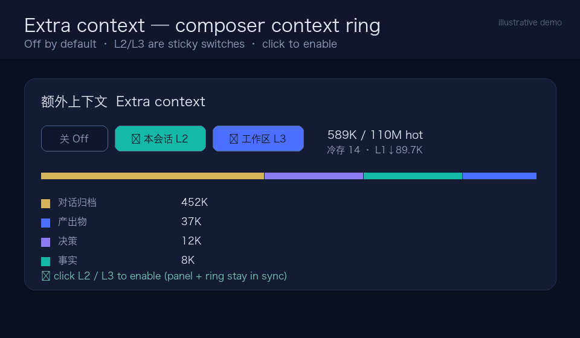

# Memex — the extra-context layer for AI agents

[](https://github.com/QiuXu-Tech/memex/actions/workflows/ci.yml)
[](LICENSE)

**A high-performance extra-context layer between an agent's history and its model window.** Memex treats context as a hierarchy — not a notes app: when the native context window fills up, older spans are moved out verbatim into sticky L2/L3 archives, capacity is managed through a lossless cold tier plus bounded batch digests, and the model can retrieve anything later with cheap hybrid search.

**Context, not just memory.** Raw session history is evicted verbatim from L1 into sticky L2/L3 context pools, paged back in with budget-aware retrieval, and compacted to a lossless cold tier — so the model reasons over the right context instead of losing it or re-reading everything. Read the concept: [Extra context, not just memory](docs/context-layer.md). Next direction: [Context materialization](docs/context-materialization.md) — exact window materialization and transformer context-specialist variants. Implemented: canonical events, materialized resident window (default in DSH), trained transformer encoder reference, runnable paged-KV/prefix host, structural fidelity eval. **A-route validated on GPU:** vLLM 0.10.2 + Qwen2.5-0.5B reused a 2,498-token stable prefix via native paged-KV prefix cache (99.2% second-request prefix hit). A separate KV-tensor probe paged 720 blocks CPU↔GPU and reconstructed the cache **exactly** (paged-vs-direct logit diff 0.0). A **custom vLLM KV connector** now stores materialized prefixes externally; 8/8 second requests hit at 0.5B, **Qwen2.5-3B**, and **real Qwen2.5-7B-AWQ** (36 layers, 420MB KV, 91% GPU utilization; steady store 0.147s → hit 0.094s). End-to-end: a real materializer window was stored through the connector and hit on the second request (1,488 KV tokens, 0.018s hit).

It started as a DeepSeek Harness plugin and is now **agent-agnostic**:

| Agent | Integration |
|---|---|
| **DeepSeek Harness** | native Cordis bundle (L1 eviction seam, Web panel, 9 HTTP routes, 7 tools) |
| **Claude Code** | MCP server + `SessionStart` / `UserPromptSubmit` / `PreCompact` hooks + `CLAUDE.md` manual |
| **OpenAI Codex** | MCP server + `AGENTS.md` manual + `config.toml` snippet |
| **Gemini CLI, Cursor, Cline, Windsurf, Zed, …** | one stdio MCP server (`packages/memex-mcp`), 7 tools + catalog resource |
| **Any HTTP agent** | the same core can be embedded (`@qiuxu/memex-core`) |

> Status: **0.58.0 (Memex)** — agent-agnostic core, MCP server, hot-body rescue, Claude Code/Codex adapters, **21 model profiles** (13 family bases + dedicated **GPT-6.1 Sol/Terra/GPT-6 Astra, Claude Opus 5.5/Sonnet 5.5/Fable 5.1/Haiku 5.5, DeepSeek Flash** variants), **144/144 offline tests**, **36/36 SQLite consistency tests**, and a vLLM paged-KV prefix-cache validation on a Blackwell GPU. DSH `0.2.1-rc.3` for DSH mode; any MCP-capable agent otherwise. No telemetry, everything stays on your machine.

## 7B KV strategy comparison (latest)

Same real **Qwen2.5-7B-AWQ** model, 8 prefixes ×2 requests (1,856-token prefix), RTX PRO 6000 96GB:

| strategy | first request | second request | notes |
|---|---:|---:|---|
| no cache | 0.0907s | 0.0924s | recompute prefix |
| native vLLM prefix cache | 0.0922s | **0.0187s** | fastest hot path |
| Memex external KV | 0.1468s | 0.0583s | 8/8 external hits, 654MiB disk, ~91% GPU |

Takeaways:

- Native GPU prefix cache is **~3× faster** than external disk KV on the second request.
- External KV still beats recompute (~37% faster) and adds persistence, tenant isolation and cross-restart reuse.
- The first external-store request pays significant overhead; gzip makes hit latency worse.
- Next: **hybrid routing** (native hot cache + external cold cache), async/pinned KV loading, prefix-length crossover tuning, and lower GPU KV reservation to free memory.

Raw data: `docs/assets/benchmarks/kv-strategy-comparison.json`.

## Latest: production benchmark + DSH runtime integration

- Real 7B-AWQ + external connector: throughput saturates ~**19 rps**; p50 75.6ms @1 concurrency, 1637ms @32 (single process).
- DSH profile now has a **`local-memex`** provider backed by the connector vLLM through an SSH tunnel; profile default model set to `qwen-7b-awq` (restart required).
- Real-trace encoder: pretrained **BGE-small** lifts real-archive ranking from 0.518 to **0.593** (still small-corpus limited).

## Six KV optimizations (v0.31.0)

- Hybrid native-first routing: hot prefixes stay on native prefix cache; external KV only for cold/uncached prefixes.
- Prefix threshold (`min_prefix_tokens`), parallel batch layer loads, cold-only gzip.
- Low GPU reservation test: 50,103/97,887 MiB with external cold KV still working.
- Crossover evidence: 512/1024/1856-token prefixes ~0.013–0.020s native; cold 2,800-token external 0.363s then native 0.024s.

## Prefix-length crossover (v0.32.0)

Real 7B-AWQ, unique prefixes, 50% GPU reservation: native prefix cache is fastest at every length (**0.0175–0.0249s** for the second request). External KV beats recompute at 2,833 tokens (0.102s vs 0.139s) but pays a first-store cost; hybrid short prefixes hit native ~0.017–0.022s.

## Learned real-trace cross-encoder (v0.34.0)

Fine-tuned BGE-small cross-encoder on the real archive split: **0.963 sample accuracy / pairwise ranking** (vs 0.593 bi-encoder), but on a small, record-shared, templated-query split. Key next step: record-disjoint real-query evaluation and query-aware materializer integration.

## Learned materializer prototype (v0.35.0)

Query-aware BGE cross-encoder selector vs current rule materializer on real archive split (27 val groups, 500-token budget):

- rule materializer positive recall **0.519** (327 tokens avg)
- learned selector **0.963** (388 tokens avg), **8.64ms/query** on GPU

Caveat: templated queries and record-shared split; not production generalization, not yet integrated into JS/DSH.

## Real-query generalization: negative result (v0.36.0)

Real DSH session queries, record-disjoint validation (4 val groups): rule materializer **0.50** recall; learned cross-encoder **0.25**; zero-shot BGE **0.25**. The earlier templated 0.963 was optimistic; learned materializer is not production-ready.

## Hybrid rule + learned materializer (v0.37.0)

On real session-query validation, rule recall 0.222 → learned top-1 0.500 → **rule ∪ learned 0.667**. On the small manual real-query set: 0.500 → 0.750. Learned alone is unstable; the hybrid keeps rules as a safety net and adds the learned candidate.

## JS hybrid materializer hook (v0.38.0)

Optional `query` + `learnedRerank` adds a learned candidate to the materialized window. Real session-query val: rule 0.222 → hybrid 0.333 at 500 tokens; 0.722 → 0.833 at 1,000; 0.778 → 0.889 at 1,500–2,400. Default rule path unchanged.

## Long-horizon memex A/B (v0.44.0)

Synthetic 60-decision archive, 10 evicted-fact probes, two real API models: baseline recent-tail **0/10**, memex materialized archive **10/10**, same-size decoy archive **0/10**. The gain is content-specific, not just extra tokens. Cost: +2.3k/+3.6k prompt tokens.

## Why

Long conversations and long-running projects hit the same wall: the native context window is finite. The usual answers are lossy — truncate, or summarize and lose the details that turn out to matter later. memex treats conversation history like a cache hierarchy instead:

| Level | What it is | Capacity | Semantics |
|---|---|---|---|
| **L1** | The model's native context window | model window | untouched; eviction removes the oldest balanced span |
| **L2** | Session-private archive | 10M tokens / session | only this conversation can read it |
| **L3** | Workspace-shared archive | 100M tokens / cwd | every session in the working directory can read it |

- **L2 and L3 are independent, sticky switches** — once enabled a level cannot be turned off (recorded context never silently disappears).
- **Lossless by default**: raw conversation/tool output is stored verbatim (markdown files + SQLite index) — no LLM summarization on the critical path.
- **Capacity compression on demand**: when a pool is near full the model asks the user first; compression then applies a **cold tier** (lossless, zero-LLM) and optionally **bounded map-reduce digests** (batched, resumable, never one giant prompt).
- **Cheap recall**: hybrid keyword retrieval (FTS + card fields + bounded cold abstracts + lexical rerank), ~1–5 ms on realistic archives, tens of tokens per hit.
- **Model-specific adaptation**: profiles tuned per model family — context window, chars/token ratio, injection format (XML/Markdown/plain), catalog/recall budgets, digest prompt style, bilingual CJK guidance **and retrieval rerank weights** (title/tags/summary/useWhen/abstract/body/recency/bm25) passed into hybrid search. 13 family bases plus **dedicated GPT-6.1 Sol / Claude Opus 5.5 / Claude Sonnet 5.5 / DeepSeek Flash** profiles with vendor-current context limits and reasoning-mode guidance. See [docs/model-profiles.md](docs/model-profiles.md) and the [cold-start + long-horizon profile validation](docs/profile-validation.md).
- **Hot-body rescue**: identifier-like body tokens are indexed (`record_terms`) so facts that never made it into a title/summary are still found when card matches fill the limit; a `body` rerank weight ranks them. On the controlled fixture this took hot-body hit@1/@5 from **0%/0% to 100%/100%**.

## Features

- **Agent-agnostic core** (`@qiuxu/memex-core`): markdown + SQLite store, hot/cold tiers, hybrid retrieval and capacity compression with zero host dependencies. DSH, MCP and CLI adapters share one record vocabulary.
- **MCP server** (`@qiuxu/memex-mcp`): stdio JSON-RPC, **10 tools** (`memory_search/open/grep/write/index/list/forget/set_status/restore/compress`) + `memory://catalog` resource, model-tailored `instructions`.
- **Claude Code adapter** (`@qiuxu/memex-claude`): one command writes `.mcp.json`, merges `.claude/settings.json` hooks and injects a model-tailored `CLAUDE.md` manual; `PreCompact` archives the raw transcript verbatim before summary loss, `UserPromptSubmit` auto-recalls relevant records.
- **Codex adapter** (`@qiuxu/memex-codex`): `AGENTS.md` manual + `codex mcp add` / `config.toml` entry.
- **Model profiles**: per-family windows, token-estimation ratios, injection budgets and digest prompts; overridable by the integration.
- **L1 eviction** through the shipped `compaction/prune` + surface-replace seam; no custom session events, no replacement of the compaction backend.
- **Sticky L2/L3 levels** with a session-private/shared split, capture policy (deepest enabled level wins) and per-level capacities.
- **Hybrid retrieval** shared by `memory_search` and auto-recall: latin identifiers, quoted spans, CJK n-grams, stopword filtering, FTS + LIKE legs, bounded cold abstracts, lexical rerank with recency.
- **Cold tier + compression**: `memory_compress` with `cold` (lossless, zero LLM) and `digest` (bounded batched summaries, 2-way concurrency, retry/fallback, `ids:` enforcement, cold quota GC).
- **Capacity consent protocol**: `[EXTRA CONTEXT CAPACITY]` notice at 80% hot usage tells the model to ask the user before compressing.
- **Sensitive-content policy**: secret-looking spans (keys/tokens/passwords) are forced into private L2, or eviction is skipped when only L3 is available.
- **Observability**: `compression_runs` history, `GET /api/memory.metrics`, `/memory status`, `memory_index`.
- **Operations**: restore/回热, cold GC, backup/verify/restore (SQLite `VACUUM INTO` + sha256 manifest).
- **UI**: composer context-ring inner arc (teal = L2 capture, blue = L3), a popover mode row, a full memory panel with compression/restore buttons and capacity warnings.

## Demo



*A condensed illustration of the context-ring popover, the capacity notice, a lossless compression run, and the memory panel (rendered animation, not a screen recording).*

## Architecture (short version)

```
Any agent (DSH · Claude Code · Codex · Cursor · …)
 ├─ adapters: DSH bundle / MCP server / Claude hooks / Codex CLI
 │      • one shared agent-agnostic core, one record vocabulary
 │      • model profile → budgets, injection format, manual, digest prompt
 │
DSH agent session
 ├─ L1 (native window) ── evict oldest balanced span ──► extra context
 │      • compaction/prune shadow price + user/message surfaceOp replace
 │      • receipt message keeps the model oriented
 ├─ L2 session archive (10M)  ─┐
 ├─ L3 workspace archive (100M)┘   sticky, verbatim, scoped
 │
 ├─ retrieval: memory_search / memory_grep / memory_open (hybrid FTS + cold abstracts)
 ├─ capacity: hot/cold accounting, memory_compress (cold/digest), quota GC
 └─ Web: context ring + memory panel via /api/memory.* (9 owner-scoped routes)
```

Full design: [docs/architecture.md](docs/architecture.md). Measured results: [docs/evaluation.md](docs/evaluation.md). Hosted docs: <https://qiuxu-tech.github.io/memex/>. Security policy: [SECURITY.md](SECURITY.md). Upstreaming plan: [docs/upstream.md](docs/upstream.md).

## Repository layout

| Path | Purpose |
|---|---|
| `packages/memex` | installable DSH bundle (patch + exports; `modules/` is generated and git-ignored) |
| `packages/memex-core` | **agent-agnostic core**: vocabulary, query terms, store/retrieval/compression, model profiles, manual + engine facade |
| `packages/memex-mcp` | **universal MCP stdio server** (Claude Code, Codex, Gemini CLI, Cursor, Cline, …) |
| `packages/memex-claude` | Claude Code integration: `init` (MCP+hooks+CLAUDE.md) and hook handlers |
| `packages/memex-codex` | Codex integration: `AGENTS.md` manual + MCP config snippet/writer |
| `packages/memex-seam` | DSH `ctx.memory` service over the core (re-exports its vocabulary) |
| `packages/memex-local` | SQLite + markdown store: hot/cold tiers, FTS, compression history |
| `packages/memex-checkpoint` | checkpoint policy: archive/receipt/catalog/recall, capacity notice |
| `packages/memex-tool` | seven model tools + the stable memory manual prompt section |
| `packages/memex-command` | `/memory on|off|status|compress|restore|gc|search|remember|pin|…` |
| `packages/memex-evict` | L1 → L2/L3 eviction policy (sensitive-content aware) |
| `packages/memex-compress` | capacity compression (cold + digest) and compression history |
| `packages/memex-api` | nine `/api/memory.*` HTTP routes for the panel |
| `packages/memex-ui` | Web client half: panel + context-ring bridge |
| `test/` | offline harness (106 tests, no `node_modules`; stubs for host packages) |
| `scripts/` | build/check bundle, scale & recall benchmarks, backup/verify/restore |

## Requirements

- **Node.js 24+** (`node:sqlite`, ESM) — for every integration.
- **DeepSeek Harness `0.2.1-rc.3`** only for DSH mode (this repo is an extension, not a fork).
- **An MCP-capable agent** for universal mode (Claude Code, Codex, Gemini CLI, Cursor, Cline, Windsurf, Zed, …).
- No npm dependencies for the offline test suite; the MCP server and adapters need only the core package.

## Quick start — any MCP agent

```bash
git clone https://github.com/QiuXu-Tech/memex.git
cd memex
node scripts/build-bundle.mjs        # only needed for DSH mode; MCP/adapters read the source packages

# Claude Code: registers MCP + hooks + CLAUDE.md manual in this project
node packages/memex-claude/bin/cli.mjs init --model claude-sonnet-5-5

# Codex: writes AGENTS.md + prints/installs the MCP config
node packages/memex-codex/bin/cli.mjs init --model gpt-6.1-sol --write-config

# Any MCP client: point it at the stdio server
node packages/memex-mcp/bin/server.mjs --root ~/.memex --model deepseek-flash --levels l3
```

See [docs/integrations.md](docs/integrations.md), [Claude Code](docs/integrations/claude-code.md), [Codex](docs/integrations/codex.md), [generic MCP clients](docs/integrations/mcp.md) and [model profiles](docs/model-profiles.md).

## Install (DSH local bundle)

memex ships as a DSH **bundle** (a patch plus runtime modules). It is not published to npm; install it as a linked local bundle in a DSH profile:

```bash
git clone https://github.com/QiuXu-Tech/memex.git
cd memex
node scripts/build-bundle.mjs        # generates packages/memex/modules
node scripts/check-bundle.mjs        # verifies generated modules match sources
```

1. Register `packages/memex` as an installed bundle in your DSH profile (see [docs/install.md](docs/install.md) for the profile/plugin-manager and manual-patch options).
2. Reload the profile. It contributes eight rows (`memory`, `memory-checkpoint`, `memory-tools`, `memory-evict`, `memory-compress`, `memory-api`, `memory-ui`, `memory-commands`) with the config in `packages/memex/cordis.patch.yml`.
3. Open a session: the composer context ring gains an “额外上下文” popover row with **L2 / L3** switches (off by default; sticky once on).

> Some local DSH builds require the client row to be addressed by a `file:` URL instead of the `@qiuxu/memex/ui` subpath; docs/install.md has the fallback row.

## Use

- **Enable**: ring popover / memory panel → `L2 本会话` or `L3 工作区`; or `/memory on l2|l3|both`. Levels are sticky.
- **Use memory**: the model has `memory_search`, `memory_open`, `memory_grep`, `memory_write`, `memory_index`, `memory_restore`, `memory_compress`; automatic catalog/recall injections keep it oriented.
- **Capacity**: at 80% hot usage the model receives a bilingual capacity notice and asks the user first; `/memory compress [l2|l3] [ratio]` or the panel button runs the lossless cold compression; `memory_compress strategy=digest` additionally produces bounded batch summaries.
- **Maintain**: `/memory status` (hot/cold/history), `/memory restore <id>`, `/memory gc <keepTokens>`, `node --import ./test/register.mjs scripts/memory-backup.mjs backup|verify|restore`.

## Configuration (row config via the bundle patch)

| Row | Config fields |
|---|---|
| `memory` (backend) | `root`, `capacityTokens` (L3, 100M), `sessionCapacityTokens` (L2, 10M), `defaultLevels` (`none|l2|l3|both`), `settingsTtlDays` (90) |
| `memory-checkpoint` | `autoArchive`, `autoRecall`, `catalogMaxChars`, `recallMaxChars`, `cardModel`, `capacityNoticeRatio` (0.8), `capacityNoticeCooldownMs` (10 min) |
| `memory-evict` | `evictAtRatio` (0.6), `retainRatio` (0.35), `maxChars` (250k), `captureLevel` (`deepest|l2`), `sensitivePolicy` (`auto|off`) |
| `memory-compress` | `batchRecords` (20), `batchChars` (120k), `maxBatches` (6), `minAgeMs` (1h), `minDigestTokens` (2000), `coldQuotaTokens` (0 = unlimited) |

HTTP API: `GET /api/memory.index|record|search|metrics`, `POST /api/memory.status|level|compress|restore|gc` (owner-scoped by the host; document-relative paths).

## Evaluation

The public benchmark below is the historical v0.30.0 run; later materializer/selection experiments are in `docs/context-materialization.md` and are not a rerun of the public benchmark suite. The current repo harness is **144/144 offline**, **36/36 SQLite consistency**.

| Metric | Result |
|---|---|
| Private archive re-check (40 curated questions; v0.5.1) | Reported hit@1 **68%** / hit@3 90% / hit@5 **93%**, cold recall 94%, p50 **1.5 ms**; this private archive cannot be independently reproduced from the public fixture |
| Synthetic recall suite (v0.30.0) | 80/80 target-record hits at rank 1 |
| Codex / GPT-6.1 Sol A/B (v0.30.0; 3 synthetic histories) | Exact answers: control with tail titles/summaries **3/60**, treatment with pre-retrieved evidence **60/60**; evicted subset **0/57 → 57/57**. [Method and limits](docs/live-testing.md#f-codex-cli--gpt-family-historical-results-and-fixed-sol-rerun) |
| 10k records / 100M assigned tokens (v0.30.0, synthetic, quiet-start gate) | write 9.4 s; cold spill 5,000 records/50M tokens in 14.45 s; cold GC 2,500 records/25M tokens in 5.36 s. [Timing context](docs/benchmark.md#4-synthetic-capacity-and-cold-operations) |
| SQLite index (synthetic v0.30.0 100M-token pool) | 10.7 MiB after writing, 28.3 MiB after cold spill; x-only bodies do not measure identifier-bearing body index overhead |

**Synthetic 160K history / 80K window, on v0.30.0:** the retained tail made 20/40 target facts available; the previously supplied summary plus tail made 24/40 available. memex search returned the target record for 40/40 probes. These are availability and retrieval checks, not end-to-end answer accuracy. Full charts, timing conditions and methodology: **[docs/benchmark.md](docs/benchmark.md)**. Recent experiments and the optimization backlog: [docs/optimization-findings.md](docs/optimization-findings.md). Post-rename verification and improvement points: [docs/experiments-v040.md](docs/experiments-v040.md). Live endpoint A/B harness/status: [docs/live-testing.md](docs/live-testing.md).

**SQLite consistency:** the fix included since v0.15.0 serializes file-backed operations with SQLite and recovers process-interrupted transactions without overwriting existing records. Previously damaged legacy stores require inspection; process-crash recovery and its limits are described in [SQLite and file consistency](docs/storage-consistency.md).

Reproduction commands, including the required saved summary and cold target ratios, are in [docs/benchmark.md](docs/benchmark.md). Additional context is in [docs/evaluation.md](docs/evaluation.md).

## Privacy

- All data stays local: `$DSH_HOME/memories` (SQLite index + markdown files + `cold/` tier). No telemetry, no network calls except the DSH model you already use.
- Archives are raw conversation/tool output — treat them with the same care as your transcripts. L3 is intentionally shared across sessions in the same working directory; sensitive-looking spans are routed to L2 when possible.
- Backup files contain the same data: store them securely (`scripts/memory-backup.mjs` writes a sha256 manifest).

## Development

```bash
node scripts/build-bundle.mjs                        # generate bundle modules
node scripts/check-bundle.mjs                        # source/bundle parity
node --import ./test/register.mjs ./test/run.mjs     # offline harness (131 tests)
node --import ./test/register.mjs scripts/recall-eval.mjs --suite all
node --import ./test/register.mjs scripts/scale-bench.mjs
```

The test harness stubs the host packages (`@deepseek-ai/*`) with ESM loader hooks, so it needs no `node_modules` and no DSH install; it spawns the MCP server and adapter CLIs to test the universal path end-to-end. See [test/README.md](test/README.md) and [CONTRIBUTING.md](CONTRIBUTING.md). Upstream package export: `node scripts/export-upstream.mjs` (see [docs/upstream.md](docs/upstream.md)).

## License

[MIT](LICENSE) © QiuXu-Tech. Not affiliated with or endorsed by DeepSeek; DeepSeek Harness is a separate project and is not bundled here.
