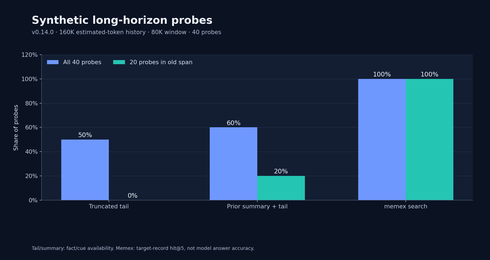
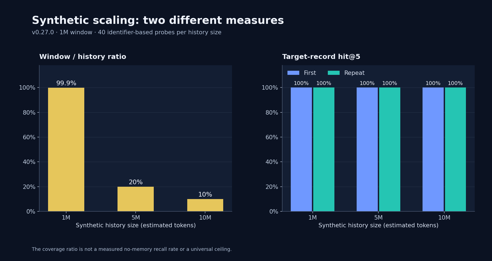
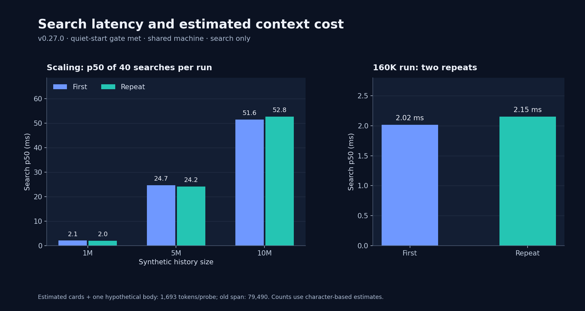
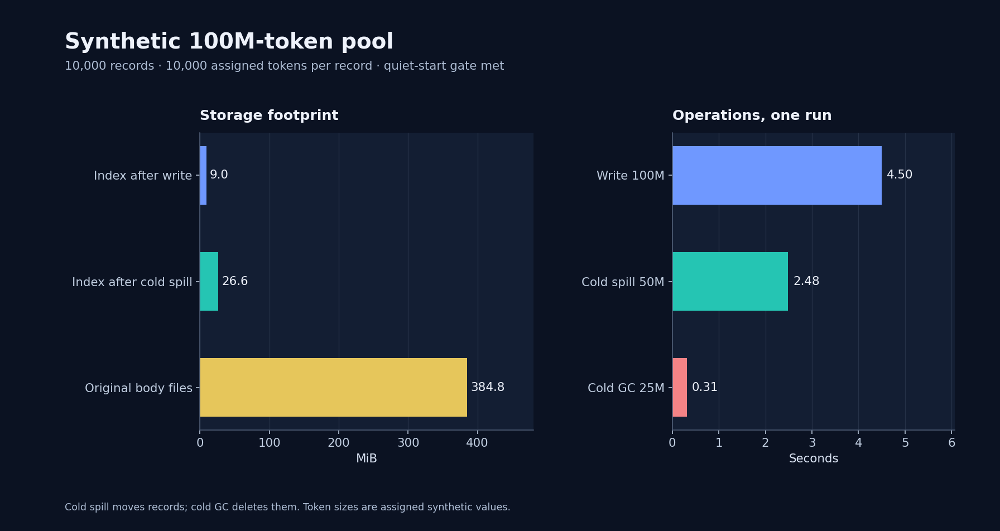

# Benchmark report: long-horizon tasks with vs without extra context

**Question:** in a long-horizon task, what do you actually gain and what does it cost when dsh-memory moves old context into L2/L3 instead of letting the harness truncate/summarize it?

**Short answer:** on a 160K-token project history with an 80K-token window, facts in the evicted region were recovered **100%** of the time with dsh-memory, versus **60%** with a model-written compaction summary (+ retained tail) and **50%** with plain truncation. At 10M tokens with a 1M-token window, the no-memory ceiling is **10%**, dsh-memory stays at **100%** hit@5; the price is ~**1.7K tokens and 6–160 ms per answered question**, plus ~689 tokens of catalog injection when memory changes.



## 1. Fact-recall A/B (compaction vs archive)

**Workload:** a deterministic synthetic 107-turn project history (~160K tokens): technical work logs (file paths, commands, test outcomes) plus 40 injected facts at different depths (`CTX-… → FACT-…` pairs). L1 window 80K tokens; everything older is either truncated, replaced by a compaction summary, or archived.

| Strategy | Model-visible context for old facts | Fact recall (40 probes) | Old-fact recovery | Context tokens |
|---|---|---|---|---|
| **No extra context** — truncate to window | recent 80K tokens only | **50%** (20/40) | 0% | 0 extra |
| **DSH compaction** — model summary + tail | 570-token model-written summary + recent 80K | **60%** (24/40) | **20%** (4/20) | ~570 tokens |
| **dsh-memory** — raw archive + retrieval | nothing unless the model searches | **100%** (40/40, hit@1 = 100%) | **100%** (20/20) | 0 idle; ~1.7K/answer |

The compaction summary was produced by a capable model given the same 79K-token evicted span and an 800-token budget (target 450–650 tokens, measured 570). It kept 6 of 27 identifier pairs (~22%) — selecting the anchor pair, a midpoint, and the freshest pairs, which is what a real summarizer does under a token budget. The truncation baseline is the ideal no-memory case; real truncation is usually worse because it also loses the tail's surrounding structure.

## 2. Scaling: recall vs history size



| History | Window | No-memory availability (window/history) | dsh-memory hit@5 | Retrieval p50 |
|---|---|---|---|---|
| 1M tokens | 1M | 99.9% | **100%** | 6 ms |
| 5M tokens | 1M | 20.0% | **100%** | 82 ms |
| 10M tokens | 1M | 10.0% | **100%** | 159 ms |

The no-memory ceiling is generous: it assumes every fact inside the window is answerable and costs nothing to find. Even so, it collapses linearly as history grows, while retrieval stays flat.

## 3. Cost and latency



| Cost | Measurement |
|---|---|
| Tokens per answered question | **~1.7K** (search result cards + one `memory_open` body of ~1.5K tokens) |
| Idle context overhead | **0** while nothing changes; **~689 tokens** catalog injection when the index changed; ~400 tokens for an auto-recall injection |
| Search latency | **6 ms** at 1M tokens, **82 ms** at 5M, **159 ms** at 10M (synthetic card+abstract index) |
| Compression (cold spill) | 7M tokens in **0.10 s**; 50M tokens in **2.56 s** |
| Cold GC | 25M cold tokens in **0.31 s** |
| No memory | fact unavailable — no bounded cost, unbounded re-derivation/guess |

For comparison, reading the lost span back into context would cost ~80K tokens per pass; dsh-memory answers a question for ~1.7K tokens (51× cheaper than re-ingesting the span) and keeps the index itself small: a 100M-token pool is a 9MB SQLite index (26.6MB after cold abstracts) over 384.8MB of verbatim markdown.

## 4. Capacity and compression



| Measurement | Value |
|---|---|
| SQLite index, real 1.9M-token archive before/after body-less FTS | **18.19 MB → 0.25 MB** (−98.6%) |
| 10,000 records / 100M tokens synthetic pool | write **2.8 s**, index **9.0 MiB**, bodies **384.8 MiB** |
| Read paths at 100M tokens | facets 11.3 ms, catalog 17.5 ms, search 16.7–28.8 ms, grep 14.6 ms |
| Cold spill 5,000 records / 50M tokens | **2.56 s** (filesystem-bound, zero LLM) |
| Cold GC 2,500 records / 25M tokens | **0.31 s** |

## 5. What this means for a long-horizon task

- **Old instructions stay executable.** With truncation, 50% of the probed facts were simply gone; with compaction, 80% of evicted facts were unrecoverable in a later turn. dsh-memory made all 40 probes recoverable, including 20 facts that existed only in the cold archive.
- **Compaction is a budget trade, not a substitute for an archive.** A 570-token summary is excellent for orientation (file paths, open threads, recent state) but structurally cannot keep every identifier. dsh-memory keeps the verbatim span and retrieves the specific fact on demand, which is cheaper both in tokens and in losses.
- **The cost is bounded and small.** Search is milliseconds; each answered question pays for exactly the evidence it needs (~1.7K tokens), not for re-reading history. Capacity compression keeps L2/L3 within their 10M/100M budgets at filesystem speed.
- **The failure mode is different.** Without extra context you fail by *absence* (the model cannot know). With dsh-memory you fail by *retrieval miss* — measured separately: real-archive natural-language recall@5 is 95%, cold-record recall 100% (see [evaluation](evaluation.html)); the remaining 5% is the retrieval gap the model can compensate for with `memory_grep`/`memory_open`.

## Fairness and limitations

- **Synthetic workload.** Facts are injected identifiers in a templated history; the model-side benefit is measured as *fact availability/retrieval*, not end-to-end answer accuracy. Real tasks have messy facts, multi-hop references and implicit history.
- **Compaction simulation.** The summary was written by one capable model with the same-class compaction prompt and a token cap; DSH's built-in compaction implementation may summarize differently. The truncation baseline is the ideal no-memory case (it keeps the entire recent tail), so the no-memory numbers are an *upper bound*.
- **dsh-memory measurement is the retrieval layer.** It assumes the model actually searches (the memory manual + auto-recall make this the default behavior). Token cost counts search cards + one `memory_open`; it excludes the model's reasoning tokens, as does the baseline.
- **Deterministic.** The fixture generator uses a seeded PRNG; results in this report were produced by the commands below on Node 24 / SQLite `node:sqlite`, macOS Apple Silicon.

## Reproduce

```bash
# Compaction A/B fixture (writes old-span.txt/tail-span.txt/results.json to /tmp/lh-compaction)
node --import ./test/register.mjs scripts/long-horizon-eval.mjs --mode compaction \
  --tokens 160000 --window 80000 --out /tmp/lh-compaction

# Optional: plug in a model-written summary of /tmp/lh-compaction/old-span.txt
node --import ./test/register.mjs scripts/long-horizon-eval.mjs --mode compaction \
  --tokens 160000 --window 80000 --summary /tmp/lh-compaction/summary.txt --out /tmp/lh-compaction

# Scaling sweep (1M / 5M / 10M-token histories, 1M window)
node --import ./test/register.mjs scripts/long-horizon-eval.mjs --mode scale \
  --sizes 1000000,5000000,10000000 --window 1000000 --out /tmp/lh-scale

# Complementary retrieval-quality suites
node --import ./test/register.mjs scripts/recall-eval.mjs --suite all
```

Charts in this report were rendered from `docs/assets/benchmarks/results-*.json` (raw measured output). The model-written compaction summary used for the table is committed verbatim as `docs/assets/benchmarks/compaction-summary.txt` so the baseline is auditable.
