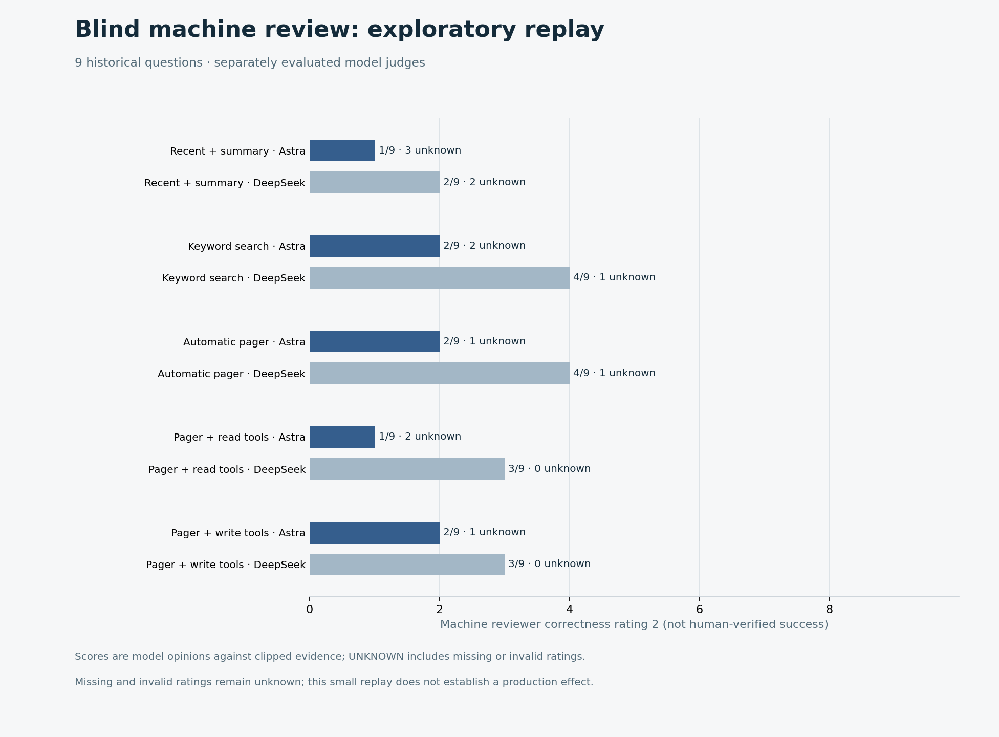
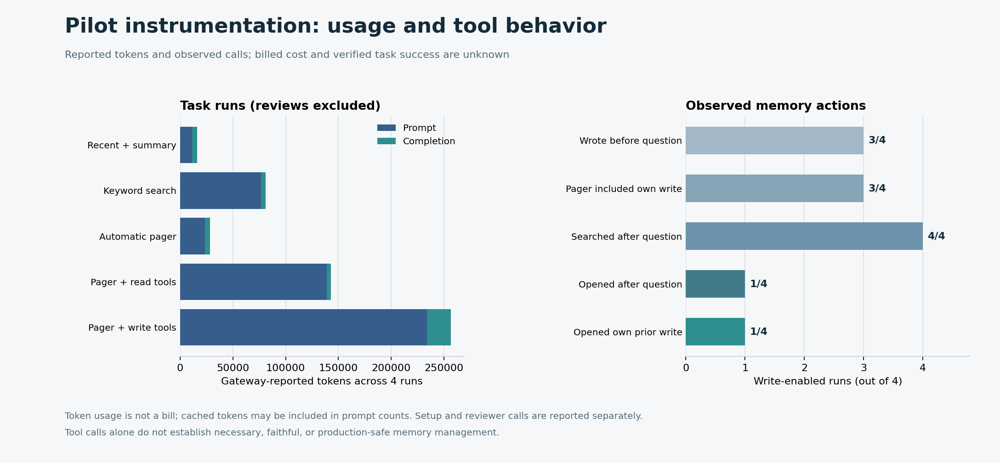
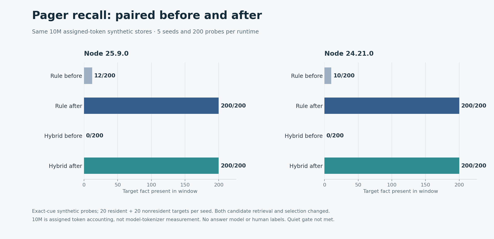
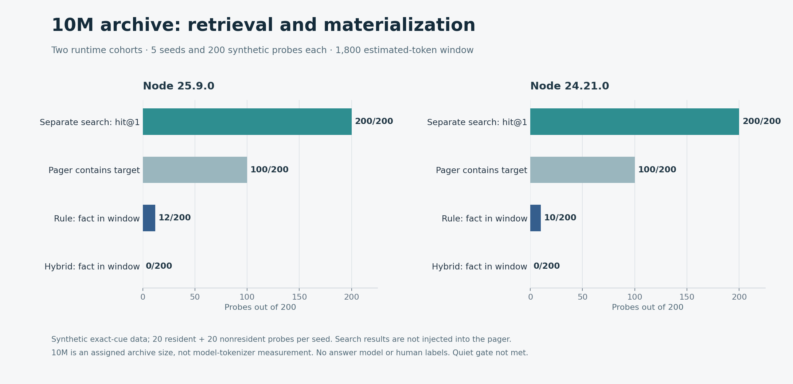

# Benchmark report

## 2026-10-31 expanded retrospective validation pilot

Nine historical questions from three correlated sessions were replayed in five randomized conditions. **41/45** answers were complete; the bounded tool-loop fallback produced complete answers in **8/9** answer phases that reached the cap. Two blinded AI reviewers returned **79/82** valid ratings, with agreement on **17/36** answers where both correctness scores were non-null. Eight of nine write-enabled runs wrote before the question; three later searched, opened and cited their own write. The **8/18** valid unblinded autonomy audits and incomplete cost data do not prove faithful production memory management or savings. Actual invoice and complete costs are **UNKNOWN**. [Full methods, results and ledger](production-pilot-expanded.md).



## 2026-10-31 earlier exploratory production-validation pilot

A five-condition randomized replay of four historical questions from two sessions produced **17/20 nonempty answers**; three runs reached the tool-round limit. In the four write-enabled runs, three wrote before the question and one later searched, opened and cited its own earlier write. This observes a tool chain, not verified correctness or real production autonomy. AI was used instead of human reviewers; only **29/51** blind-machine responses passed the defined format and source-ID checks, and one reviewer was added post hoc. Full invoiced costs are **UNKNOWN**. The small retrospective sample does not demonstrate production accuracy or savings. [Methods, ledger, outcomes and limitations](production-pilot.md).



## 2026-10-31 synonym and archive excerpt retest

On 12 handcrafted English/Chinese questions repeated over ten seeded layouts, optional model query expansion changed target-fact availability from **4/120 to 91/120** for rule and **0/120 to 104/120** for hybrid; the 120 observations are not independent questions. Without rewriting, the new pager matched the prior results. One English access-control question failed for all ten layouts. The prior deep-archive omission probe now retains its fact, but long-document completeness is not guaranteed. A separate exact-cue regression retained **400/400** for both policies on synthetic 10M assigned-token stores. No quiet-start gate passed. [Methods, raw data, real-session replay and caveats](pager-semantic-evaluation.md).


## 2026-10-31 historical query recall and hybrid ranking repair

On the same ten synthetic 10M assigned-token stores and 400 exact-cue probes used in the previous retest, query-aware rule windows contained target facts **22/400 → 400/400** and hybrid windows **0/400 → 400/400**. Both candidate generation and selection changed. An ablation using the same post-fix candidate pages found hybrid **0/400 → 400/400**. These are synthetic availability checks, not answer accuracy.



On a separate small synthetic topic diagnostic, both repaired policies included target facts for **16/16** questions with shared searchable terms and **0/4** lexically disjoint synonym questions. Neither run establishes production generalization. The shared host failed the quiet-start gate for all ten paired runs. [Full methods, raw results and limitations](pager-recall-evaluation.md).

## 2026-10-31 pager repair and 10M materializer retest

The v0.65.0 pager repair was tested at commit [`bfeee59`](https://github.com/QiuXu-Tech/memex/commit/bfeee596cc7a06fd304b025b0b031de05bbd2f12). Each of two runtime cohorts used five seeded synthetic 10M **assigned-token** archives and 200 probes. Separate exact-cue search hit the target at rank 1 in 200/200 per cohort, but search results were not injected into the pager. With the same resident candidates and 1,800 estimated-token budget, the final rule/hybrid windows contained the target fact **12/200 and 0/200** on Node 25.9, and **10/200 and 0/200** on Node 24.21. Each cohort deliberately sampled 100 resident and 100 nonresident targets; these are stress cases, not production accuracy estimates.



The shared host did **not** meet the quiet-start gate for any of the ten runs, so timings are not low-load performance claims. Methods, raw synthetic data, verification, real-session replay limitations and the strategy decision are in the [pager retest report](pager-retest.md).

## Historical report: v0.30.0 synthetic long-horizon retrieval

The public synthetic workloads were run against v0.30.0, commit
[`7d81314`](https://github.com/QiuXu-Tech/memex/commit/7d813147e9cc6d3aa9d61ebf321647061f44054d).

On 2026-10-30 the test machine was an Apple M4 (10 logical CPUs, 16 GiB),
running macOS 27.2 and Node 24.21.0. Before starting, two consecutive five-second
samples showed CPU busy **17.8% / 15.2%** and one-minute load **4.41 / 4.14**
(quiet-start thresholds ≤20% and ≤4.5). During the run, 20 five-second
samples showed CPU busy **24.4%–40.8%** and one-minute load **3.52–4.04**,
including the benchmark itself. Samples can cross stage boundaries; short
stages may have no dedicated sample. This was a shared machine, not an isolated
host. The [run metadata](assets/benchmarks/run-metadata.json),
[load samples](assets/benchmarks/results-load-samples.jsonl), and
[execution records](assets/benchmarks/results-execution.jsonl) record the
method and tested input hashes.

All seven offline stages completed in one run, including the 100M capacity
stage that failed with SQLite `database is locked` in the previous v0.14.0
measurement. Section 7 covers the fix, tests and historical failure.

The [v0.27.0 report](https://github.com/QiuXu-Tech/memex/blob/538d81dfd6b5d4eb6861daff44c1e6a2018ce055/docs/benchmark.md),
the [v0.26.0 report](https://github.com/QiuXu-Tech/memex/blob/d4a17a8a33fd3205468c887dce9cdb8b2148ac1e/docs/benchmark.md),
previous [v0.14.1 + SQLite fix report](https://github.com/QiuXu-Tech/memex/blob/6bcae11642bb9326fc02f8e0c8aa22f11ae2f30b/docs/benchmark.md)
and earlier [v0.14.0 report](https://github.com/QiuXu-Tech/memex/blob/44a02124831c9cd279d99d3220d148e827b5936f/docs/benchmark.md),
[v0.9.1 + tail-fix report](https://github.com/QiuXu-Tech/memex/blob/ff30e1fd101de3c8f9484af2dca8837a100411d3/docs/benchmark.md),
[v0.8.1 + tail-fix report](https://github.com/QiuXu-Tech/memex/blob/72ba8fc338e79e46121d44c8757594c773ed3b6b/docs/benchmark.md),
[v0.5.0 report](https://github.com/QiuXu-Tech/memex/blob/4ab6d6b35d643ce38e638769c1332e2d56a0b807/docs/benchmark.md),
and [v0.3.0 report](https://github.com/QiuXu-Tech/memex/blob/0555d45b64d6de4c1001960187a5a87d1422b6d5/docs/benchmark.md)
remain available. Separate shared-machine timings do not isolate version or
load effects and do not establish a performance change.

**Result in brief:** in a synthetic 160K-token history with an 80K-token
window, 20/40 target facts were present in the retained tail and 24/40 were
present under the supplied summary-plus-tail baseline. Memex search returned
the target record for 40/40 probes at rank 1. For the 20 probes whose records
were outside the window, the corresponding counts were 0/20, 4/20 and 20/20.
The first two are availability checks; the third is a retrieval hit, not an
end-to-end model answer. No model was called for these offline measurements;
the separate live Codex A/B is described in section 6.

## 1. Compaction and retrieval comparison


The fixture creates 107 synthetic turns (160,473 estimated tokens) with 40
evenly spaced probes. It retains a tail near 80K tokens; the older span contains
79,490 estimated tokens and 20 probes. Each question includes a unique
`CTX-…` cue, which also appears in the corresponding record's title; its
summary contains the cue-to-`FACT-…` pair.

| Strategy | All 40 probes | 20 probes in old span | What is counted |
|---|---:|---:|---|
| Truncate to retained tail | 20/40 (50%) | 0/20 (0%) | Target fact in the tail |
| Supplied summary + tail | 24/40 (60%) | 4/20 (20%) | Tail facts plus old probes matched in the summary |
| Memex search | 40/40 (100%) | 20/20 (100%) | Target record in search results; all were rank 1 |

The summary is the previously committed [compaction-summary.txt](assets/benchmarks/compaction-summary.txt).
No model was invoked to create a new summary in this rerun, and its original
model/provider and generation transcript are not recorded here. The script
counts an old probe if **either** its cue or value appears in the summary. An
independent check of this summary found both the cue and value for each of the
four counted old probes. That does not establish that an arbitrary summary
preserves the relationship between a cue and its value.

The summary's 570-token size and the history/window sizes are character-based
estimates, not measurements with a model tokenizer. The supplied summary is
one simulated baseline, not a run of DSH's native compaction implementation.

## 2. Scaling the synthetic history


| Estimated history | Records | Window / history | Search hit@5, both runs | Search p50, first / repeat |
|---|---:|---:|---:|---:|
| 1,000,811 tokens | 667 | 99.9% | 40/40 (100%) | 1.92 / 1.96 ms |
| 5,004,369 tokens | 3,333 | 20.0% | 40/40 (100%) | 23.66 / 23.76 ms |
| 10,011,439 tokens | 6,667 | 10.0% | 40/40 (100%) | 51.10 / 51.85 ms |

The window/history column is an arithmetic coverage ratio, not measured
no-memory recall and not a universal ceiling. Actual availability depends on
where queried facts occur. Each hit@5 is a search for a known synthetic cue;
the workload does not measure whether an agent chooses a useful query or
answers correctly.

## 3. Search time and estimated context cost


The 160K comparison's search p50 was **1.85 ms** on the first run and
**1.93 ms** on a repeat with the same fixture and supplied summary. Each p50
comes from 40 searches. The script selects sorted element `floor(n / 2)`;
for 40 observations this is the upper of the two middle values, rather than
their average. The scaling sweep was also repeated; these observations are not
a production latency distribution.

The script estimates **1,693 tokens per probe** for result cards plus one
assumed target-record body. It does not call `memory_open` or measure model
reasoning. Comparing this estimate with the 79,490-token old span yields
approximately **47×** (79,490 / 1,693), as a token-count proxy, not a measured
cost saving. Search timing excludes record opening and model execution. Catalog
and auto-recall injection costs were not measured in this rerun.

## 4. Synthetic capacity and cold operations


The capacity fixture assigns 10,000 estimated tokens to each record and uses
repeated-character bodies; it is not a tokenizer-derived natural-language
corpus. The two sizes use different cold target ratios to reproduce the prior
7M and 50M spill sizes.

| Pool | Write | Cold spill | Cold GC |
|---|---:|---:|---:|
| 1,000 records / 10M assigned tokens | 1.0 s | 700 records / 7M tokens in 1.07 s | 350 records / 3.5M tokens in 0.24 s |
| 10,000 records / 100M assigned tokens | 9.4 s | 5,000 records / 50M tokens in 14.45 s | 2,500 records / 25M tokens in 5.36 s |

In the 100M run, the SQLite index was 10.7 MiB after writing and 28.3 MiB
after cold spill; the original body files totalled 384.8 MiB. Cold spill moves
the records, while **cold GC deletes** the records it removes. Both were
exercised only on throwaway stores. These are single-run times under the sampled
load noted above.

The prior v0.27.0 run reported **10.0 s / 16.72 s / 7.54 s** for the
100M write, spill and GC operations; v0.30.0 measured **9.4 s /
14.45 s / 5.36 s**. These are separate single runs on a shared
machine; they do not isolate load or version effects. The earlier v0.14.0
recovery run reported **3.6 s / 2.36 s / 0.29 s** before the consistency fix
added per-record staging, manifests and serialized cleanup.

The fixture's bodies consist only of repeated `x` characters. In this version,
`record_terms` also indexes numeric anchors from card fields. A separate
[two-record spot check](assets/benchmarks/results-body-index-probe.json),
using identical number-bearing cards, found two indexed hashes with an
`x`-only body and four when an identifier was added to the body. Thus these
capacity and index-size figures include card-field anchors but do **not**
represent the overhead of identifier-bearing real-world bodies.

## 5. Complementary offline checks

The public `recall-eval.mjs --suite all` run reported 80/80 synthetic probes
at hit@1 and hit@5, and 16/16 demo probes at hit@1 for both direct search and
the auto-recall query path. The synthetic identifiers use `Math.random()`;
the questions are synthetic, and the auto-recall path requests only three
results. See the [raw output](assets/benchmarks/results-recall.txt).

The bundle was built in the isolated checkout; bundle parity passed and the
Node 24 offline harness reported [131/131 passed](assets/benchmarks/results-harness.txt),
including U25's fixed-timestamp, reverse-ID tail-order test. Before the fix,
that test [failed as expected](assets/benchmarks/results-tail-regression.json).
These checks are not a live agent benchmark.

The v0.30.0 GPU/KV connector and real-trace encoder experiments were **not
rerun** in this Mac benchmark; their separate historical evidence is in
[context materialization](context-materialization.html).

The earlier 95% hit@5 figure came from a private, curated 40-question archive.
It was **not rerun** here and cannot be independently reproduced from the
public fixtures. See [evaluation](https://github.com/QiuXu-Tech/memex/blob/main/docs/evaluation.md)
for its historical context.

## 6. Codex A/B and retained-tail verification


A separate live run used `gpt-6.1-sol` through Codex CLI 0.166.0-alpha.5.1
and Node 25.9.0, with three synthetic 300-turn histories and 20 probes each.
The local sessions recorded reasoning effort `xhigh`. The control received
titles and summaries of the 20 recent tail records, not their full bodies;
the treatment received the same cards plus evidence selected and opened by
the fixture before the model call. This tests answers given pre-retrieved
evidence, not autonomous memory-tool use.

| Condition | All probes | 57 evicted probes |
|---|---:|---:|
| Control: tail titles and summaries | 3/60 (5%) | 0/57 (0%) |
| Treatment: tail cards + retrieved evidence | 60/60 (100%) | 57/57 (100%) |

The bridge and all six Codex calls exited zero. The
[published result](assets/benchmarks/live-ab-codex-sol-v030.json) retains
the grades, answers, call statuses and hashes; the
[fixture evidence](assets/benchmarks/live-ab-codex-sol-v030-evidence.json)
contains the actual plans and both prompts. All three tails are turns
**280–299 in order**, prompt contexts match the recorded tails, and all probe
flags match those tails. Local Codex session completion events matched the
saved answers; no model-issued tool calls appear in those six session logs.

Before this run, two five-second samples showed CPU busy **22.9% / 16.7%**
and load **3.55 / 3.83** (thresholds ≤25% and ≤5). During the live bridge,
27 samples showed **17.2%–30.5%** busy and load **3.42–4.60**, including the
fixture and other work on the shared machine. The [live load samples](assets/benchmarks/results-load-samples-codex.jsonl)
and [execution record](assets/benchmarks/results-execution-codex.jsonl) are
separate from the offline measurements.

The six local session `token_count` events report **158,503 input tokens**
(including 79,104 cached input), **1,753 output tokens**, and **160,256 total**.
The 761 reasoning-output tokens are included in output, not additional. These
are local session counts, not a provider billing receipt; monetary cost is
**unknown**. The bridge captured only the final 1,200 characters of each
diagnostic stream, and 6 captured tails contained initialization warnings.
Those potentially sensitive tails and the native report remain local; their
hashes are retained in the published result.

The earlier [v0.27.0 result](assets/benchmarks/live-ab-codex-sol-v027.json)
and [v0.14.1 + SQLite fix result](assets/benchmarks/live-ab-codex-sol-sqlite-fixed.json) are separate runs.

### Historical tail-order limitation

The original harness first selected `list()` by updated time after archiving.
v0.8.0 improved membership recording but still sorted by `created_at, id`:
records written in the same millisecond can be reordered by their random IDs.
The fixed fixture uses the order in which `store.write` returned each ID for
both archiving and constructing the tail. U25 freezes the clock and reverses
IDs to reproduce the defect deterministically.

In the earlier v0.8.0 Codex run, saved prompts for two seeds included turn
278 or 279 and omitted turn 281. The previously published DeepSeek tail records
also differ from turns 280–299 in two seeds. The historical result counts are
preserved, but the full old DeepSeek provider prompts were not saved, and the
published Terra and Claude results have tail IDs without all tail record
titles, so exact chronological tails cannot be established for those calls. See the
[historical tail audit](assets/benchmarks/results-tail-history-v080.json) and
[prior Codex prompt evidence](assets/benchmarks/results-tail-history-v080-codex-prompts.json).

The old v0.5.0 and v0.5.1 result snapshots also contain `generatedAt` values
later than their respective Git commit timestamps. The reason remains unknown;
those historical time discrepancies are not evidence of when calls occurred.

## 7. SQLite lock fix and recovery

The [previous v0.14.0 investigation](assets/benchmarks/sqlite-lock-investigation-v014.json)
found that a lock error could occur after a file was moved or replaced but
before SQLite was updated. A retry of the legacy archive path could then
overwrite the surviving cold file. The original historical lock holder remains
**unknown**.

The fix acquires SQLite's writer lock before file-backed mutations, stages a
separate file and records a recovery manifest before committing the new index
path. Cleanup is reconciled under a writer lock after commit, or by a later
writer or store open if cleanup was interrupted.
The busy timeout is five seconds; a longer conflict still returns an error
without first changing the indexed record file. A failed write reports its
record ID so an ambiguous commit can be inspected before retrying.

In the controlled lock diagnostics, the fixed archive left the hot body
present after `SQLITE_BUSY` and preserved it on retry; a blocked update did
not change the existing body or summary. The [fixed diagnostic evidence](assets/benchmarks/sqlite-consistency-fix-evidence.json)
and [36-case Node 24 regression output](assets/benchmarks/results-sqlite-consistency.txt)
cover competing processes, failed staging, target collisions, lost commit
acknowledgements, process termination before and after commit, interrupted
recovery, and backup/restore without the original source directory. The
[Node 25 suite](assets/benchmarks/results-sqlite-consistency-node25.txt) also
passed 36/36. Four concurrency cases were
[repeated five times](assets/benchmarks/results-sqlite-concurrency-repeat.txt).
These diagnostics and repeats are from the earlier fix commit; the v0.26.0
[Node 24 SQLite suite](assets/benchmarks/results-sqlite-consistency-v026.txt)
was separately rerun and passed 36/36. The v0.27.0
[Node 24 suite](assets/benchmarks/results-sqlite-consistency-v027.txt) also
passed 36/36. The v0.30.0 [Node 24 suite](assets/benchmarks/results-sqlite-consistency-v030.txt) also passed 36/36.

A relocated copy of the prior synthetic failure was also checked: the missing
indexed body was reported and its cold candidate remained byte-for-byte
unchanged. Pre-existing ambiguous stores are not automatically repaired; see
[SQLite and file consistency](storage-consistency.html) for preservation and
recovery boundaries. Process interruption is tested; sudden power-loss and
storage-hardware durability are **not established**.

## Scope and limitations

- The offline search timings call `LocalStoreCore` with default rerank weights;
  they do not benchmark model-specific `AgentMemory` profiles, MCP/DSH
  integration, transcript capture, or an agent's end-to-end answers. The
  separate Codex A/B uses a model-specific profile to construct evidence.
- Exact synthetic cues and prefilled card summaries make these retrieval
  probes easier to locate than many real project questions. The results do not
  establish recall on paraphrases, multi-hop tasks, or missing cues. The
  long-horizon fixture itself does not isolate the cold natural-language fix.
- Timings were collected on a shared machine after a quiet-start gate, with
  five-second load samples during longer stages; this is not full isolation.
  The capacity script prints a `p95` from only five samples using its own index
  rule; this report does not treat it as a reliable 95th percentile.
- The supplied summary is reused; no independent model-summary generation or
  private-archive test was performed. No live memory store was accessed.

## Reproduce

Use Node 24+ and a separate checkout of the tested commit. These commands
create dedicated temporary output directories; the scripts also create and
remove throwaway stores. The summary must be passed explicitly. Record load
separately if comparing shared-machine timings.

```bash
git clone https://github.com/QiuXu-Tech/memex.git memex-benchmark-sqlite-fix
cd memex-benchmark-sqlite-fix
git checkout --detach 7d813147e9cc6d3aa9d61ebf321647061f44054d
out_dir="$(mktemp -d "${TMPDIR:-/tmp}/memex-benchmark.XXXXXX")"
for run in first repeat; do
  node --import ./test/register.mjs scripts/long-horizon-eval.mjs --mode compaction \
    --tokens 160000 --window 80000 --summary docs/assets/benchmarks/compaction-summary.txt \
    --out "$out_dir/compaction-$run"
done
for run in first repeat; do
  node --import ./test/register.mjs scripts/long-horizon-eval.mjs --mode scale \
    --sizes 1000000,5000000,10000000 --window 1000000 --out "$out_dir/scale-$run"
done
node --import ./test/register.mjs scripts/scale-bench.mjs \
  --records 1000 --tokens 10000 --target 0.3 --gc 0.5
node --import ./test/register.mjs scripts/scale-bench.mjs \
  --records 10000 --tokens 10000 --target 0.5 --gc 0.5
node --import ./test/register.mjs scripts/recall-eval.mjs --suite all
node scripts/build-bundle.mjs
node scripts/check-bundle.mjs
node --import ./test/register.mjs test/run.mjs
node --import ./test/register.mjs --test test/sqlite-consistency.mjs
```

With a logged-in Codex CLI, a new live A/B attempt can be run from the same
checkout with the command below. It makes live model calls.

```bash
node scripts/codex-ab.mjs --model gpt-6.1-sol --keep --out "$out_dir/codex-ab.json"
```

The historical lock diagnostics use disposable synthetic stores; the archive
diagnostic intentionally retries within its own fixture. They were not rerun
for v0.30.0.

```bash
for name in sqlite-lock-diagnostic sqlite-write-lock-diagnostic; do
  node --import ./test/register.mjs "scripts/$name.mjs"
done
```

The checked-in [compaction results](assets/benchmarks/results-compaction.json),
[repeat](assets/benchmarks/results-compaction-repeat.json),
[probe manifest](assets/benchmarks/results-probes.json),
[scaling results](assets/benchmarks/results-scale.json),
[scaling repeat](assets/benchmarks/results-scale-repeat.json),
[capacity data](assets/benchmarks/results-capacity.json), and raw capacity
outputs ([10M](assets/benchmarks/results-capacity-10m.txt),
[100M](assets/benchmarks/results-capacity-100m.txt)) are from this run.
Earlier results remain available in Git history. In a checkout containing this
report, install Matplotlib 3.10.7 and run `python scripts/plot-benchmarks.py`
to regenerate the PNGs. The plotting script reads the checked-in snapshot,
not a new temporary run.
