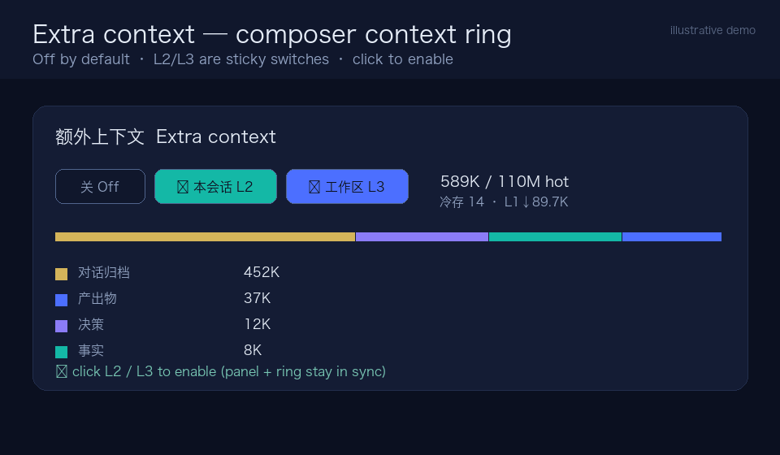

# Memex — the extra-context layer for AI agents

A high-performance context hierarchy between an agent's history and its model window.

[](https://github.com/QiuXu-Tech/memex/actions/workflows/ci.yml)
[](https://github.com/QiuXu-Tech/memex/blob/main/LICENSE)



Memex treats context as a hierarchy: eligible older text spans can be archived in sticky **L2 (10M, session-private)** / **L3 (100M, workspace-shared)** pools, and DSH compaction retains captured source-event envelopes. Selected context can be retrieved under per-model budgets; capture and retrieval can omit relevant information or externally referenced attachment bytes.

## Quick start

```bash
git clone https://github.com/QiuXu-Tech/memex.git
cd memex
node scripts/build-bundle.mjs && node scripts/check-bundle.mjs
node --import ./test/register.mjs ./test/run.mjs   # offline harness
```

Install the built bundle into a DSH profile: [install guide](install.html).

## Documentation

- [Architecture and behavior](architecture.html) — levels, eviction seam, retrieval, compression, API/UI.
- [Archive integrity and privacy repairs](archive-integrity-20261102.html) — atomic compaction, private transcripts, namespace and backup limitations.
- [Integrity and real-issue follow-up](production-integrity-followup-20261102.html) — archive repairs, separately registered issue replays, blinded AI review, failures and cost reconciliation.
- [Registered integrity follow-up](production-integrity-20261102-registration.html) — frozen issue criteria, comparison and AI review plan.
- [Evaluation](evaluation.html) — recall and scale benchmarks with methodology.
- [Benchmark report](benchmark.html) — synthetic long-horizon availability and retrieval, with charts.
- [Cross-session memory and issue triage (2026-11-02)](production-autonomy-20261102.html) — real-issue replay, agent and hook writes, blinded AI review, usage gaps and retained failures.
- [Agent memory overhead and three-session issue replay](production-longhorizon-20261101.html) — empty-search repair, incomplete Codex pairs, AI review, a setter regression and cost gaps.
- [30-issue cross-session follow-up](production-real30-20261101.html) — randomized source investigations, AI review, memory access, usage and cost gaps.
- [Executable real-agent comparisons and grep repair](production-value-20261101.html) — two paired issue replays, memory observations, AI review, cost gaps and retrieval trade-offs.
- [Independent-issue real-agent progress](production-cohort-30-20261101.html) — 30 registered investigations, initial paired trials, memory observations and AI-review limitations.
- [Real-agent isolation and cross-session pilot](production-real-agent-20261101.html) — paired Codex tasks, one observed memory lifecycle, AI review and cost gaps.
- [Isolated pilot tools for MCP agents](integrations/isolated-pilot.html) — bounded repository tools and fixed sandbox tests for Codex and Claude Code.
- [Synonym and archive excerpt retest](pager-semantic-evaluation.html) — paired seeded diagnostics and historical replay.
- [Retrospective pilot follow-up](production-pilot-followup.html) — bounded answer continuation, citation validation, outage evidence and cost gaps.
- [Follow-up registration](production-pilot-followup-registration.html) and [post-outage replication registration](production-pilot-followup-replication-registration.html) — preregistered designs and limitations.
- [Expanded retrospective validation pilot](production-pilot-expanded.html) — bounded tools, AI blind review, autonomous-memory observations and cost gaps.
- [Expanded pilot registration](production-pilot-expanded-registration.html) — frozen pre-outcome design and sample limitations.
- [Exploratory production-validation pilot](production-pilot.html) — randomized retrospective replay, AI review, observed tools and incomplete cost ledger.
- [Pilot registration](production-pilot-registration.html) — frozen design, model-review scope and later parsing correction.
- [Production validation protocol](production-validation-plan.html) — proposed evidence for correctness, cost and autonomous memory claims.
- [Pager recall and ranking retest](pager-recall-evaluation.html) — paired synthetic results, lexical limits and historical-session replay.
- [Pager retest](pager-retest.html) — pager repair, synthetic multi-seed rule/hybrid comparison, and replay limits.
- [SQLite and file consistency](storage-consistency.html) — lock handling, interrupted-operation recovery and backup scope.
- [Extra context, not just memory](context-layer.html) — the concept: a context hierarchy between history and the model window.
- [Context materialization](context-materialization.html) — the direction: canonical events, pager/materializer + DSH switch, tiny trained transformer encoder, runnable paged-KV/prefix host, structural fidelity eval.
- [Integrations](integrations.html) — Claude Code, Codex, Gemini CLI, Cursor, Cline, Windsurf, DSH.
- [Model profiles](model-profiles.html) — per-family budgets, injection formats and digest prompts.
- [Optimization findings](optimization-findings.html) — retrieval/perf experiments, fixed issues, backlog.
- [Profile validation](profile-validation.html) — cold-start + long-horizon A/B for the dedicated model profiles.
- [Live endpoint A/B](live-testing.html) — harness, status and how to run it with provider keys.
- [v0.4.0 experiments](experiments-v040.html) — rename/defaults verification, recall re-check and improvement points.
- [Claude Code](integrations/claude-code.html) · [Codex](integrations/codex.html) · [Generic MCP clients](integrations/mcp.html)
- [Install guide](install.html) — profile registration, config rows, local fallback.

## Highlights

| | |
|---|---|
| **L1 eviction** | Uses the shipped `compaction/prune` + surface-replace seam — no custom session events, no replacement of the compaction backend. |
| **Sticky context pools** | Session-private L2 vs workspace-shared L3; capture deepest enabled level; capacities 10M/100M. |
| **Context paging** | Shared query-term extractor, FTS + cold abstracts + exact numeric/identifier anchors + lexical rerank; pages are injected only when budget allows. A private archive previously reported recall@5 **93%**, cold recall 94%, hit@1 65% (68% with `coldPartial: 0`), and p50 ~2.9 ms. In the [v0.30.0 synthetic Codex Sol A/B](live-testing.html#f-codex-cli--gpt-family-historical-results-and-fixed-sol-rerun), control answered **3/60**, treatment with pre-retrieved evidence **60/60**, and evicted probes **0/57 → 57/57**; all six calls exited zero and all three actual tails were checked in order. Earlier DeepSeek, Terra and Claude results have a [tail-order caveat](live-testing.html#deepseek-flash-results-2026-10-29); Claude Sonnet/Opus/Fable/Haiku each reported **60/60** with ~39.7–40.7k gateway-reported tokens per model. Small historical anchor-free runs reported **0/3 → 3/3** for hot, cold and cold partial/synonym cases; a real Claude tool loop answered **3/3** against the live MCP server. |
| **Capacity compression** | Cold tier (lossless, zero LLM) and bounded map-reduce digests (2-way concurrency, retry/fallback, `ids:` enforcement, quota GC) — after the model asks the user. |
| **Surfaces** | Seven model tools, `/memory` command set, nine `/api/memory.*` routes, Web panel + context ring, sensitive-content policy, backup/verify/restore. |

MIT licensed © QiuXu-Tech. Not affiliated with or endorsed by DeepSeek.
