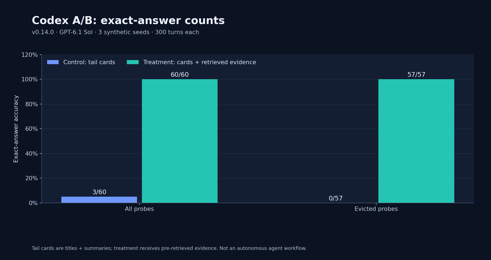

# Live endpoint A/B: help us collect multi-model data

Offline synthetic retrieval, profile, cold-start, and 100M-scale checks have been run. The next step needs **real usage data from many people running many models**: quality and token-usage differ per model family, and we want to validate and tune the dedicated profiles (Claude 5.5 series, GPT-6.1 series, GPT-6 Astra, DeepSeek Flash, and the family profiles) against actual model behavior rather than synthetic proxies.

Tracking request and discussion: [issue #1](https://github.com/QiuXu-Tech/memex/issues/1).

## DeepSeek Flash results (2026-10-29)

**Tail-membership status:** v0.8.0 recorded tail IDs and probe flags, but
its `created_at, id` sort could reorder turns written in the same millisecond.
The [tail-order fix](https://github.com/QiuXu-Tech/memex/commit/c1cda8ba1ba931fa4db9acdf6787cb0a80872c00)
uses the fixture's actual insertion order. In the v0.14.0 GPT-6.1 Sol run, saved
plans and prompts confirm turns 280–299 in order for all three seeds.
[Results and evidence](assets/benchmarks/live-ab-codex-sol-v014-evidence.json)
are available below. Earlier DeepSeek, Terra and Claude counts remain historical;
see the [tail audit](assets/benchmarks/results-tail-history-v080.json) before
interpreting their claimed chronological tails.

### A. Evidence-in-prompt A/B

Historical pre-fix 8-probe run (the 3-seed rerun below supersedes it). Two fresh-context calls on **DeepSeek Flash** (via DSH's DeepSeek Account route), synthetic 120-turn fixture and 8 deep-fact questions. Actual tail membership was not saved; treat this table as historical.

| Condition | Overall | Reported evicted-fact subset (historical, unverified) |
|---|---|---|
| control (recent tail only) | **1/8 (12.5%)** | **0/7 (0%)** |
| treatment (tail + memex evidence) | **8/8 (100%)** | **7/7 (100%)** |

This 8-probe table is historical; a later three-seed rerun is below.

### B. Multi-seed replication (3 seeds × 300-turn history × 20 probes)

| Condition | Overall | Reported evicted records (inTail=false) | Reported cold natural-language subset |
|---|---|---|---|
| control | **3/60 (5%)** | **0/57 (0%)** | 0/30 |
| treatment | **60/60 (100%)** | **57/57 (100%)** | **30/30 (100%)** |

The v0.8.0 result saves tail IDs, tail records and probe flags. Two of its three recorded tail lists are not exactly turns 280–299; the original provider prompts were not retained. The three queried tail facts and 57 reported evicted probes are recorded in the result, but this historical run should not be described as a verified comparison using the strictly newest 20 turns. The first multi-seed run exposed a cold natural-language gap; the later results remain synthetic-fixture observations.

### C. Full agent loop (tools, n=1)

A mediated tool protocol: the model emits JSON tool calls, the harness executes them against the real memex MCP server.

- control (no tools): `UNKNOWN` — wrong.
- treatment: `memory_search` (noisy query) → refined `memory_search` (expected record at rank 10) → `memory_open` → **`FACT-025-r6h18`** — correct, 3 tool calls, 4 turns.

This shows the loop can search, refine, open and answer end-to-end; n=1 is a mechanism check, not a statistical result.

Raw data: [evidence-in-prompt 8 probes](assets/benchmarks/live-ab-deepseek.json) · [multi-seed](assets/benchmarks/live-ab-deepseek-multiseed.json) · [agent loop](assets/benchmarks/live-ab-deepseek-agent-loop.json).

**Caveats:** synthetic fixtures; these DeepSeek runs were agent-mediated and did not capture provider usage tokens or complete provider transcripts. Earlier tail chronology has the limitation described above.

### D. Anchor-free natural-language recall (n=3)

Questions contain **no turn numbers or IDs**; the three facts live only in hot bodies whose card titles/summaries are generic (`release note N`).

| Condition | Result |
|---|---|
| control (recent tail only) | **0/3** — all UNKNOWN |
| treatment (memex evidence) | **3/3** — `FACT-BILL-OK`, `FACT-AUTH-30D`, `FACT-CACHE-LRU` |

This exercises the new **anchor-free hot-body coverage rescue**: it runs only when no card field shares a meaningful query term, then scans at most 240 hot bodies. Cold anchor-free facts still rely on abstract FTS/card summaries. Raw: [evidence](assets/benchmarks/live-ab-deepseek-anchor-free.json).

### E. Cold anchor-free natural-language recall (n=3)

Questions contain **no turn numbers or IDs** and the answer-bearing records are **archived cold**, with generic card titles (`decision record N`). The retrieval path used is the v0.7.0 cold rescue: a cold-only FTS candidate leg + full-abstract-coverage boost, without reading cold bodies.

| Condition | Result |
|---|---|
| control (recent tail only) | **0/3** — all UNKNOWN |
| treatment (memex evidence) | **3/3** — `FACT-BILL-OK`, `FACT-AUTH-30D`, `FACT-CACHE-LRU` |

Limits kept explicit: the boost requires the cold abstract to cover **every** meaningful query term (partial overlap is ignored), and morphology must match (`decision`, not `decide`). Raw: [evidence](assets/benchmarks/live-ab-deepseek-cold-anchor-free.json).

### F. Codex CLI / GPT family: historical results and fixed Sol rerun



| Model / fixture | Control | Treatment | Evicted probes | Tail evidence |
|---|---|---|---|---|
| Sol, prior v0.7.1 contribution | 3/60 | 60/60 | 3/57 → 57/57 reported | Older tail selection; subset not verified |
| Terra, v0.8.1 contribution | 3/60 | 60/60 | 0/57 → 57/57 reported | IDs/flags saved; full chronological tail not saved |
| Sol, v0.8.1 + tail-order fix | 3/60 | 60/60 | 0/57 → 57/57 | Actual plans and both prompts saved; turns 280–299 in order |
| Sol, v0.9.1 + tail-order fix | 3/60 | 60/60 | 0/57 → 57/57 | Plans and prompts saved; turns 280–299 in order; seed 3 resumed after fixture error |
| Sol, v0.14.0 | **3/60** | **60/60** | **0/57 → 57/57** | All three actual prompt tails verified in order; bridge and six calls exited zero |

The v0.9.1 + fix and v0.14.0 runs use three synthetic 300-turn histories and
20 probes per seed. Both conditions see the titles and summaries of the 20 tail records,
not their full conversation bodies. The fixture searches and opens records
before inserting evidence into the treatment prompt; it does not test an
autonomous model choosing memory tools.

In the v0.9.1 run, the original bridge completed seeds 1–2, then failed to generate seed 3 with
SQLite `database is locked` before any seed-3 model call. Only the two missing
seed-3 calls were run in a fresh temporary directory. The result is
**reconstructed** from the saved plans and answers, not a completed single
bridge run. For the first four calls, process exit codes were not retained;
local Codex `task_complete` events and final messages matched the saved
answers. Both recovery calls exited zero. The lock's cause and monetary cost
remain unknown. Local session usage records total **159,311 tokens**, including
79,104 cached input; they are not a billing receipt.

[The v0.14.0 bridge](assets/benchmarks/live-ab-codex-sol-v014.json) completed
all six calls with exit code zero. The [actual plans and prompts](assets/benchmarks/live-ab-codex-sol-v014-evidence.json)
confirm each chronological tail and probe flag; local Codex completion events
matched all saved answers, and no model-issued tool calls appear in those logs.
The local session counts total **165,054 tokens**, including 86,912 cached
input; billing cost remains unknown. Before the run CPU busy was
21.1% / 21.3%; 27 samples during it ranged 13.7%–34.0% on a shared machine.
For the separate offline capacity failure and controlled contention tests, see
the [SQLite lock investigation](benchmark.html#7-sqlite-lock-investigation).

[v0.9.1 result](assets/benchmarks/live-ab-codex-sol-v091.json) ·
[v0.9.1 actual plans and prompts](assets/benchmarks/live-ab-codex-sol-v091-evidence.json) ·
[v0.8.1 + fix Sol result](assets/benchmarks/live-ab-codex-sol-tail-fixed.json) ·
[prior Sol](assets/benchmarks/live-ab-codex-gpt.json) ·
[prior Terra](assets/benchmarks/live-ab-codex-terra.json).
The earlier results remain distinct observations; matching aggregate scores do
not establish equality across models or real projects.

### G. Cold anchor-free morphology/synonym + partial coverage (n=3, v0.8.0)

Questions are anchor-free and the records are cold. They exercise morphology-lite (`decide` ↔ `decision`), synonym phrasing, and a partial-coverage case with an extra query term.

| Condition | Result |
|---|---|
| control (recent tail only) | **0/3** — all UNKNOWN |
| treatment (memex evidence) | **3/3** — `FACT-BILL-OK`, `FACT-AUTH-30D`, `FACT-CACHE-LRU` |

Mechanism: stopword-filtered content terms, prefix ≥4 loose matching, cold-only FTS variants + cold abstract prefix LIKE, and a cold partial-coverage boost (`coldPartial`) gated to protect fully-covered hot cards. Cold bodies are not read. Raw: [evidence](assets/benchmarks/live-ab-deepseek-cold-partial.json).

**Trade-off:** the partial boost is on by default and costs ~3pp real-archive hit@1 (68% → 65%) while hit@5 stays 93%; set `coldPartial: 0` in rerank for the precision-first behavior.

### H. Claude family: Sonnet, Opus, Fable and Haiku (reported, v0.9.0–v0.9.1)

The four Claude models were run through the **APIMaster** OpenAI-compatible gateway with the pre-tail-order-fix batch bridge (`scripts/claude-ab.mjs`), 3 seeds × 20 probes, 6 calls each.

| Model | Control | Treatment | Reported evicted | Gateway-reported usage (6 calls) |
|---|---|---|---|---|
| `claude-sonnet-5-5` | **3/60 (5%)** | **60/60 (100%)** | **0/57 → 57/57** | **40,673 tokens** (prompt 39,025 / completion 1,648) |
| `claude-opus-5-5` | **3/60 (5%)** | **60/60 (100%)** | **0/57 → 57/57** | **40,676 tokens** (prompt 39,028 / completion 1,648) |
| `claude-fable-5-1` | **3/60 (5%)** | **60/60 (100%)** | **0/57 → 57/57** | **40,663 tokens** (prompt 39,015 / completion 1,648) |
| `claude-haiku-5-5` | **3/60 (5%)** | **60/60 (100%)** | **0/57 → 57/57** | **39,677 tokens** (prompt 37,631 / completion 2,046) |

- Tail IDs and per-probe `inTail`/`evicted` flags are saved, but the complete tail record titles and prompts are not; strict chronological-tail membership cannot be independently confirmed for these historical runs.
- The reported aggregate counts match on this synthetic fixture; they do not establish that the four Claude models behave identically in other settings.
- The gateway reported 39,677–40,676 tokens per model (six calls each), 161,689 across all 24 calls. Monetary cost and billing receipts were not captured.
- Raw: [Sonnet](assets/benchmarks/live-ab-claude-sonnet55.json) · [Opus](assets/benchmarks/live-ab-claude-opus55.json) · [Fable](assets/benchmarks/live-ab-claude-fable51.json) · [Haiku](assets/benchmarks/live-ab-claude-haiku55.json).

Run it yourself (key is read from env, never committed):

```bash
APIMASTER_API_KEY=... node scripts/claude-ab.mjs --model claude-sonnet-5-5
```

### I. Claude real tool-calling loop (n=3, v0.10.0)

Unlike the batch evidence-in-prompt bridge, this lets the model decide when to call tools. Claude Sonnet 5.5 received native OpenAI-style `memory_search` / `memory_open` function definitions; the harness executed every requested `tool_calls` against the **real memex MCP server**, appended results, and graded the final FACT id.

| Condition | Result |
|---|---|
| control (no memory tools) | **0/3** — no answer |
| treatment (tool loop) | **3/3** — `FACT-BILL-OK`, `FACT-AUTH-30D`, `FACT-CACHE-LRU` |

- The model searched, opened the right cold record, and answered; examples include a noisy first query followed by a refined search, and opening two records before selecting the right one.
- Usage: **15,649 tokens / 12 API calls** for 3 probes × 2 conditions.
- This is the **first end-to-end tool-calling validation** (not evidence pre-injected). Raw: [evidence](assets/benchmarks/live-ab-claude-tool-loop.json).

**Caveats:** n=3 probes, one model/run; control produced empty answers (counted incorrect); usage from the gateway response; synthetic fixture, no private data.

## How to contribute

1. Clone and run the dry-run sanity check (no network):

   ```bash
   git clone https://github.com/QiuXu-Tech/memex.git
   cd memex
   node --import ./test/register.mjs scripts/live-ab.mjs --dry-run --probes 4 --out /tmp/live-ab-dry.json
   ```

2. Run the harness with your own provider access **in your own environment**, for one or more models:

   ```bash
   ANTHROPIC_API_KEY=... node --import ./test/register.mjs scripts/live-ab.mjs --provider anthropic --model claude-opus-5-5 --probes 6 --out /tmp/live-ab-opus55.json
   OPENAI_API_KEY=...    node --import ./test/register.mjs scripts/live-ab.mjs --provider openai    --model gpt-6.1-sol --probes 6 --out /tmp/live-ab-gpt61.json
   DEEPSEEK_API_KEY=... node --import ./test/register.mjs scripts/live-ab.mjs --provider deepseek --model deepseek-flash --probes 6 --out /tmp/live-ab-dsflash.json
   ```

3. Share the produced JSON (comment on [issue #1](https://github.com/QiuXu-Tech/memex/issues/1) or open a PR adding it under `docs/assets/benchmarks/live-ab-<model>.json`).

**Privacy:** the fixtures are synthetic — no private conversations are sent or stored. When sharing results, remove API keys, auth headers, and any local paths you do not want public; the harness output contains only prompts from the synthetic fixture, model answers, usage, and timings. Never paste provider keys into the repository or an issue.

## Run it with Codex CLI (GPT models)

If you use Codex CLI with GPT models, you can contribute without an OpenAI API key. The bridge generates the same synthetic fixture, asks `codex exec` for the control and treatment answers, grades exact FACT ids, and writes a shareable JSON report (no keys, no private data):

```bash
git clone https://github.com/QiuXu-Tech/memex.git
cd memex
node scripts/codex-ab.mjs --model gpt-6.1-sol
```

Requirements: Node >= 24 (the project engine requirement) and a logged-in `codex` CLI. Options: `--model gpt-6.1-terra`, `--seeds 3`, `--probes 20`, `--turns 300`, `--out /tmp/codex-ab.json`, `--keep` (keep prompts). The script prints the report path; attach that JSON to [issue #1](https://github.com/QiuXu-Tech/memex/issues/1) or open a PR under `docs/assets/benchmarks/`.

The control/treatment prompts are synthetic; review the `raw` replies before publishing. Codex has its own tools, so the prompts ask it not to use them — the per-run work directories are isolated and `--sandbox read-only` is used.

The bridge saves tail IDs and probe `inTail`/`evicted` flags. Use `--keep` to retain generated prompts and plans for an independent comparison; the bridge does not automatically verify the full chronological tail or retain a complete provider transcript. Earlier reports remain caveated as described above.

## What the harness measures

The intended comparison for each synthetic long-horizon question uses two conditions on the same model. The fixed harness selects the tail by fixture insertion order and records its membership:

- **control** — titles and summaries of the retained tail records are in context; older records are evicted;
- **treatment** — the same tail cards plus fixture-generated Memex search/open evidence for that question.

Answers are graded by exact `FACT-###` token. The output reports per-probe `correct`, latency, provider usage, and aggregate `accuracy.control` / `accuracy.treatment`.

A contribution template and the current dry-run plan live at [`docs/assets/benchmarks/live-ab.json`](assets/benchmarks/live-ab.json).

## What we do with the data

- Validate whether the dedicated profiles (Claude 5.5 / GPT-6.1 / DeepSeek Flash) actually improve long-horizon answers.
- Calibrate `charsPerToken`, catalog/recall/open budgets, and rerank weights per family with real token usage.
- Publish an aggregated table in this document (no contributor-identifying data unless explicitly offered).
