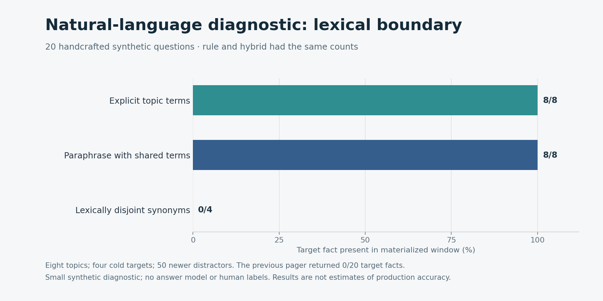
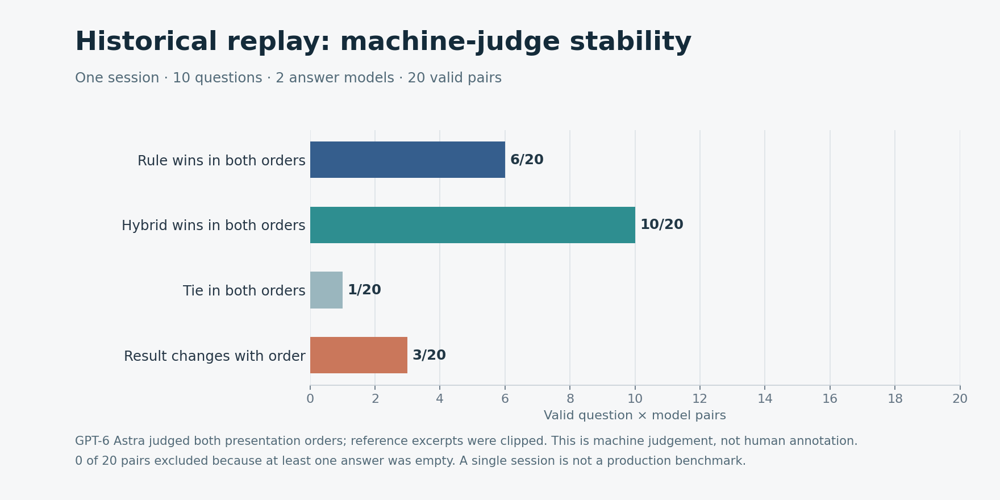

# Pager recall and hybrid ranking evaluation — 2026-10-31

**Scope:** v0.65.0 plus the preceding pager repair (`c05dd12`), compared with query-recall and ranking repair [`a0a33db`](https://github.com/QiuXu-Tech/memex/commit/a0a33db5319ead359b089b3f5fb585212245e044). The synthetic tests below measure evidence availability, not human-rated answer accuracy or real-world productivity.

## What changed

The pager now adds up to eight scoped search hits to its pinned/open/recent candidate set when a query is present. Superseded records are excluded before returned search hits are selected, and empty visible scopes do not list or search. Rule selection tries query hits in search order within the budget before chronological fill. Existing forced/pinned handling stays in place; a forced page may still explicitly exceed the budget.

Hybrid ordering now ranks by IDF-weighted query-term coverage first; the existing learned score breaks coverage ties, then page cost breaks score ties. This prevents a negative learned coefficient from demoting a distinctive lexical match below a weaker-coverage page. It is a lexical heuristic, not a semantic model or a newly human-trained ranker.

The repository checkpoint supports opt-in `materializerHybridRerank`, `materializerLearnedTopK` and `materializerLearnedPageMaxTokens`; hybrid remains **off by default**. Query-aware rule behavior changes when a direct user query is available. The user's active DSH profile was not changed or restarted for this evaluation.

The end-to-end tests cover old cold records, checkpoint → pager recall, Chinese queries, workspace/session isolation, no visible scopes, superseded-record crowding, and generated bundle hybrid weight resolution. Both Node 25.9.0 and Node 24.21.0 passed **161/161** offline tests; Node 24 SQLite consistency passed **36/36** and bundle parity passed. These are test results, not active-runtime acceptance.

## Paired 10M assigned-token synthetic retest


The ten previously measured stores were copied; all **20,000** record files and 20,000 rows of key metadata matched their originals after path rebasing. Each store has 2,000 synthetic records assigned 5,000 tokens, half cold. Bodies contain repetitive filler; the 10M size is assigned token accounting, not model-tokenizer measurement.

Each of two Node cohorts uses the exact same five seeds and 200 target probes as its prior run. The probes were deliberately sampled 50/50 from prior resident and nonresident records. The query is a natural-language question containing an exact `cardcue` from the target record. No target was injected into candidates. Both conditions use 1,800 chars/4 estimated tokens, 400-token body excerpt cap, and no forced core IDs. Hybrid additionally uses the existing lexical weights, topK 8 and learned-page max 700.

| Runtime | Prior candidate contains target | New candidate contains target | Prior rule fact | New rule fact | Prior hybrid fact | New hybrid fact |
|---|---:|---:|---:|---:|---:|---:|
| Node 25.9, 5 seeds | 100/200 | 200/200 | 12/200 | 200/200 | 0/200 | 200/200 |
| Node 24.21, 5 seeds | 100/200 | 200/200 | 10/200 | 200/200 | 0/200 | 200/200 |

The old and new systems changed both candidate generation and selection, so the paired totals alone do not isolate either change. A separate ablation reused the **same post-fix candidate pages** in the old and new hybrid materializers: target facts appeared **0/400 → 400/400** on this exact-cue fixture. All 400 paired probes were independently rerun, with identical candidates, selected IDs, tokens and fact-presence outcomes; the new 800 returned windows stayed within the estimated budget. These scores do not imply comparable performance on unfamiliar language or production data.

All ten new runs failed the quiet-start gate (two consecutive five-second samples with CPU busy ≤20% and load1 ≤4.5); timings are shared-host observations. Across Node 25, median rule/hybrid pager calls were **5.980/6.761 ms before** and **11.271/12.014 ms after**; across Node 24 they were **4.917/5.552 ms before** and **9.618/10.372 ms after**. The new path includes search; differing shared-host load prevents a controlled performance comparison.

[Aggregate](assets/benchmarks/pager-recall/aggregate.json) · [load samples](assets/benchmarks/pager-recall/load-samples.json) · [independent verification](assets/benchmarks/pager-recall/verification.json) · [synthetic topic data](assets/benchmarks/pager-recall/topic-eval.json). Per-seed synthetic paired and ablation data are alongside the aggregate. The original full synthetic stores are retained locally, not published; generated record IDs are random, so their exact original IDs cannot be reconstructed from the public seed alone.

For an available copy of one of those stores, whose SQLite file paths have been rebased to the copy, the paired run and ranking ablation can be repeated as follows. The output paths must not already exist. The baseline repository must be checked out at `c05dd12`.

```bash
node --import ./test/register.mjs scripts/pager-paired-bench.mjs \
  --input docs/assets/benchmarks/pager-10m/seed-301.json \
  --store /private/rebased-copy/seed-301-store --out /tmp/pager-paired-301.json
node --import ./test/register.mjs scripts/pager-ranking-ablation.mjs \
  --baseline /path/to/baseline-repo --input /tmp/pager-paired-301.json \
  --store /private/rebased-copy/seed-301-store --out /tmp/pager-ablation-301.json
node --import ./test/register.mjs scripts/pager-topic-eval.mjs \
  --baseline /path/to/baseline-repo --store /tmp/new-pager-topic-store --out /tmp/pager-topic.json
node --import ./test/register.mjs scripts/pager-archive-probe.mjs \
  --store /tmp/new-pager-archive-store --out /tmp/pager-archive.json
```

The plot scripts consume the checked-in aggregates and require Matplotlib. Recreating a fresh seeded store can support a new paired experiment but will not reproduce the original randomly generated record IDs.

## Small synthetic natural-language checks

A separate synthetic store used eight topics, 50 newer distractors, four cold targets and 20 questions: eight explicitly named the topic, eight used paraphrases retaining some searchable vocabulary, and four used intentionally lexically disjoint synonyms. The prior pager included the target fact in **0/20**. The repaired rule and hybrid each included **8/8 explicit**, **8/8 vocabulary-overlap paraphrases**, and **0/4 lexically disjoint** target facts. An independent rebuild reproduced all 20 outcomes. This is a small handcrafted diagnostic without human-labelled answers; it exposes the remaining dependence on shared words rather than proving natural-language generalization.



There is also a remaining **archive-card content limitation**. In a [synthetic probe](assets/benchmarks/pager-recall/archive-probe.json), an oversized episode was recalled and selected, and its full stored body contained the queried fact; the fact was absent from the final window because the card was cut before query-aware excerpting. A selected record ID therefore does not establish that its decisive body text is present. `scripts/pager-archive-probe.mjs` reproduces this case. Query-aware card construction or explicit `memory_open` remains necessary for this class of record.

## Historical session replay

The same 10 time-cutoff questions from one private, approximately 73-hour historical session were replayed through the repaired pager. The inputs contain successful write-call snapshots available before each question, plus the preceding conversation tail; ten malformed source lines were skipped. They do not reconstruct the full historical store or an autonomous agent/tool-use run. Rule and hybrid had identical candidate sets for all 10 questions, while their selected IDs differed in all 10. Against the earlier pager, rule selected different IDs in 9/10 and hybrid in 10/10; an independent reconstruction reproduced the new windows in 10/10. No human relevance labels were supplied.

With the user's prior authorization, the real contexts were sent via APIMaster to DeepSeek Flash and Claude Haiku 4.5, with a 2,500-token output limit for both policies. All 40 answer calls returned nonempty text. The gateway identified the DeepSeek responses as `deepseek-v4-1-flash-261017`. GPT-6 Astra judged both answer orders for each of the 20 question/model pairs, using reference body excerpts clipped to 1,000 characters. All 40 judge responses parsed, and any listed relevance IDs matched known snapshots; this checks format, not factual correctness:

| Machine-judge outcome | Question/model pairs |
|---|---:|
| Rule wins in both orders | 6/20 |
| Hybrid wins in both orders | 10/20 |
| Tie in both orders | 1/20 |
| Outcome changes with answer order | 3/20 |



These are **machine judgements**, not human annotations, and are not independent tasks across models or answer orders. They do not prove a stable policy advantage or a real-world accuracy improvement. The earlier run had four incomplete pairs, so its aggregate should not be treated as a directly comparable quality delta. Gateway-reported answer usage was 73,252 input / 38,510 completion tokens for DeepSeek and 98,940 / 29,143 for Claude; the judge used 751,704 / 12,395. Actual billed cost is **UNKNOWN**. The non-identifying [aggregate](assets/benchmarks/pager-recall/replay-aggregate.json) and [judge validation](assets/benchmarks/pager-recall/replay-judge-validation.json) are public; raw session data, contexts, answers, rationales and the unfilled human-review sheet remain local.

## What Memex can and cannot demonstrate

Memex provides a persistent, scoped archive and a bounded way to search and reintroduce selected historical evidence into an agent's prompt. This can be useful for long-running projects when important decisions or constraints have left the recent window, provided the relevant record is captured, retrieved and selected. The historical three-seed Codex experiment reported 3/60 versus 60/60 exact answers when the treatment received **pre-retrieved synthetic evidence**; it did not test autonomous memory-tool use. A separate mediated agent loop has only one synthetic case.

It does not increase a model's native context window or guarantee that relevant evidence will be found, included, interpreted correctly or cited. The four lexical-disjoint misses and the single-session replay limitations demonstrate why exact-cue availability results cannot be treated as a real production effectiveness or cost-saving estimate. SQLite recovery tests cover cooperating-process interruptions, not power-loss or hardware failure. Human-verified, session-disjoint tasks, actual agent usage, latency and billing measurements remain necessary for a production value claim.

The next practical priorities are: preserve query-relevant evidence from deep archive bodies; evaluate semantic recall on multilingual paraphrases and hard negatives without weakening scope checks; and run multi-session, human-verified comparisons against recent-history, summary and ordinary retrieval baselines. Measure end-to-end task correctness, unsupported claims, abstention, token use, latency and actual bills before changing the hybrid default or claiming productivity gains.
