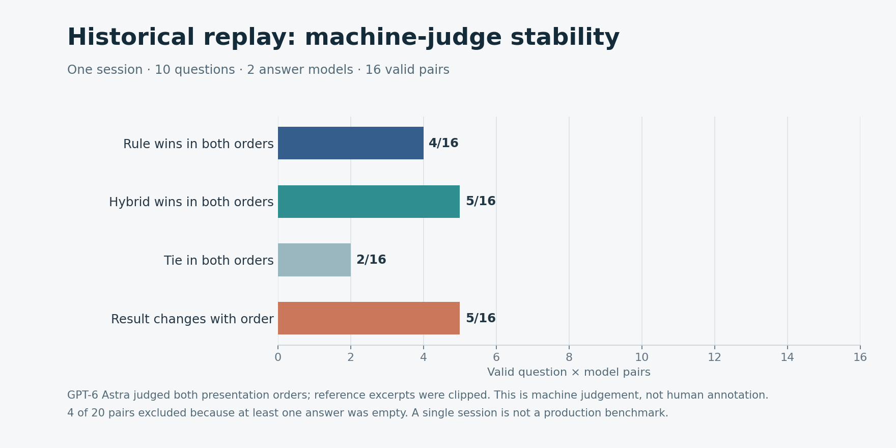

# Pager repair and materializer retest — 2026-10-31

**Scope:** v0.65.0 with pager repair [`bfeee59`](https://github.com/QiuXu-Tech/memex/commit/bfeee596cc7a06fd304b025b0b031de05bbd2f12). These results are a synthetic stress test and a limited private historical replay; they are not a human-labelled production benchmark.

This is the historical pre-query-recall result. The subsequent [paired recall and ranking retest](pager-recall-evaluation.md) uses the same synthetic stores and probes with an updated pager.

## Repair and verification

The pager now loads the stored record body when no canonical events exist, including for archive cards. Missing or unreadable files produce an error instead of silently substituting a summary. `pageTokenCap`, `tokenCounter` and `tokenizerName` are forwarded to the materializer; the engine forwards those options and canonical-event selection. The checkpoint exposes the optional page cap and forwards the current direct user query, allowing query-aware excerpts. Excerpted pages no longer retain the original page token count for learned-candidate limits. No active DSH profile was changed or restarted by this retest.

The excerpt body length is still chosen using a chars/4 approximation; a custom token counter measures the final rendered window, but the page cap itself is not an exact tokenizer-specific bound. Forced pages can explicitly report an exceeded budget. Loading actual bodies also adds file I/O; the synthetic timings below do not characterize worst-case large production records.

A real-store end-to-end harness covers hot/cold bodies, query-aware excerpts through checkpoint → service → pager, tokenizer forwarding, archive cards, missing-file errors, and the learned-page cap. Both Node v25.9.0 and v24.21.0 passed **152/152** offline tests and **36/36** SQLite consistency tests; source/bundle parity also passed. These checks do not establish production runtime acceptance.

## 10M assigned-token rule/hybrid comparison


Each of ten seeds created a throwaway real SQLite/file store with 2,000 synthetic records, each assigned 5,000 tokens; half were archived cold. Seeds 301–305 used Node 25.9.0 and seeds 401–405 used Node 24.21.0. Bodies contain repeated `x` filler. The 10M figure is an assigned storage accounting value, not a measurement by a model tokenizer.

Each seed sampled **20 targets from the pager's resident set and 20 outside it**, for 200 probes per runtime cohort. The search query was an exact `cardcue` in the target title. Search results were measured separately and were **not** passed to the pager. Both pager conditions used the same candidates, query, 1,800 chars/4 estimated-token budget and 400-token body excerpt cap. Hybrid used the repository lexical weights, topK 8 and a 700-token learned-page limit; neither condition used forced core or pinned pages. These settings exercised the pager API; the checkpoint at the tested commit did not enable the hybrid strategy.

Node 25.9.0:

| Check | All probes | Resident targets | Nonresident targets |
|---|---:|---:|---:|
| Probes | 200 | 100 | 100 |
| Separate search hit@1 | 200 | 100 | 100 |
| Target in pager candidates | 100 | 100 | 0 |
| Rule window contains target fact | 12 | 12 | 0 |
| Hybrid window contains target fact | 0 | 0 | 0 |

Node 24.21.0 yielded the same 200/200 separate search hits and 100/200 candidate inclusions; rule/hybrid facts appeared **10/200 / 0/200**, all 10 in the resident group. Across both cohorts' 800 returned windows, none exceeded the budget under the chars/4 estimator. The split was deliberately balanced and is not an estimate of how often real targets are resident. Exact cues and repetitive filler also limit generalization. Presence of the synthetic fact in the rendered text is an availability metric, not model answer correctness.

| Seed | Search hit@1 | Rule fact present | Hybrid fact present |
|---:|---:|---:|---:|
| 301 | 40/40 | 2/40 | 0/40 |
| 302 | 40/40 | 3/40 | 0/40 |
| 303 | 40/40 | 2/40 | 0/40 |
| 304 | 40/40 | 4/40 | 0/40 |
| 305 | 40/40 | 1/40 | 0/40 |

Node 24 seeds 401–405 each had search 40/40, rule 2/40 and hybrid 0/40. Each saved store was independently reopened under its original runtime and all 400 probes replayed: selected IDs, token counts, fact inclusion, target candidate membership, and rule/hybrid candidate equality matched the saved data (0 mismatches). The host was a shared Apple M4/16 GiB machine running macOS arm64. Before each seed we sampled twice for five seconds per attempt, retrying once if the gate failed. **None of the ten runs met** both CPU busy ≤20% and load1 ≤4.5 for two consecutive samples; stored timings are shared-host observations, not low-load performance results.

Observed per-call medians on this shared host were rule/hybrid **5.980/6.761 ms** for the Node 25 cohort and **4.917/5.552 ms** for the Node 24 cohort. These include pager body reads and materialization, exclude archive construction and separate search, and use different seeds under uncontrolled load; they do not establish a runtime speed comparison.

[Node 25 aggregate](assets/benchmarks/pager-10m/aggregate.json) · [Node 24 aggregate](assets/benchmarks/pager-10m-node24/aggregate.json) · [Node 25 load samples](assets/benchmarks/pager-10m/load-samples.json) · [Node 24 load samples](assets/benchmarks/pager-10m-node24/load-samples.json) · [Node 25 verification](assets/benchmarks/pager-10m/verification.json) · [Node 24 verification](assets/benchmarks/pager-10m-node24/verification.json). The seed JSON files in those directories contain the raw synthetic probe records.

Reproduce a synthetic seed with a fresh, nonexistent directory:

```bash
node --import ./test/register.mjs scripts/pager-10m-bench.mjs \
  --seed 301 --store /tmp/memex-pager-seed-301 --out /tmp/memex-pager-seed-301.json
python3 scripts/plot-pager-10m.py
```

The chart script uses the checked-in aggregate and requires Matplotlib. Store IDs and timing vary across runs; the RNG controls target/fact generation. Use a fresh output path so an earlier store is not overwritten.

## Historical session replay

One private historical session spanning about 73.39 hours yielded 10 question snapshots. The extraction retained only successful `memory_write` arguments whose tool results preceded each question, plus the preceding conversation tail. All 232 selected historical write snapshots and all tail entries passed that sequence cutoff. Ten malformed source JSONL lines were skipped; they are a coverage limitation. Each snapshot was reconstructed into a fresh local store and passed through the repaired pager. The two policies had the same candidate set in all 10 cases, selected different IDs in all 10, and stayed within the 1,800 chars/4 window budget.

This is a **retrospective snapshot simulation**, not a full agent/tool-use replay: successful write arguments do not reconstruct the entire historical store, workspace scope was reconstructed, and one session cannot establish generalization. There are no human-verified relevance or fact labels. The [aggregate](assets/benchmarks/pager-replay-aggregate.json) is public; raw session content, contexts, model answers and judge rationales remain local.

With explicit user authorization, real context was sent via APIMaster to DeepSeek Flash and Claude Haiku 4.5. Each model received rule and hybrid contexts at the same 2,500 output-token ceiling. All 40 HTTP calls returned successfully, but five DeepSeek responses contained an empty answer; four question/model pairs were therefore excluded. For the **16 valid pairs**, GPT-6 Astra judged the same answers in both presentation orders using historical write excerpts clipped to 1,000 characters:

| Machine-judge outcome | Valid pairs |
|---|---:|
| Rule wins in both orders | 4 |
| Hybrid wins in both orders | 5 |
| Tie in both orders | 2 |
| Outcome changes with presentation order | 5 |



These are **machine judgements, not human annotations**; they do not establish production answer accuracy or a stable policy winner. The 32 judge responses parsed successfully and referenced known source IDs. Reported answer usage was 69,896 input / 39,451 completion tokens for DeepSeek and 93,741 input / 31,857 completion tokens for Claude; judge usage was 630,469 input / 9,872 completion tokens. These are gateway-reported usage counts, not billed amounts; the actual invoice is **UNKNOWN**.

The local, private replay inputs can be reconstructed with `zstd` installed (choose private paths and do not publish them):

```bash
umask 077
python3 scripts/extract-asof-replay.py --session /private/session.v4.jsonl.zstd --out /private/episodes.json
node --import ./test/register.mjs scripts/replay-pager.mjs \
  --input /private/episodes.json --stores /private/new-replay-stores --out /private/contexts.json
```

The extractor and pager scripts were rerun against the same source snapshot and reproduced the 10 selected question/write snapshots. Re-running answer models requires separate provider authorization and can produce different results or incur costs.

## Strategy

Do not promote hybrid as the default based on these limited results. The nonresident results identify a candidate-generation boundary, and the resident stress case warrants a ranking regression investigation. A broader, record/session-disjoint, human-verified evaluation and validation of the actual runtime path remain necessary before changing a default.
