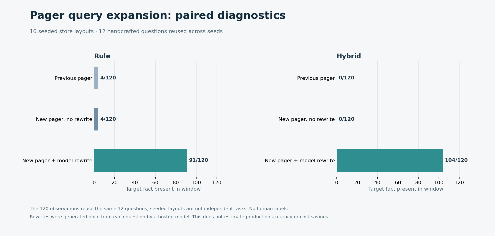
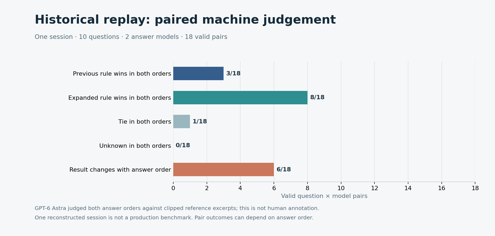

# Pager synonym and archive excerpt retest — 2026-10-31

**Parser correction (2026-10-31):** the earlier extractor treated Unicode separators inside valid JSON strings as line breaks, producing ten invalid fragments from four valid JSONL events. Newline-only parsing found **zero** invalid source lines. Re-extraction produced exactly the same ten selected questions, write snapshots and conversation tails as the old extraction; the previously reported replay answers and scores were not rerun or changed. [Verification](assets/benchmarks/production-pilot/old-parser-verification.json). The historical raw JSON retains its original `malformedLinesSkipped` field as provenance.

**Scope:** prior commit [`13b9301`](https://github.com/QiuXu-Tech/memex/commit/13b93010ed69b87892e89e1696781cd4162df0a9) versus source commit [`caa4b03`](https://github.com/QiuXu-Tech/memex/commit/caa4b0316451d52618bf06bdf7cc1964ee95b4ed). This is an offline diagnostic and retrospective replay, not a human-labelled production benchmark. The [production validation protocol](production-validation-plan.md) describes what would be required to substantiate task-correctness, cost or autonomous-operation claims.

## What changed

An optional checkpoint setting, `materializerQueryExpansion: true`, sends up to 800 characters of the current question to the session's configured model, requesting up to three short alternative search phrases. The pager searches the original question and alternatives separately, fuses the bounded results, applies the same workspace/session and supersession checks, and makes the alternatives available for hybrid ranking and excerpting. Invalid or unavailable model responses fall back to the original query. This setting is **off by default**: it sends question text to the configured provider, adds model cost and latency, and a rewrite may be wrong or fail to bridge the vocabulary gap. Hybrid remains independently opt-in. The user's active DSH profile was not modified or restarted.

For oversized episode archives, the pager now finds a query term in the original body before building the bounded source-marked card. It leaves the stored body untouched. The prior [archive probe](assets/benchmarks/pager-recall/archive-probe.json) selected the record but omitted its deep fact; the [new probe](assets/benchmarks/pager-semantic/archive-probe.json) includes the fact. This fixes the reproduced path, not every possible long-document question: an early or ambiguous match, no shared cue, scattered facts, a tight budget or canonical event layout may still omit decisive content. Use `memory_open` and verify the original when completeness matters.

The checkpoint → local store → pager tests cover both selection strategies, model-response fallback, scope and supersession isolation, and the cold archive body. Node 25.9.0 and Node 24.21.0 each passed **165/165** offline tests; Node 24 passed **36/36** SQLite consistency tests and bundle parity passed. This does not establish an installed runtime result.

## Ten-seed synthetic diagnostics

Each seed uses the same 12 handcrafted English/Chinese questions and their 12 fixed target records, plus 60 partially topical distractors; all targets precede the distractors and half are cold. The 10 seeds vary ordering and cold placement; thus the 120 observations reuse **12 questions**, not 120 independent tasks. Claude Haiku 4.5 via APIMaster generated the alternative phrases **once per question from the question alone**, without the target records, and those alternatives were reused across seeds. The offline runner supplies these saved alternatives directly to the pager; the checkpoint model-stream path is separately covered by a mock end-to-end test. The actual host may choose a different routed model and decoding settings.

| Condition | Rule: fact in window | Hybrid: fact in window |
|---|---:|---:|
| Prior pager | 4/120 | 0/120 |
| New pager, rewrite off | 4/120 | 0/120 |
| New pager, model rewrite on | 91/120 | 104/120 |

The rewritten query brought the target into the candidate pool in 104/120 observations. One English access-control question failed in all ten layouts for both policies; one Chinese billing question succeeded in four of ten under each, and a Chinese deployment question was selected in zero of ten by rule versus ten of ten by hybrid. These are examples of residual retrieval and budget-selection failures, not a broad language evaluation. The 12 rewrite calls used 652 prompt and 374 completion tokens as reported by the gateway; observed median request time was 4.229 s (maximum 4.933 s), under shared-host and network conditions. Actual billed cost is **UNKNOWN**.

For the exact-cue regression, ten cloned synthetic stores of **10M assigned tokens** each were retested on the same 400 probes as the [previous report](pager-recall-evaluation.md). Rule and hybrid each remained **400/400** target-fact availability before and after, with query expansion off. This is not a tokenizer measurement or natural-language accuracy. All 20,000 cloned body files matched their source hashes. All ten quiet-start gates failed (two 5-second samples with CPU busy ≤20% and load1 ≤4.5, up to two attempts), so these are not low-load latency measurements. Old and new runs were not a controlled performance comparison.

[Raw synthetic outcomes and load/copy checks](assets/benchmarks/pager-semantic/aggregate.json) include per-seed data, queries and rewrites. The `before` field inside the 10M raw paired files refers to the older `c05dd12` baseline inherited from the runner; the previous `13b9301` outcomes are in [the prior published raw files](assets/benchmarks/pager-recall/aggregate.json). An independent reconstruction of seeds 301 and 401 matched all candidate, selected and fact-presence outcomes across 144 condition comparisons; 44 estimated-token values differed by 1–2 tokens. The seed alone does not fully freeze timestamps and layout, so these are not byte-identical window reproductions. [Recheck details](assets/benchmarks/pager-semantic/recheck.json).

## Historical-session replay

The same ten time-cutoff questions were reconstructed from one private historical session spanning approximately 73 hours, using prior successful memory-write snapshots and conversation tail; the original extractor skipped ten parser fragments; see the correction above. This is not a full historical store or an autonomous agent run. The comparison is **prior rule without rewriting versus repaired rule with rewriting**, not rule versus hybrid. The new rule selected different IDs on 9/10 questions; all windows stayed within the 1,800-token chars/4 estimate. The same ten question-only alternatives were generated by Claude Haiku 4.5 and supplied offline to the new pager.

With prior user authorization, the contexts were sent through APIMaster to DeepSeek Flash and Claude Haiku 4.5, at temperature 0 and a 2,500-token output cap. All 40 HTTP calls succeeded; **two DeepSeek responses were empty**, leaving **18/20** complete question/model pairs. The gateway identified DeepSeek as `deepseek-v4-1-flash-261017`. GPT-6 Astra judged each complete pair in both answer orders, using reference body excerpts clipped to 1,000 characters. All 36 responses parsed, their score fields were in range and listed source IDs belonged to the available snapshots; this validates format, not factual correctness.

| Two-order machine outcome | Complete question/model pairs |
|---|---:|
| Prior rule wins in both orders | 3/18 |
| Repaired rule with rewrite wins in both orders | 8/18 |
| Tie in both orders | 1/18 |
| Winner changes with answer order | 6/18 |

These are **machine judgements**, not human annotations, and the answer orders and models do not make the ten questions independent. No result establishes production answer accuracy or a general policy advantage. The two empty answers were retained and their pairs excluded, not silently retried. An unfilled blind review packet has 36 answer rows and remains private alongside the source data and raw responses.

Gateway-reported usage: ten private question rewrite calls used **1,299 prompt / 606 completion tokens**, with 4.921 s median and 6.718 s maximum observed request time. DeepSeek answers used **71,070 / 36,759** and Claude answers **95,460 / 30,970** prompt/completion tokens; the 36 judge calls used **692,478 / 11,729**. These are reported usage, not reconciled invoices; billed cost is **UNKNOWN**. The [non-identifying replay aggregate](assets/benchmarks/pager-semantic/replay-aggregate.json) is public.

## Reproduction and scope

The synthetic tests require Node ≥24. Use new store/output directories; do not point tests at a live store. `scripts/pager-semantic-eval.mjs` accepts a previous checkout, seed, store directory and a JSONL file of synthetic expansions; [the saved synthetic rewrites](assets/benchmarks/pager-semantic/synthetic-expansions.jsonl) contain the model output used here. `scripts/pager-archive-probe.mjs` checks the deep-body case. `scripts/replay-pager.mjs` accepts an optional private expansion JSONL; the raw replay data and generated answers are deliberately not public. The plotted numbers are generated by `scripts/plot-pager-semantic.py` and `scripts/plot-pager-semantic-replay.py` from published aggregates.

Future work should evaluate multilingual and semantically disjoint questions with hard negatives, query-aware evidence from multiple archive regions, robustness to inaccurate rewrites, and actual model/provider bills. Use independent human-labelled projects and the [preregistered-style production plan](production-validation-plan.md) before changing defaults or claiming production value.
