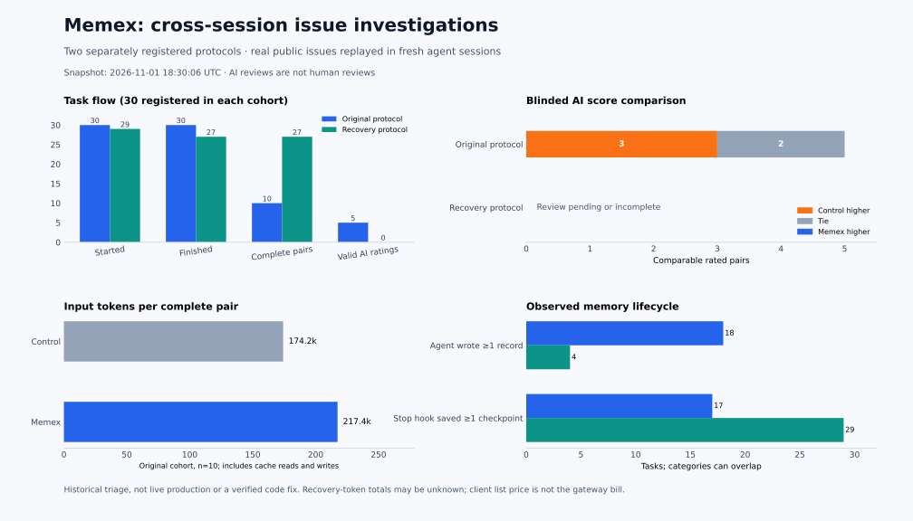

# Cross-session memory and real-issue triage

**RUNS FINISHED; GAPS AND POST-HOC REVIEWS SHOWN BELOW.** This page is a dated snapshot, not evidence of a production correctness gain or cost saving. The tasks are real public issues, but their historical discussions were replayed in compressed sessions as source-backed triage; agents did not ship changes, and AI judges are not human reviewers. Snapshot: `2026-11-01T18:55:38.605917+00:00`.

[Machine-readable results](assets/benchmarks/production-autonomy-20261102/results.json) · [Calibration ledger](assets/benchmarks/production-autonomy-20261102/calibrations.json) · [Original 30-task registration](assets/benchmarks/production-autonomy-20261102/triage30-registration.json) · [Original review plan and evidence correction](assets/benchmarks/production-autonomy-20261102/triage30-review-plan-metadata-revision.json) · [Supplemental 30-task registration](assets/benchmarks/production-autonomy-20261102/supplement-triage-registration.json) · [Supplemental review plan](assets/benchmarks/production-autonomy-20261102/supplement-triage-review-plan-final.json) · [Supplemental blind packet commitments](assets/benchmarks/production-autonomy-20261102/supplement-triage-packet-commitments.json) · [Post-review unblinding](assets/benchmarks/production-autonomy-20261102/supplement-triage-packet-unblinding.json)

## What changed

- Claude Code's installed hook event names now dispatch correctly. `Stop` checkpoints completed assistant responses without another model call, marks them untrusted, skips generic refusals and certain credential-like strings, and deduplicates identical outputs in the same client session. The filter is not a comprehensive secret detector.
- A stable L2 namespace no longer causes the current-session filter to hide checkpoints from other Claude sessions. Session startup injects a short notice instead of repeating the same titles later in recall; relevant previews remain available on matching prompts.
- The isolated pilot bridge accepts larger read windows, supports multiword same-file search with an explicit fallback label, and summarizes repeated reads and search snippets while retaining an explicit refresh option. The later recovery protocol permits one tool-free continuation of the **same** session after budget exhaustion; the next stage remains a distinct session.
- A further MCP change, evaluated in the separate recovery cohort, marks agent-written MCP records untrusted and shows bounded summaries and trust metadata in search/open results. Existing records are not relabeled. The label is not a fact checker. The original cohort used the earlier frozen version; do not attribute this later change to it.
- After both registered cohorts, the default recall notice was updated to say that earlier memory can be incomplete or stale and to check current sources and later discussion before concluding information is absent. The registered cohorts used earlier commits; the change has an end-to-end hook regression test and a separate post-hoc follow-up, not 30 new independent evaluations.
- Reviewer parsing rejects missing scores, invalid evidence IDs, empty output and truncation. A review canary exposed omitted comment authors and dates in the anonymous packet; those public fields were restored before cohort ratings. A Gemini adjudication first truncated; a separately recorded low-effort retry completed. Both the failure and correction are retained.

## Frozen real-issue replays

| Protocol | Registered | Started | Finished | Complete paired two-session tasks | Valid AI-rated pairs |
| --- | ---: | ---: | ---: | ---: | ---: |
| Original | 30 | 30 | 30 | 10 | 5 |
| Supplemental recovery | 30 | 30 | 30 | 30 | 28 |

Each task has its own pinned public source revision, issue snapshot hash, issue-specific criteria and randomized arm order. Both arms receive the same issue, staged comments, read-only source tools and their own searchable prior handoffs. The Memex arm additionally receives actual Claude Code hooks and memory tools. A completed pair requires two successful, distinct client sessions in each arm. Failures, tool errors, incomplete sessions and unstarted tasks remain in the results.

The issue discussions are historical public material that the models may already have seen; the pinned source revision can also postdate the discussion and contain subsequent fixes. This is a compressed replay of issue investigation, rather than a live long-running production workflow.

Original sessions not completed by final status: `{"error_max_budget_usd": 28, "success": 2}`; supplemental: `{}`. In the supplemental protocol, 82 budget-exhausted sessions had a same-session finalization attempt and 82 completed; 5 nonexistent-tool attempts were explicitly rejected and retained. A `success` status can still fail the completion rule if an unapproved tool was attempted. These counts are sessions, not tasks.

The recovery cohort was selected and registered **after** observing budget exhaustion in the first cohort. It uses lower initial budgets, one tool-free same-session finalization when the initial budget is exhausted, the later MCP trust change and a revised pilot bridge. Treat the two cohorts separately; an observed difference between them is not a randomized comparison of those protocol changes.

- **Original:** 5 rated pairs; control higher 3, tie 2, Memex higher 0. Mean score, control / Memex: 1.20 / 0.60 on the 0–2 rubric.
- **Supplemental recovery:** 28 rated pairs; control higher 12, tie 16, Memex higher 0. Mean score, control / Memex: 1.29 / 0.82 on the 0–2 rubric.

Scores assess the supplied triage evidence against the frozen 0–2 rubric; they do not establish that a patch works, an issue is resolved, or a production task is correct. Reviewers are GPT-6.1 Sol and DeepSeek Flash; material disagreements are sent to Gemini Flash when both initial reviews are valid. Candidate labels are randomized and product names are removed, but the wording may still reveal the condition. An absent, truncated, invalid or unresolved review stays missing.

The first cohort published unsalted hashes of two-option label keys, which are enumerable. Earlier in-progress snapshots also exposed some supplemental answers by arm. The AI review requests did not include the arm mapping, but these publications mean allocation was not concealed from a determined outside observer. Supplemental packet keys use salted commitments; their salts are withheld until the reviews finish. Previous Git history remains available.

The original cohort also has a **post-hoc sensitivity view** of 10 rated pairs: control higher 4, tie 4, Memex higher 2. This supplements the original primary view; it includes deterministic revalidation where judges cited a visible `limits` field, a different-model replacement after one timeout, and a separately registered retry of a malformed adjudication. The initial outcomes remain in the JSON. [Reference correction](assets/benchmarks/production-autonomy-20261102/triage30-limits-revalidation-registration.json) · [Reviewer rescue](assets/benchmarks/production-autonomy-20261102/triage30-review-rescue-registration.json)

The supplemental cohort's **post-hoc sensitivity view** covers 30 pairs: control higher 12, tie 18, Memex higher 0. Two initial GPT-6.1 Sol requests timed out; separately registered GPT-6.1 Terra replacement reviews and Gemini adjudications were run on the unchanged blind packets. These replacements do not change the primary count, and any charge for the timed-out requests remains unknown. [Supplemental review rescue registration](assets/benchmarks/production-autonomy-20261102/supplement-triage-review-rescue-registration.json)

## Memory behavior and cost

Across all started tasks, the original cohort has **18** tasks with an observed successful agent `memory_write`; **14** have an agent-written record explicitly opened in the next session. The Stop hook saved a first-session checkpoint in **17** tasks, and a checkpoint was opened in the next session in **15**. For the supplemental cohort, those corresponding counts are **4**, **2**, **30**, and **30**. These are observed operations, not proof that the content was correct or necessary; categories overlap.

An exploratory check prompted by the low scores found that the supplemental second session opened a later-stage discussion comment in **24 / 14** tasks (control / Memex). Counting a returned search excerpt as exposure gives **29 / 15**. These are observed tool outputs, not proof the agent read, understood or used them, and this diagnostic was selected after seeing results.

After the recall-notice change, a separately registered follow-up replayed two deliberately selected issues that had previously claimed no discussion. Their Memex second sessions opened a later-stage comment in **0/2 before and 1/2 on the follow-up**. One still did not open later discussion; this does not establish a reliable fix or generalize beyond the selected cases. The new answers were not subjected to another blind quality review. Its Claude client list price was **$0.421867**, not an allocated gateway charge. [Registration](assets/benchmarks/production-autonomy-20261102/discussion-recall-canary-registration.json) · [Results](assets/benchmarks/production-autonomy-20261102/discussion-recall-canary-results.json).

In the 10 original-protocol complete pairs with reported usage, control used 1,741,774 input tokens and Memex 2,173,899 (+24.8%). The difference comprises +417,074 cache-read, +15,036 cache-creation and +15 uncached input tokens; token counts are not wallet charges. Input totals include uncached, cache-read and cache-creation tokens, following [Anthropic's usage definition](https://platform.claude.com/docs/en/build-with-claude/prompt-caching). Output tokens are reported separately in the JSON. In recovered sessions, individual attempt usage is retained, but a full session total is **UNKNOWN** when the client may omit usage from a budget-failed request; zero is not substituted.

For supplemental budget-exhausted initial attempts, summed input usage in streamed assistant messages agrees with the client summary in 0 cases, differs in 82, and lacks usable evidence in 0. The difference cannot safely be filled in as a known billed total.

Those input totals reconcile to 180 / 183 distinct assistant message IDs, averaging 9,677 / 11,879 input tokens per message. This points to larger per-message context in this sample, but does not isolate which context component caused it. Before any model tool result in the first session, the first assistant messages averaged 5,338 / 7,292 input tokens (control / Memex). Tool schemas, hooks and other initial context differ, so this does not isolate one cause.

For those 10 complete original pairs, client list prices were $0.9299 control and $1.0202 Memex (+9.7%). These are client list prices, not measured gateway wallet charges.

In the original 10 complete pairs, the control / Memex arms made **264 / 231** tool attempts, of which **2 / 2** repeated the identical tool and arguments within a single session. Overlapping source ranges and semantically repeated searches are not included in that narrow count. Fewer attempts alongside more input tokens does not by itself identify the cause: repeated context, cache traffic and output size require separate investigation.

The reported Claude client list-price totals for completed and failed session attempts are **$7.0025** for the original cohort and **$7.7135** for the supplemental cohort; sessions with missing client costs: **0** and **0** respectively. These figures are not APIMaster wallet charges and exclude the separate canaries, reviewers, machine time and labor. Gateway attribution and any missing fees are not assumed to be zero.

For supplemental reviews and post-hoc rescue, 90/90 successful calls uniquely matched visible wallet rows by model, input/output tokens and finish time (within three seconds); displayed amounts sum to **$0.353598**. This is a heuristic match, not request-ID proof or the entire study cost. The two timed-out calls and solver charges remain unallocated. [Per-call reconciliation](assets/benchmarks/production-autonomy-20261102/supplement-review-cost-reconciliation.json). The gateway account's overall usage view was also checked; its account-wide amount cannot be uniquely assigned to this study and is retained privately. Infrastructure and labor remain UNKNOWN.

The following reviewer usage is reported by the gateway for terminal attempts with complete usage; failed or usage-missing attempts remain a separate gap. It is not a dollar invoice.

| Cohort | Model | Attempts | Known prompt tokens | Known output tokens | Failed or usage missing |
| --- | --- | ---: | ---: | ---: | ---: |
| Original | gpt-6.1-sol | 10 | 164,754 | 5,098 | 1 |
| Original | deepseek-flash | 10 | 125,041 | 3,909 | 0 |
| Original | gemini-3.8-flash | 11 | 165,259 | 5,046 | 0 |
| Original | gpt-6.1-terra | 1 | 10,589 | 373 | 0 |
| Supplemental | gpt-6.1-sol | 30 | 743,504 | 18,258 | 2 |
| Supplemental | deepseek-flash | 30 | 397,915 | 12,312 | 0 |
| Supplemental | gemini-3.8-flash | 30 | 460,457 | 12,714 | 0 |
| Supplemental | gpt-6.1-terra | 2 | 28,898 | 1,000 | 0 |

## Retained calibration failures

The initial synthetic hook smoke was contaminated by inherited stdin and failed. A second clean-input attempt failed because the model did not repeat the supplied fact in its answer; a third, clearer synthetic attempt succeeded across two processes. These are mechanism checks, not independent real tasks. [Initial registration](assets/benchmarks/production-autonomy-20261102/hook-smoke-registration.json) · [First retry](assets/benchmarks/production-autonomy-20261102/hook-smoke-retry-registration.json) · [Clarified retry](assets/benchmarks/production-autonomy-20261102/hook-smoke-clarified-registration.json) · [MCP trust smoke](assets/benchmarks/production-autonomy-20261102/mcp-trust-smoke-registration.json)

The new [Axios #6690](https://github.com/axios/axios/issues/6690) calibration reproduced the read-only inherited `toJSON` failure, while a separate inherited-setter regression check passed initially. Both original arms and both separately registered retries exhausted their first-session budgets without a final patch. Their AI reviews scored only the missing artifacts; this cannot compare solving ability. [Registration and fixed criteria](assets/benchmarks/production-autonomy-20261102/axios-6690-registration.json) · [Post-hoc retry registration](assets/benchmarks/production-autonomy-20261102/axios-6690-retry-registration.json) · [Blind packet](assets/benchmarks/production-autonomy-20261102/axios-6690-blind-packet.json)

The retained records preserve incomplete results and unknown charges; an absent result is not a zero-cost success.
