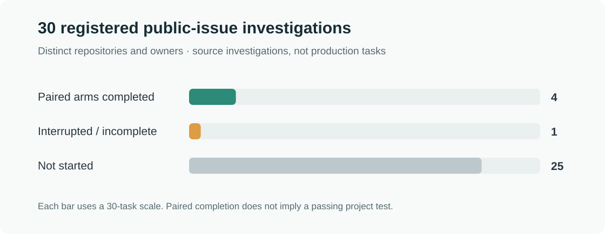

# Real-agent public-issue cohort: initial progress (2026-11-01)

**Thirty new public-issue investigations are frozen, not thirty completed trials.** They concern 30 distinct repositories and owners and use recorded source revisions and task-specific criteria. At this report, **4/30 have completed both randomized arms**, 1 was interrupted or incomplete, and 25 had not started. Each completed arm uses three fresh Codex processes. These are historical issue replays and source investigations, not live user production tasks; cohort-specific executable acceptance tests were **not run**. A separate Krkn engineering canary did use a frozen sandbox test.

[Public registration, task criteria and pinned source](assets/benchmarks/production-cohort-30-20261101-registration.json) · [Aggregates, blind reviews, failures and billing candidates](assets/benchmarks/production-cohort-30-20261101.json) · [Previous real-agent pilot](production-real-agent-20261101.md)

## Design and boundaries

The investigator selected issues which were open in the captured snapshot, had at least 30 days between creation and the last recorded human comment, and at least two non-bot participants. One issue per repository and owner reduces obvious reuse; it does **not** establish statistically independent users or a representative production sample. Cross-checking earlier local reports found no matching issue URLs/identifiers, which is not proof that no prior study ever used them.

The registration fixes each issue snapshot, the discussion split, current source commit, one source-file blob, three acceptance criteria, randomized task/arm order, reviewer names and 0–2 rubric. It was recorded locally before the cohort calls (SHA-256 `a5725bae2689dd3ae331c0ce73ed737f099258c2ba2ca58fb5f8937c56b52c06`), but was not independently timestamped or published before these results. Future arm order and seed are withheld until their experiments conclude. The captured issue body may have been edited; historic comments are presented against a newer frozen source, and some discussions already include proposed solutions. T03 uses its maintained `v1.x` branch rather than the default branch.

For each completed comparison, a fresh `gpt-6.1-sol` Codex process receives each of three sequential sessions. Both arms receive the same source snapshot and public issue history; later sessions also receive their own arm's previous session outputs. The treatment adds a new initially empty Memex L3 store and the standard project manual, which directs the agent how and when to use memory. Individual task prompts do not command memory calls. Source and issue files are accessible through bounded MCP tools; shell, network search and unrelated connectors are disabled for the corrected runs. Each cohort task is an investigator-defined source investigation and proposed verification, **not an upstream-issued coding assignment**. The VM workers and controls are described in the [integration guide](integrations/isolated-pilot.md).

Two AI reviewers score anonymous handoffs against the frozen task-specific criteria: 0 means materially wrong or irrelevant, 1 partial or uncertain, and 2 evidence-supported and meets the criteria. Arm labels and memory IDs were removed, although content can reveal the condition; source excerpts may be clipped. All reviewers use the same gateway, and model identity is based on response metadata, not independently verified. They are not human reviewers. A `deepseek-flash` adjudicator was used for specified disagreements, retaining original opinions. Scores reflect investigation/handoff quality in the prepared read-only setting; they are not project test results.

## Randomized task results

Scores below are **control / Memex**, in the order shown. `*` marks a post-hoc mechanical recovery from an invalid original response. `†` marks a commit inferred from local history: those two execution registrations did not record a Memex server hash. Both cohort arms lack project-specific executable verifiers. A completed arm means three processes completed with final responses; it does not mean its issue was fixed.

| Task | Memex code | Paired status | GPT score | Claude score | Tool observations |
|---|---|---|---|---|---|
| T29 [qooxdoo/qooxdoo #10738](https://github.com/qooxdoo/qooxdoo/issues/10738) | — | interrupted or incomplete | UNKNOWN | UNKNOWN | Control interrupted on unexpected web-search event; treatment not started. |
| T24 [devcontainers/cli #863](https://github.com/devcontainers/cli/issues/863) | `de00e08†` | paired completed | 1 / 1 | 1 / 1 | Memory writes 0; grep 0 completed / 1 failed. |
| T10 [josdejong/mathjs #1305](https://github.com/josdejong/mathjs/issues/1305) | `de00e08†` | paired completed | 1 / 1 | 1 / 1 | Memory writes 0; grep 0 completed / 1 failed. |
| T19 [elysiajs/elysia #1515](https://github.com/elysiajs/elysia/issues/1515) | `788c841` | paired completed | 2 / 2 | 1 / 1 | Memory writes 0; grep 1 completed / 0 failed. |
| T06 [pyodide/pyodide #4139](https://github.com/pyodide/pyodide/issues/4139) | `788c841` | paired completed | 2 / 1 | 1 / 1* | Memory writes 0; grep 1 completed / 0 failed. |

For T24 and T10, both original reviewers scored both handoffs 1/2. On T10, they disagreed in their *reasons* about whether the answers discussed the parenthesized control and both operator aliases. A separately registered post-hoc adjudication found that both did, but retained 1/2 for each because neither supplied concrete ordinary-arithmetic regression expectations. No agent-executed project test is implied.

For T19, GPT scored both answers 2/2 and Claude scored both 1/2; the adjudicator scored both 2/2, considering the source-grounded investigation and proposed tests sufficient for this rubric. For T06, GPT scored control/Memex 2/1. Claude's original response was invalid JSON because two reason strings had unescaped internal quotes; the original failure remains in the aggregate. A separately registered, deterministic post-hoc recovery escaped only those inner quotes and recovered control/Memex **1/1**, without another model call. The original review packet also clipped the Memex answer's successful read of `src/js/package.json`: the pinned file and captured read confirm version `314.1.0-dev.0`. After supplying that evidence, the adjudicator rated both T06 answers 2/2. These post-hoc recoveries and supplements are not original valid blind scores and do not erase the initial disagreement.

The first two treatment investigations, T24 and T10, searched their empty stores but did not write a record. In their third sessions both tried `memory_grep` and received an error. These failed calls remain in the results; neither was silently rerun. The corrected studies are a separate post-fix continuation and should not be treated as the same treatment version. Their treatment agents also searched but did not write in any of their three sessions.

T29's first two control sessions completed. During the third, Codex emitted an unexpected web-search start event and the live guard stopped the process; the treatment did not start and the interrupted turn did not emit a usage record. The event alone does not establish that a search completed. The issue was closed and later reopened, so a current defect was not assumed. Afterward we explicitly set `web_search = "disabled"` in accordance with the [Codex configuration reference](https://learn.chatgpt.com/docs/config-file/config-reference); a separate prompted smoke confirmed no web-search event. This was an adaptive configuration repair, not a retry of T29.

## Separate executable Krkn canary

A separate randomized coding task narrowed [Krkn #1404](https://github.com/krkn-chaos/krkn/issues/1404) to one `application_outage` caller at commit [`ffa9eb2`](https://github.com/krkn-chaos/krkn/commit/ffa9eb2041a5e928b8659959507f89f7a535782a); it is **not** one of the 30 investigations. Before either arm, its sandbox verifier failed the baseline and passed an investigator reference change. Both agent patches later passed the same fixed checks for false return, thrown exception, and normal policy lifecycle (**2/2 arms**). External Kubernetes calls were mocked, so this is not a cluster integration test or an issue-wide fix.

In the Memex arm, session 2 wrote a record; a fresh third process searched for, opened the same record body and cited it in its handoff. The standard manual encouraged memory use; the individual task did not direct a tool call. Both arms also had prior-session archives and source, so the observation establishes a particular write → open → citation path, not that memory was necessary or caused a better outcome.

Both blind reviewers rated each patch 2/2 for delivery and side effects. Their supplemental handoff ratings, added after observing the outcomes, differed 1 versus 2 for each answer. The first review packet omitted runner source and prior-session outputs; a separately registered adjudication supplied them and rated both handoffs 2. The adjudicator also incorrectly inferred that agent claims about inaccessible test code were unsupported because the *reviewer* could see the harness. Worker inspection showed that the agents could not read the separate checks root; the original adjudication and this correction are both retained in the aggregate. The missing initial evidence and post-hoc supplementary rubric limit that handoff rating.

## Fix and independent diagnostic

The trial exposed a Memex MCP bug: `memory_grep` treated the core's returned array as an object with a `hits` member, causing both empty and matching results to fail. Commit [`788c841`](https://github.com/QiuXu-Tech/memex/commit/788c8415c406af076e7566e5879be7206477f846) fixes the adapter and adds end-to-end MCP checks for empty, matching, limited, ID-filtered and malformed-regex calls. The new test reproduced the failure first; the local fixed harness reported **178/178 passed with four bundle-dependent checks skipped**; the built-bundle CI harness separately reported **178/178 passed**. The commit's [CI](https://github.com/QiuXu-Tech/memex/actions/runs/41296921275) and [Pages deployment](https://github.com/QiuXu-Tech/memex/actions/runs/41296920750) completed successfully. A real Codex process explicitly instructed to call grep then correctly observed a matching and a missing result. That prompted synthetic smoke is not autonomous memory use.

For T10, an investigator separately installed the pinned Math.js dependencies with scripts disabled and ran a network-disabled diagnostic **after the agents had started**. `10 km in meters + 100 meters` and the equivalent `to` form both raised `Parameter x contains a unit with undefined value`; the parenthesized controls both returned `10.1 kilometers` (10,100 meters). The diagnostic used the pinned source's `src/defaultInstance.js`, not an agent patch, and was not part of the preregistered task acceptance.

## Usage and candidate charges

Codex reported the following counts for this round. Cached input is already included in input; an interrupted turn's missing usage is **UNKNOWN**, not zero.

| Stage | Completed usage records | Input tokens | Cached input | Output tokens |
|---|---:|---:|---:|---:|
| Separate Krkn task | 6 | 1,251,010 | 1,108,864 | 7,682 |
| 30-task cohort, including interruption | 26 | 4,769,183 | 3,998,976 | 40,885 |
| Two synthetic integration smokes | 2 | 59,935 | 41,216 | 252 |
| Reported total | 34 | 6,080,128 | 5,149,056 | 48,819 |

The AI review/adjudication gateway returned 14 successful call records with **445,899 input / 4,212 output** tokens; 0 call records lack a successful complete usage record. One successful response was initially invalid JSON, as described above. 14 visible APIMaster wallet rows match this round's calls by model, timestamp and token counts, for a **candidate $0.062814**. Cache-creation tokens are included in the input shown; no per-request receipt linkage is available. This subtotal covers matched gateway reviews only, not Codex ChatGPT usage. Subscription allocation, the interrupted turn, VM/host compute, storage and engineering/review time remain **UNKNOWN**. No cost saving or cost per verified production success follows from these observations.

## Registered issue list

The full three-point criteria, captured source blob and input hashes are in the [registration](assets/benchmarks/production-cohort-30-20261101-registration.json). History days are from issue creation to last captured human comment; they do not imply that these agents worked continuously for that duration.

| ID | Public issue | History days | Pinned source |
|---|---|---:|---|
| T29 | [qooxdoo/qooxdoo #10738](https://github.com/qooxdoo/qooxdoo/issues/10738) — Serve command fail if bootstrap framework locally | 245 | [`bebc064`](https://github.com/qooxdoo/qooxdoo/commit/bebc06480647dfc2c250662597d9cdd0e456358f) |
| T24 | [devcontainers/cli #863](https://github.com/devcontainers/cli/issues/863) — devcontainer up not working with podman and docker-compose file | 825 | [`a190a3f`](https://github.com/devcontainers/cli/commit/a190a3f86fe20b582c25c4dcb7bbf5fdb739ab26) |
| T10 | [josdejong/mathjs #1305](https://github.com/josdejong/mathjs/issues/1305) — Allow adding units after a unit conversion | 2924 | [`2078445`](https://github.com/josdejong/mathjs/commit/20784452aa607b065461d07b0a20a2a4a617891b) |
| T19 | [elysiajs/elysia #1515](https://github.com/elysiajs/elysia/issues/1515) — Cannot implement SPA fallback routing: HTML bundle serialized as JSON in onError | 369 | [`e037eca`](https://github.com/elysiajs/elysia/commit/e037eca710e7ad193be09cc6615ab0dbe54af914) |
| T06 | [pyodide/pyodide #4139](https://github.com/pyodide/pyodide/issues/4139) — Batched stdout handler doesn't get called when stdout is flushed | 1142 | [`950e0de`](https://github.com/pyodide/pyodide/commit/950e0de49536778f2d7a0efc825e932d812be9e7) |
| T30 | [capricorn86/happy-dom #2203](https://github.com/capricorn86/happy-dom/issues/2203) — HTMLElement::replaceWith() doesn't work | 142 | [`5e100de`](https://github.com/capricorn86/happy-dom/commit/5e100dedb73111a276f75a3daff3a506e2524759) |
| T17 | [getpaseo/paseo #2471](https://github.com/getpaseo/paseo/issues/2471) — daemon.log: 86% of records are one repeated error with a full stack; no dedupe or sampling | 96 | [`fa89738`](https://github.com/getpaseo/paseo/commit/fa89738e3a937e83d10b8998ee0d96f3708947dd) |
| T15 | [Arize-ai/openinference #2101](https://github.com/Arize-ai/openinference/issues/2101) — [bug] Using openai and openai.agents duplicates llm spans. | 132 | [`5c68f3a`](https://github.com/Arize-ai/openinference/commit/5c68f3a6d1ba1095e9b7ae594fabfbe0271c6948) |
| T05 | [yt-dlp/yt-dlp #14206](https://github.com/yt-dlp/yt-dlp/issues/14206) — `--embed-thumbnail --remux-video ogg` do not work together - Python EoF Error | 425 | [`b77c930`](https://github.com/yt-dlp/yt-dlp/commit/b77c9304e1c4220cca450c583491904daf8455af) |
| T18 | [usebruno/bruno #7362](https://github.com/usebruno/bruno/issues/7362) — Impossible to use built-in library 'cheerio' with CLI ( ../webidl: File is not defined) | 139 | [`e559194`](https://github.com/usebruno/bruno/commit/e559194058d7802627ce692b90358d5f6b9deabc) |
| T14 | [autogluon/autogluon #5521](https://github.com/autogluon/autogluon/issues/5521) — [BUG] Training fails due to fastai ImportError when already installed | 301 | [`65ea1bf`](https://github.com/autogluon/autogluon/commit/65ea1bf737d767729dcbd15b2d8f213dd243cd3b) |
| T23 | [storybookjs/storybook #31699](https://github.com/storybookjs/storybook/issues/31699) — [Bug]: Running Visual Test locally from browser fails if addon-docs enabled in sb 9.0.6 | 460 | [`43a1388`](https://github.com/storybookjs/storybook/commit/43a13889a499ee209a52dc5f874c0ad84b3eeec3) |
| T11 | [yargs/yargs #873](https://github.com/yargs/yargs/issues/873) — Environment variables trigger errors for irrelevant commands (in strict mode) | 3467 | [`ee7b7ab`](https://github.com/yargs/yargs/commit/ee7b7ab5338a03beb86c6acec38bbe3417822c5a) |
| T28 | [cdxgen/cdxgen #1797](https://github.com/cdxgen/cdxgen/issues/1797) — Generated purl for OCI images includes namespace, which is not allowed by purl spec | 69 | [`b3d0710`](https://github.com/cdxgen/cdxgen/commit/b3d0710cb59120d81866c4465c95c6cdfed0bf40) |
| T22 | [ioBroker/ioBroker.mqtt #518](https://github.com/ioBroker/ioBroker.mqtt/issues/518) — High memory consumption | 590 | [`bfd6503`](https://github.com/ioBroker/ioBroker.mqtt/commit/bfd65032c50a0b4aa80355abcb03d65214da418e) |
| T13 | [huggingface/huggingface_hub #4196](https://github.com/huggingface/huggingface_hub/issues/4196) — No resuming of downloads | 178 | [`5077876`](https://github.com/huggingface/huggingface_hub/commit/5077876d472bf0fbd8525b9dbb60f968c31f5302) |
| T25 | [adobe/react-spectrum #2806](https://github.com/adobe/react-spectrum/issues/2806) — Unit in NumberField cannot be deleted (for some units/ unit-displays) | 1728 | [`a562b33`](https://github.com/adobe/react-spectrum/commit/a562b335e645c172ec5a940b3e47ccdadbeeaa15) |
| T12 | [npm/cli #9800](https://github.com/npm/cli/issues/9800) — [BUG] `--dry-run` fails with EALLOWREMOTE on registry tarballs for packages that declare bundleDependencies | 98 | [`fc517df`](https://github.com/npm/cli/commit/fc517df18fb59a33b39d383c6766690bc427ac06) |
| T26 | [auth0/auth0-react #929](https://github.com/auth0/auth0-react/issues/929) — Users getting logged out with "Unsuccessful Refresh Token exchange, reused refresh token detected" | 353 | [`7af5029`](https://github.com/auth0/auth0-react/commit/7af5029c6056e5d3879bb3f113ad8dc4239aa7cf) |
| T03 | [modelcontextprotocol/python-sdk #2610](https://github.com/modelcontextprotocol/python-sdk/issues/2610) — RequestResponder.__exit__ leaks CancelledError on cancelled request, killing the stdio receive loop | 167 | [`52e64dd`](https://github.com/modelcontextprotocol/python-sdk/commit/52e64ddb9f8f897bcb74de0bc9417f820af35a59) |
| T16 | [oppia/oppia #23412](https://github.com/oppia/oppia/issues/23412) — IndexError: list index out of range when fetching exploration summaries in the library page | 406 | [`0538628`](https://github.com/oppia/oppia/commit/0538628a88da77478174636b85bff9c834492329) |
| T20 | [ray-project/ray #58976](https://github.com/ray-project/ray/issues/58976) — [Dashboard] Tasks with retries alternate randomly between any of their runs (Both FAILED and RUNNING/SUCCEEDED). | 338 | [`03d3d8a`](https://github.com/ray-project/ray/commit/03d3d8a680dacba16c1e92d56655dfd7b786b29a) |
| T02 | [mllam/neural-lam #393](https://github.com/mllam/neural-lam/issues/393) — CPU runs fail with explicit --devices due to list parsing and fixed DDP strategy in CLI | 230 | [`1e936a1`](https://github.com/mllam/neural-lam/commit/1e936a1928b62351e384f843d8b504be95448d97) |
| T01 | [mnemosyne-oss/mnemosyne #552](https://github.com/mnemosyne-oss/mnemosyne/issues/552) — bug(query-cache): global invalidation does not reach already-open Enhanced Recall peers | 96 | [`d34b5df`](https://github.com/mnemosyne-oss/mnemosyne/commit/d34b5df79f40a39a3becc7116cf7148260dbcae7) |
| T27 | [ansible-collections/community.hashi_vault #456](https://github.com/ansible-collections/community.hashi_vault/issues/456) — vault_read module shows an error when disabling certificate validation | 752 | [`2a0b75c`](https://github.com/ansible-collections/community.hashi_vault/commit/2a0b75ce88e1deb08822b587461f2987b7710c72) |
| T04 | [pydantic/pydantic-ai #1196](https://github.com/pydantic/pydantic-ai/issues/1196) — `pydantic_graph`: `asyncio.get_event_loop()` is deprecated since python 3.12 | 587 | [`e286b84`](https://github.com/pydantic/pydantic-ai/commit/e286b84a1302849da685eeeeefcf2f4b12662d45) |
| T07 | [gchq/CyberChef #1881](https://github.com/gchq/CyberChef/issues/1881) — Bug report: Argon2 salts do not match between input and hash output | 797 | [`b75398f`](https://github.com/gchq/CyberChef/commit/b75398f1134fc59fd74d288f620aa1eecba77dc9) |
| T09 | [conventional-changelog/commitlint #3129](https://github.com/conventional-changelog/commitlint/issues/3129) — input is not displayed correctly (non-existing blank lines added) | 1655 | [`e64e17b`](https://github.com/conventional-changelog/commitlint/commit/e64e17b48fcb7341f93b07f5933aca595f855b0f) |
| T08 | [asyncapi/website #5151](https://github.com/asyncapi/website/issues/5151) — [BUG] check-edit-links generates 404s | 261 | [`eccff65`](https://github.com/asyncapi/website/commit/eccff65adaaa6edb67e98ad0f19d6002e9b30cad) |
| T21 | [loopbackio/loopback-next #11096](https://github.com/loopbackio/loopback-next/issues/11096) — ajv request body validation regression following an upgrade to @loopback/rest 15.0.3 | 464 | [`f7f4070`](https://github.com/loopbackio/loopback-next/commit/f7f40707f9a113e29580803d928930d761b49e08) |

Raw agent conversations, issue snapshots and account details remain private. Public hashes identify the local inputs but cannot reconstruct edited/deleted issue text; reproducibility is therefore limited. These initial findings do not establish a reliable improvement in production correctness, complete autonomous memory management, or a net cost saving.
