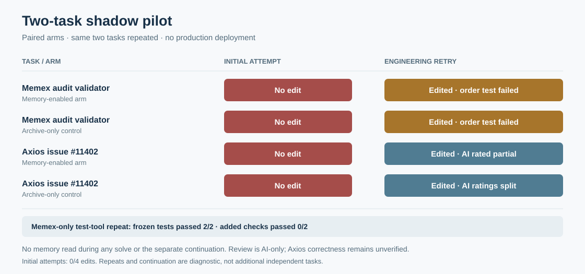

# Two-task prospective shadow pilot — 2026-11-01

Two actual engineering tasks were attempted in isolated paired conditions. **The first four attempts produced no requested edits; a diagnostic retry produced four edits, but both Memex validator candidates failed a frozen test and the Axios edits remain unverified.** A further Memex-only repeat with a test tool passed the frozen checks in both arms, but both candidates failed newly added cases. A later fresh session did not use the available Memex tools. The work found and repaired an actual audit-validator defect, but it does not establish a production accuracy gain, cost saving, or autonomous memory management.

[Aggregate data](assets/benchmarks/production-forward-pilot-20261101.json) · [Initial registration](assets/benchmarks/production-forward-pilot-20261101-initial-registration.json) · [Retry registration](assets/benchmarks/production-forward-pilot-20261101-retry-registration.json) · [Test-tool registration](assets/benchmarks/production-forward-pilot-20261101-test-tool-registration.json) · [Previous prospective canary](production-prospective-canary.md)

## Tasks and design

| Task | Source and frozen acceptance criteria | Scope |
|---|---|---|
| Memex audit | The user's ongoing request to correct autonomy-review citations, at Memex commit [`9570413`](https://github.com/QiuXu-Tech/memex/commit/957041355bd94fd09b8a023b0c4e92a8dcf60d8f). Change only `scripts/pilot_citations.py`; preserve existing citation tests; reject write-only claims; accept only a same-ID successful earlier write followed by a successful open or pager inclusion and answer citation; reject failed, unrelated or out-of-order actions; preserve no/unknown behavior. | Selected real conversation excerpts were replayed. This is a shadow of real maintenance, not a live long-running production session. |
| Axios documentation | Open [issue #11402](https://github.com/axios/axios/issues/11402), at Axios commit [`9d11464`](https://github.com/axios/axios/commit/9d11464a75ee5c644c0308d742f58755c0482594). Change only `README.md`; explain `proxy: false` and agent `proxyEnv` in agreement with the adapter without generalizing across unsupported versions or custom agents; explain how to retain agent proxying; add no actual credentials or proxy addresses. | Public open-source shadow task; the short issue discussion already contained proposed guidance. No change was submitted to Axios. |

The task definitions, a Memex regression verifier, source snapshots, seed and order were recorded before the first model calls. The initial registration was written at 03:59 UTC, with SHA-256 `cd51abcb29e9319d54548a933330140b6b5e21906cafdf8dc55d53055dffb9df`. The local registration is not independently timestamped. Private conversation excerpts, raw traces and patches are retained locally and are not included in this public report; consequently an external reader cannot fully reproduce the private task from the public aggregate alone.

Both arms used `deepseek-flash`, the same repository snapshot, task prompt, archive search/open and constrained repository tools. The memory arm also received a fresh Memex store and a model-driven intake of earlier history before the task; the control could search the same archive during the task. This extra intake is an unequal exposure and has a cost. Within each task the arm order was randomized with the frozen seed; by chance, the memory arm ran first for both. Tools were limited to reading, searching and an exact replacement of the designated file; model-produced code was checked separately in a network-disabled sandbox. This was a custom constrained agent, not the Codex product.

Two AI models, `gpt-6.1-sol` and `claude-haiku-4-5`, reviewed anonymized answers and patches against 0/1/2/unknown anchors. `deepseek-flash` adjudicated the observed substantive or score disagreements. These are AI assessments, not human labels; all calls went through one gateway and upstream independence is unverified. Anonymization cannot prevent answer content from revealing its condition.

## Initial attempts and engineering retry

All four initial solves used their six-round tool budget and ended with a nonempty explanation, but **none changed the requested file**. Both blinded reviewers gave every attempt delivery **0/2**, analysis **1/2**, and no apparent side-effect concern **2/2**. The Axios analyses mixed up preserving `proxyEnv` proxying with constructing an agent without `proxyEnv`; an additional AI adjudication recorded that substantive issue. Returning an explanation after the tool limit is therefore not counted as task completion.

After observing this failure, an explicitly separate retry on the **same two tasks** added a remaining-round reminder for both arms, allowed eight solve rounds and adjusted the intake/output limits. Its [registration](assets/benchmarks/production-forward-pilot-20261101-retry-registration.json) was recorded before those retry calls. This is an adaptive engineering diagnosis, not another independent sample.

| Task and arm | Retry result | Two blinded AI delivery ratings |
|---|---|---|
| Memex, memory enabled | Edited; frozen verifier failed the open-before-write control | 1, 1 |
| Memex, archive control | Edited; frozen verifier failed the open-before-write control | 1, 1 |
| Axios, memory enabled | README edited; reviewer identified an overbroad claim | 1, 1 |
| Axios, archive control | README edited; reviewers disagreed about completeness | 1, 2 |

Both Memex candidates collected writes and reads independently, allowing a read before the write to support a positive claim. The frozen verifier failed both candidates in the isolated sandbox. For the Axios control, the adjudicator gave **2/2**, but source inspection still found that the prose generalizes agent-copy behavior beyond the adapter's transport instance, protocol and own object-valued `proxyEnv` checks. The AI rating is retained as an opinion; full acceptance or maintainer approval is **unverified** for both Axios edits.

An investigator then repaired the Memex validator outside the A/B runs: it requires the same recorded ID to be written in intake, subsequently opened in the answer phase or included by the pager, and cited by the answer before accepting `answer_used_prior_write: yes`. The pre-existing source and both model candidates failed the frozen verifier; the investigator repair passed it and the existing citation regression. This checks trace linkage, not semantic fidelity. The change is in this repository's audit script and tests; it is not counted as an agent trial success.

## Fixed test-tool canary on the same Memex task

The previous agent could edit a file but could not run its acceptance tests. A further [registered diagnostic](assets/benchmarks/production-forward-pilot-20261101-test-tool-registration.json) gave both arms the same fixed `repo_test` tool: it copied the candidate into a network-disabled VM sandbox and ran only the original frozen verifier and existing citation test. Both arms started from the original source. Each first ran the test and failed the ordering case, revised the file, and then passed; a separate post-run execution also passed **2/2** candidates. Neither solve called a memory tool, and the memory arm wrote no record in its intake.

The [blinded review plan](assets/benchmarks/production-forward-pilot-20261101-test-tool-review-plan.json) retained both AI opinions. One reviewer gave each candidate delivery **2/2** and the other **1/2**, identifying missing-citation bypass, substring ID matching and failed-pager handling; it also identified a false rejection in the control. Four **post-hoc**, sandboxed checks were then added to investigate these claims:

| Post-hoc check | Memory candidate | Control candidate | Investigator repair |
|---|---:|---:|---:|
| Reject a positive claim with no memory IDs when `require_memory` is false | Fail | Fail | Pass |
| Reject `mem_abcd` as a citation of `mem_abc` | Fail | Fail | Pass |
| Reject a failed pager event as evidence | Fail | Fail | Pass |
| Accept a valid later open after an earlier out-of-order open | Pass | Fail | Pass |

The adjudicator assigned both candidates delivery **1/2** based on those gaps. The adjudicator was also the solver model; the original reviews and all test failures remain recorded. The investigator repair passed **4/4** additional cases, which have also been added to the repository regression test. The model saw failures from the frozen verifier, so passing those cases is useful tool feedback but not a held-out generalization result. The test tool was used by the isolated custom pilot, not integrated into Codex or a production agent.

## Memory actions and fresh-session continuation

During initial intake, the Axios memory arm wrote two records and made one invalid write call; the Memex audit arm wrote none. During the retry, the Axios memory arm wrote two records and the Memex audit arm again wrote none. No solve in either round or in the later test-tool canary called a Memex read tool. A write receipt is not evidence that the record was later retrieved or used.

After the retry, a separately registered adaptive continuation asked fresh sessions to review the same Axios control candidate against source. The treatment received a copy of its two previously model-written records and could choose the memory tools; the control had the same archive and repository tools. Neither answer session was instructed to invoke memory. **The treatment made zero memory-tool calls.** A manual positive control after the experiment opened both records in another MCP process with the same workspace scope; that verifies accessibility, not autonomous retrieval. The two continuation attempts are follow-ups to the same task, not additional tasks.

The two blinded reviewers both scored the continuation control **2/2** and the memory-enabled answer **1/2** on their review rubric, but cited different reasons. A supplemental adjudication with the complete hook list found that the memory-enabled answer omitted one hook and misstated where the Node-support qualifier appeared. One reviewer also miscounted its own list, and the first review packet had omitted part of the list. The adjudicator was the solver model, so this does not resolve the matter as independent human review. The treatment did not read its memory, and the small, adaptive example cannot establish a Memex effect.

## Usage, billing and failures

The gateway logs retain every attempt, including failed responses; explicit 503 responses alone were retried with bounded backoff. Each stage's successful responses matched the account's visible billing rows by stage, model and aggregate input/output tokens, including Claude cache-creation tokens. The account view did not establish a per-request receipt match, so the amount is a **candidate matched subtotal**, not a reconciled invoice.

| Stage | Successful requests | Explicit 503 attempts | Reported input tokens | Reported output tokens | Candidate billed subtotal |
|---|---:|---:|---:|---:|---:|
| Initial attempts, two reviews and adjudication | 39 | 7 | 303,911 | 8,198 | $0.023934 |
| Engineering retry, two reviews and adjudication | 38 | 2 | 237,583 | 9,365 | $0.015702 |
| Fresh-session continuation, two reviews and adjudication | 19 | 0 | 144,824 | 4,875 | $0.012490 |
| Test-tool canary, two reviews and adjudication | 28 | 2 | 202,905 | 5,766 | $0.012942 |
| **Total** | **124** | **11** | **889,223** | **28,204** | **$0.065068** |

The gateway reported 420,096 cached input tokens, included in the input total; the continuation also reported 5,184 Claude cache-creation tokens, likewise included in input. The 503 responses exposed `system_cpu_overloaded` but supplied no usage; the issuing upstream, its actual CPU state and final charges for failed requests are **UNKNOWN**. Other compute, storage, historical context preparation, engineering and review labor, subscription costs, and total cost per independently verified success are **UNKNOWN**. These numbers do not establish a cost saving.

## Interpretation and next step

This small feasibility run revealed tool-budget exhaustion, gaps in model-generated fixes and the original verifier, no observed autonomous read, and AI-review limitations. It improves the audit checker and preserves a low-cost record of the failures. It does **not** complete the requested 30–50 independent, evaluable prospective production tasks: the two sources are a selected replay and a public shadow task, and the other attempts repeat them.

The next useful step is to bring the fixed sandbox test capability and the expanded checks to the intended agent runtime, then verify an unprompted write → later read → answer-use sequence across genuinely separate sessions. Register new distinct tasks before execution, retain both arms and failures, and continue billing reconciliation and blinded review. Do not change the default memory policy based on these two tasks.
