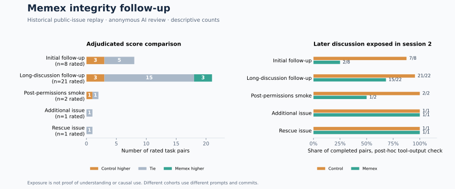

# Archive integrity and real-issue follow-up

The initial eight-task randomized replay and AI blind review are complete. A separate 25-task long-discussion follow-up is registered and running. Neither is a live production benchmark or a demonstration of a correctness gain or cost saving.

[Results and per-task statuses](assets/benchmarks/production-integrity-followup-20261102/results.json) · [Initial registration](production-integrity-20261102-registration.html) · [Long-discussion registration](production-long-integrity-20261102-registration.html) · [Post-review label unblinding](assets/benchmarks/production-integrity-followup-20261102/packet-unblinding.json) · [Initial allocation unblinding](assets/benchmarks/production-integrity-followup-20261102/first-allocation-unblinding.json) · [Candidate review-wallet matches](assets/benchmarks/production-integrity-followup-20261102/first-review-wallet-matches.json) · [Solver account-window context](assets/benchmarks/production-integrity-followup-20261102/first-solver-wallet-window.json) · [Repair details and limitations](archive-integrity-20261102.html)

During the later long-discussion run, a separate [single 8-output-token-cap diagnostic](assets/benchmarks/production-integrity-followup-20261102/anthropic-route-diagnostic.json) to the same Claude model route timed out after about 26 seconds without an HTTP status. It was not retried and its actual charge is **UNKNOWN**. A separate [DeepSeek review-route diagnostic](assets/benchmarks/production-integrity-followup-20261102/review-route-diagnostic.json) succeeded in 2.5 seconds with 7 input and 2 output tokens; one matching wallet row displayed **$0.000002**. These observations do not isolate the gateway, upstream model or network as the Claude timeout's cause.

The same Anthropic-compatible endpoint returned [a small DeepSeek request](assets/benchmarks/production-integrity-followup-20261102/anthropic-deepseek-diagnostic.json), and an [isolated Claude Code + DeepSeek smoke](assets/benchmarks/production-integrity-followup-20261102/claude-code-deepseek-smoke.json) produced a response. Candidate wallet matches displayed $0.000006 and $0.000094 respectively. These diagnostics are outside the randomized study; a successful small request does not guarantee sustained tool-calling reliability.

## Repairs and tests

The changes protect compaction completeness and retry, private transcript capture, workspace/session scoping and existing Claude and Codex configuration. A later POSIX repair makes SQLite and its active sidecars owner-only, including when the store root already existed with broader permissions. Source-event JSON can be reconstructed with paged `memory_open`, including a single oversized line; externally referenced attachment bytes are not guaranteed to be captured. An interrupted configuration file replacement leaves the old file intact, although separate configuration files are not one transaction. Claude's MCP process still lacks a verified automatic binding to the hook's private L2 session. [Details](archive-integrity-20261102.html).

On Node 25.9, the offline harness passed **196/196**, SQLite consistency and process-interruption recovery passed **37/37**, the integrity and isolation suite passed **33/33**, and bundle parity passed. Codex CLI `0.166.0-alpha.5.1` also recognized the generated MCP entry in an isolated configuration directory; that check made no model call. These checks cover exercised cases, not power-loss durability or every possible host failure.

## Initial eight-task replay

Eight issues from distinct organizations were selected after prior cohorts and registered before solver calls at commit `af610afa30a77e56f69bc1379ebd76b66760e6f4`. Each randomized pair used two distinct Claude Code 2.1.283 sessions per arm with `claude-haiku-4-5` through the configured gateway. Both arms could inspect the same pinned public source, staged discussion and their own prior handoff; only the treatment also had Memex hooks and MCP. All **8/8** pairs completed. Fourteen of 32 sessions needed the registered tool-free continuation after exhausting their initial client list-price budget. Two unavailable-tool attempts were recorded; no incomplete sessions were discarded.

Two AI reviewers, GPT-6.1 Sol and DeepSeek Flash, scored anonymous second-session triage on a frozen 0–2 rubric. Their numeric scores differed for **8/8** tasks; Gemini 3.8 Flash supplied a valid adjudication for each. After adjudication, control scored higher on **3/8**, the arms tied on **5/8**, and Memex scored higher on **0/8**; the mean control/Memex score was **1.125 / 0.750**. This is a small descriptive sample and AI review is not human evaluation. Candidate labels were randomized and obvious Memex names removed, but wording could reveal the condition. Salts and labels were published only after review; raw packets and issue snapshots are retained privately.

In a post-hoc tool-output check, the second session received a later-discussion comment or search excerpt in **7/8 control** and **2/8 Memex** tasks. This records exposure, not whether the model understood or used the text, and does not establish why the answers differed. It motivates the hypothesis that a recalled handoff can leave later discussion underchecked; this cohort does not test that mechanism causally. Three Memex tasks had an observed successful agent write and a later open of that record; all eight had an automatic first-session Stop checkpoint and a later open. A write/open chain demonstrates the mechanism, not the necessity, correctness or causal effect of the memory.

## Usage and costs

The Claude client's reported list prices for the eight completed pairs total **$1.200828 control / $1.479450 Memex**. These are list-price telemetry, not gateway charges. A session-level input total that reconciles with the streamed messages exists for only **1/8 pairs** because budget-exhausted attempts report incomplete cumulative usage; the remaining session totals are **UNKNOWN**. For that one pair, input including cache creation and cache reads was 127,803 / 149,792 tokens; it is not a cohort-wide estimate.

As a separate diagnostic, summing the usage on 383 distinct recorded assistant messages gives **2,152,596 control / 3,007,254 Memex input tokens** (+39.7%), including cache creation and cache reads. The count and combined uncached/cache-input totals exactly equal the visible account-wide rows for the solver's model and time window. This aggregate check is not a per-request or per-arm gateway match and cannot rule out unrecorded or failed calls; it does not replace the unknown session totals or establish a production-wide overhead.

All 24 successful AI-review calls uniquely matched visible wallet rows by model, input/output counts and completion time within three seconds, totaling **$0.091542**. This is a candidate match, not request-ID proof. Separately, the visible account-wide Claude Haiku entries in the solver time window totaled **$0.294406 across 383 distinct displayed row texts**. The aggregate token cross-check described above supports this as a candidate window, but it can include other activity, omit rows as pagination shifts or collapse identical entries; it is not attributed per arm or asserted as the study's solver bill. The solver's actual allocated wallet cost, other account activity, infrastructure and labor remain **UNKNOWN**. Review usage by model and all session statuses are in the machine-readable results. Client per-session limits may be exceeded by an in-flight request before it stops.

## New long-discussion cohort

The 25 additional public issues have distinct repository owners absent from the earlier cohorts, a discussion span of at least seven days, source hashes and task-specific acceptance criteria published before calls. Two initial tasks run before the remaining 23. The revised prompt tells both arms to use targeted lookups and stop when evidence suffices; it was selected after earlier results and before these runs. The separate cohort uses commit `c47e4456451d3e9990be40ce52bfbe6fda6cc7cc`, so its results must not be pooled with the initial eight as though they used one fixed protocol. The Codex configuration and POSIX SQLite permissions repairs were made later and are not evaluated by these Claude runs; the tested Claude, MCP and core source hashes remain frozen. Its outcomes, incomplete tasks, blind-review failures and cost gaps will be added after verification.

The task discussions are historical public material that models may already know, and pinned code may postdate comments. Compressed read-only triage does not ship a patch or prove that an issue is resolved. The private source snapshots are preserved by hash; this page does not make their full contents public.
