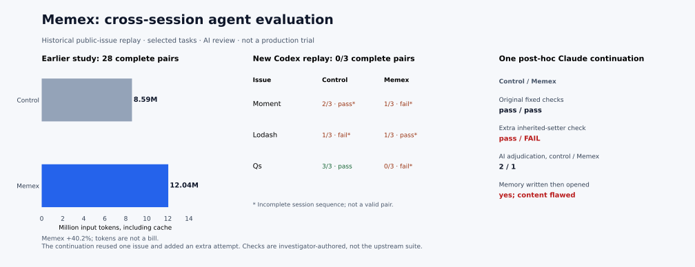
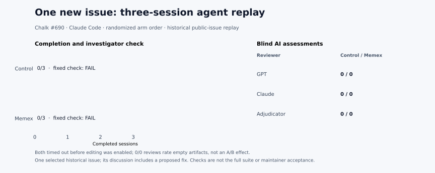

# Agent memory overhead and three-session issue replay

**Result: no complete new randomized pair; one post-hoc Claude Code continuation exposed a compatibility regression.** This is a small historical replay, not evidence that Memex improves live production correctness or reduces total cost. The original attempts, budget failures, incomplete reviews and additional checks are retained. [Machine-readable results](assets/benchmarks/production-longhorizon-20261101/results.json) · [Original registration](assets/benchmarks/production-longhorizon-20261101/registration.json) · [Claude recovery registration](assets/benchmarks/production-longhorizon-20261101/claude-recovery-registration.json) · [Budgeted canary](assets/benchmarks/production-longhorizon-20261101/claude-capped-registration.json) · [Continuation](assets/benchmarks/production-longhorizon-20261101/claude-resume-registration.json)

## Why the previous study cost more

In the previous [30-issue study](production-real30-20261101.md), the 28 original complete pairs reported **8,588,215 control** versus **12,040,197 Memex** input tokens, including cached input: **40.2% more** for Memex. The difference appeared in both first sessions (3,931,298 versus 5,502,969) and second sessions (4,656,917 versus 6,537,228). Output was also higher in Memex. These are cumulative model-reported tokens, not a dollar bill.

All **28/28** treatment first sessions searched an initially empty store. In **26/28**, the second session opened both its ordinary handoff and a memory record; these are overlapping reads, not proof that the contents were identical or that source verification was unnecessary. Total second-session tool calls were nearly equal (475 control, 476 Memex), so extra calls alone do not explain the token difference. The added manual and tool schemas, longer outputs, different source-reading paths and model behavior are plausible contributors, but their separate causal contributions were not measured. Both arms were given ordinary handoffs, which may also limit the incremental value of a second memory copy.

The model-specific prompts also contradicted the shared manual: the Claude profile told the agent to search first and open a record, while the generic OpenAI and GPT-6.1 profiles directed a search/open sequence even when a preview or existing context could suffice. That is a concrete instruction conflict; these observations do not establish that it caused the measured 40.2% difference.

The prior adjudicated investigation scores did not favor Memex (the sensitivity view was 27 ties and 3 control-higher cases). The two unflagged control-higher cases omitted particular rubric details in the Memex answers; AI scores do not establish why the omissions occurred.

## Repairs

- The MCP initialization now reports an **empty visible archive as a snapshot** and warns that other sessions or later writes may change it. Visibility includes cold and superseded records and respects workspace and session scopes.
- The manual distinguishes already-available context, avoids unchanged duplicate writes and directs the agent to save new durable information needed later. It no longer tells a model to open a record when a focused preview is sufficient.
- After a real replay searched an empty archive and then called both grep and index, the MCP search response was corrected: a currently empty visible archive no longer recommends those fallback searches; a miss in a nonempty archive still can. The last response change was made **after** the original and budgeted first attempts; it was present during the post-hoc continuation.
- The Claude, generic OpenAI and GPT-6.1 model-specific hints now agree with the shared guidance: search for unavailable earlier context, use a sufficient preview, and open a record only if needed. The manual also asks agents to mark unverified hypotheses and verify consequential remembered conclusions against current source or tests. These are instructions, not an enforcement or correctness guarantee. The changes were made **after** the Chalk attempt below and have not been evaluated in a completed agent pair.
- A pilot result helper now distinguishes a completed Codex turn from an exit-time timeout. The original preregistered process-based classification is preserved below; the helper is used as a supplementary observation, not to rewrite the original outcome.

The final offline integration suite passed **187/187**, the SQLite consistency suite **36/36**, and bundle parity passed. These tests verify the specified behavior; they do not prove an agent will follow the guidance or that total token use will fall.

## Three new real issue replays

Three distinct open issues from different project owners were selected after reproducing their bugs. Each arm was assigned up to three separate ephemeral Codex processes, its own ordinary handoffs and an isolated source copy; the treatment additionally had Memex. The pinned current source was held fixed while historical issue comments arrived in stages. The agent could edit the assigned source and run the same investigator-authored checks in sessions 2 and 3. Source views are partial, and the Moment view uses its generated distribution file. The checks are **not** the full upstream suites or maintainer acceptance.

| Issue | Control: completed sessions / fixed check | Memex: completed sessions / fixed check | Strict complete pair |
| --- | --- | --- | --- |
| [Lodash #6112](https://github.com/lodash/lodash/issues/6112) | 1/3; fail | 1/3; pass after incomplete session | No |
| [Moment #4127](https://github.com/moment/moment/issues/4127) | 2/3; pass after process timeout | 1/3; fail | No |
| [qs #387](https://github.com/ljharb/qs/issues/387) | 3/3; pass | 0/3; fail | No |

**0/3** original pairs completed under the registered process-exit rule. In the Moment control's third session, a final answer and `turn.completed` with usage were recorded before process shutdown timed out; this is a completed model turn with an abnormal process ending, not a normal process success. Four other timed-out turns lacked a completion/usage event. Codex logs showed intermittent TLS/response-stream interruptions; the local sandbox checks did return. The agent-produced patches and their test results are retained even when their session sequence was incomplete.

Two blinded AI reviewers and an adjudicator scored all three pairs of available artifacts, but **none are complete randomized three-session pairs**. The scores therefore describe partial artifacts, not a treatment effect. A post-hoc inherited-setter test then found that the Lodash Memex candidate changed assignment semantics despite passing the original fixed check. The original two reviewers and adjudicator had all rated that candidate 2. The supplemental test is a separately registered compatibility check, not an original primary criterion. [Review plan](assets/benchmarks/production-longhorizon-20261101/review-registration.json) · [Setter check](assets/benchmarks/production-longhorizon-20261101/posthoc-setter-registration.json)

## Claude Code budgeted canary and continuation

Because the Codex pairs were interrupted, a separately registered Claude Code replay was attempted on the same three issues. Three first sessions reached the client list-price budget without a final response; two other streams were interrupted to limit spending. The raw streams and missing usage are retained. A subsequent one-issue Lodash canary used fresh randomized workspaces and asked both agents to keep tool use shallow; this limit was **advisory**, and one session exceeded it. The control completed 3/3 sessions, while the Memex arm reached its budget in session 2. [Recovery](assets/benchmarks/production-longhorizon-20261101/claude-recovery-registration.json) · [Canary](assets/benchmarks/production-longhorizon-20261101/claude-capped-registration.json)

The treatment was then continued in the same isolated workspace under a separately registered higher per-session client budget. Both final candidates passed the original fixed checks. The extra inherited-setter check **passed for control and failed for Memex**: the Memex patch used `defineProperty` for every property, preventing an inherited setter from running. Its final answer nevertheless described the change as low risk. The control patch was narrower; other inherited property names and the full upstream suite remain unverified.

In the continued treatment, the agent wrote a decision in one process and searched and opened that same record in the next. The final answer did not cite its ID, and the recorded decision itself contained the flawed broad fix. Thus the observed write → open chain does not establish a correct memory, causal necessity, or reliable autonomous memory management.

For the resumed artifacts with the supplemental test included, GPT assigned **control 2 / Memex 1**, Claude **2 / 2**, and the adjudicator **2 / 1**. These are AI assessments of one reused issue with an unequal extra attempt, not independent human review or a valid population effect. The prior blind opinions remain recorded. [Blind review registration](assets/benchmarks/production-longhorizon-20261101/claude-resume-review-registration.json)

Across the canary and its continuation, reported input including cache creation and cache reads was **99,745 control** versus **194,086 Memex**, including the failed Memex session and its retry. The extra attempt and selected single task prevent interpreting this as a general overhead estimate. Claude's internal list-price totals and the gateway's discounted charges are different measures.

## Additional new Chalk issue replay

A fourth, independently selected public issue, [Chalk #690](https://github.com/chalk/chalk/issues/690), was registered with source commit `72110019e147683f60e13fa0ff5c14a0c27cd9fe`, randomized arm order and investigator-authored ANSI mapping checks before execution. The public discussion includes a proposed fix, so prior exposure is possible. Historical comments were staged into three fresh Claude Code sessions per arm in isolated workspaces. The limits of eight tool calls in session 1 and twelve in later sessions were instructions, not an enforced cap; memory calls counted against the same advisory limits. This selected historical replay is not a live production trial. [Registration](assets/benchmarks/production-longhorizon-20261101/chalk-registration.json) · [Fixed check](assets/benchmarks/production-longhorizon-20261101/checks/chalk/verify.js) · [Allocation](assets/benchmarks/production-longhorizon-20261101/chalk-allocation.json) · [Results](assets/benchmarks/production-longhorizon-20261101/chalk-results.json)

Both arms timed out after 180 seconds in their first session and reported no final usage. Editing was not enabled until session 2, so neither arm produced a patch; the pre-existing source failed the fixed check in both workspaces. The treatment searched the empty archive once and did not call grep or index, but its session never finished. Neither arm reached a later process, so **no complete pair or cross-session memory-use comparison exists**. The gateway displayed individual requests taking 38–79 seconds and two canceled requests with upstream usage unavailable; the origin of the delay was not established.

Two blinded AI reviewers and the adjudicator each scored the empty artifacts **0/0**, with no material disagreement. This grades the absence of a fix and does not compare task-solving ability. Some review text extrapolates from the first failing assertion; the check stops at that first failure. The blind packet is retained locally; its hash and reviewer mapping are published, so the packet content itself is not independently inspectable from this report. [Review registration](assets/benchmarks/production-longhorizon-20261101/chalk-review-registration.json) · [Review key](assets/benchmarks/production-longhorizon-20261101/chalk-review-key.json)

## Usage and cost

The original Codex sessions reported **1,261,993 input tokens** including **1,088,000 cached**, and **7,728 output tokens**. Four timed-out turns reported no usage. The 15 completed AI review/adjudication calls reported **125,079 input / 3,681 output tokens** and matched candidate APIMaster rows totaling **$0.019720** by model, token counts and time; this is not receipt-level attribution.

For Claude Code solver calls, visible account-level rows in the three relevant time windows totaled **$0.054140** across 101 charged rows. Adding the review candidates gives **$0.073860**. The solver subtotal is a time-window candidate, not individually matched attribution; unrelated account activity could be included. At least one canceled request is marked pending reconciliation; two interrupted Claude streams lack final usage. Codex subscription allocation, any unsettled calls, compute, storage and labor remain **UNKNOWN**. The full cost and cost per successful production task cannot be calculated.

The additional Chalk replay has four visible account-level solver charges totaling **$0.003380**, plus two canceled rows pending reconciliation. Three uniquely matched review rows total **$0.005998**, for a new candidate subtotal of **$0.009378**. Adding it to the earlier candidate subtotal gives **$0.083238**, not a complete invoice. The Chalk reviews reported **34,085 input / 688 output tokens**; both solver sessions lack final usage, and solver charges are only time-window candidates that could include unrelated activity. The two pending rows, previously pending amounts and all non-model costs remain **UNKNOWN**. [Cost details](assets/benchmarks/production-longhorizon-20261101/chalk-results.json)

## Interpretation

The empty-search fix has a targeted test, and neither the resumed agent nor the incomplete Chalk treatment chained grep and index after its empty search. That single adaptive case does not prove an overall token saving. The larger concern is memory fidelity: a retrieved record can repeat an incorrect implementation judgment unless the agent checks relevant controls. The current evidence does not justify enabling a more aggressive default or claiming improved production correctness, savings, or reliable unattended memory management. A useful next evaluation needs more new tasks with executable, independently reviewed acceptance and regression checks, stable agent connectivity, and full per-request costs.
