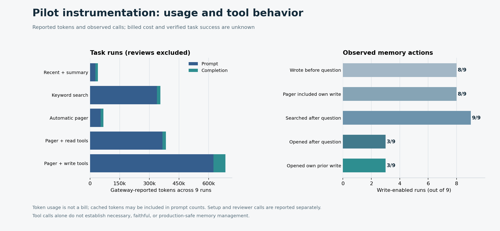

# Expanded retrospective Memex validation pilot — 2026-10-31

**Scope: exploratory historical replay, not production proof.** This follow-up repairs the pilot harness and tests nine real historical questions from three session snapshots across five randomly ordered conditions. The answers are reconstructed in isolated replay; no original project work was executed or independently accepted. Four questions appeared in the prior pilot and three others in an earlier replay; only two were previously unscored in these evaluations. The sources are correlated, convenience-selected sessions associated with the same user, not independent projects or a representative held-out sample. [Pre-outcome registration](production-pilot-expanded-registration.md) · [Previous pilot](production-pilot.md) · [Production validation protocol](production-validation-plan.md).

## Design and fixes

The answer model was `claude-haiku-4-5` via the existing APIMaster configuration. The five conditions were recent history plus summary, keyword search, automatic pager, pager with read-only tools, and pager with read/write tools. Each task used a fixed random condition order and an isolated store. At most two tasks were run concurrently; elapsed times include gateway latency and are not low-load performance measurements. The write-enabled arm began with an empty store and chose what to retain from earlier messages in chronological batches before seeing the question, whereas the read-only memory arms indexed the archive directly. This difference prevents attributing any score difference solely to the choice to write.

The fixed pilot runner bounds tool rounds. When the budget is exhausted, outstanding calls receive explicit **not executed** responses and the model is asked once for a tool-free final answer or an honest abstention. Exact repeated searches are reused until a write attempt; identical writes are blocked after a successful or ambiguous attempt within the same tool-loop invocation. The cache and write guard reset between intake batches. These changes apply to the **pilot harness**, not a claim that all production agents or runtimes have been fixed. Regression tests exercise the cap and forced finish, denied actions, cache invalidation and ambiguous-write protection.

Reviewer requests now disable DeepSeek thinking, request explicit JSON, and classify empty, truncated, malformed or schema-invalid responses instead of equating HTTP success with a usable rating. Three synthetic and three previously seen real-answer diagnostic calls yielded six structurally usable results, with zero reported reasoning tokens; these are development probes, not scores for the expanded trial. Two AI judges independently rated anonymized complete answers against clipped historical evidence, using explicit 0/1/2 anchors or UNKNOWN for correctness, coverage and support. Answer or evidence content can still reveal the condition. Each submitted source ID was validated separately. The user's choice was AI review; there are **no human ratings**.

Time-cutoff checks cover all nine questions, including the third session's immutable snapshot: retained archive messages, summaries and recent tails all precede the question. Up to 40 earlier messages were retained per task, each clipped at 1,800 characters for the tested archive; reviewers saw at most 1,000 characters per message. [Temporal verification](assets/benchmarks/production-pilot-expanded/temporal-verification.json). An [exact-string audit](assets/benchmarks/production-pilot-expanded/intake-verification.json) found zero future-question matches in 94 write-arm intake requests; this cannot rule out semantic leakage. Session duration includes idle time. Source conversations, answers, traces and review reasons remain private.

## Execution and blind assessment

All **45/45 assigned runs** have traces: **41** produced complete nonempty responses and **4** were truncated. Nine answer phases reached the tool-round cap; the tool-free fallback produced eight complete answers and one truncated answer. Eight intake phases also reached the cap; seven produced complete fallback responses and one was truncated. No exact duplicate read or write was encountered in this sample, so the protections are established here by regression tests, not by a positive real-history observation.

| Condition | Complete answers / attempts | Truncated | Astra correctness 2 / 9 | DeepSeek correctness 2 / 9 |
|---|---:|---:|---:|---:|
| Recent + summary | 7/9 | 2 | 1 | 2 |
| Keyword search | 8/9 | 1 | 2 | 4 |
| Automatic pager | 8/9 | 1 | 2 | 4 |
| Pager + read tools | 9/9 | 0 | 1 | 3 |
| Pager + write tools | 9/9 | 0 | 2 | 3 |

The last two columns are **individual AI ratings**, not verified success rates; the denominator includes missing and invalid ratings. See the figure and [aggregate](assets/benchmarks/production-pilot-expanded/aggregate.json) for UNKNOWN counts and full 0/1/2 distributions. The two judges gave non-null correctness ratings for the same 36 answers and agreed exactly on **17/36**. No ranking or generalizable gain can be inferred from these small, correlated data and imperfect agreement.

For the 41 complete answers, all **82/82** planned blind calls returned; **79/82** passed schema and source-ID validation. DeepSeek produced **41/41** valid ratings with no empty responses; Astra produced **38/41**, with three invalid JSON responses. Unlike the previous pilot, no replacement judge was added. The earlier DeepSeek failure was 16 empty responses in 17 calls; the new result is a useful operational diagnostic, but it uses expanded, reused samples and a revised rubric, not a controlled product-effect estimate.

Of the four questions shared with the previous pilot, all 20 matched condition pairs had a complete answer in this run, including the three pairs that had previously ended at the tool-round limit. This descriptive [overlap audit](assets/benchmarks/production-pilot-expanded/overlap-verification.json) is not a randomized before/after comparison. No calls were silently retried to obtain these outcomes.

## Autonomous memory observations

In **8/9** write-enabled runs, the agent wrote **13** records before the question, and the pager later included at least one of its own prior records in each of those eight runs. In **3/9**, it searched, opened and cited its own earlier written record. Two further writes occurred after the question. None of the 13 earlier write bodies was an exact full-string copy of a retained prior message; that does not establish whether paraphrases were faithful. Six of nine runs had an intake problem, and 21 intake model calls recorded a length finish; a complete final answer therefore does not imply complete memory preparation.

The separately planned, **unblinded** AI lifecycle audit produced **8/18** valid results: nine responses cited IDs outside the supplied evidence and one request failed. Valid results still include subjective and sometimes conflicting model judgments; they cannot establish faithful or necessary memory management. The audit checks all successful writes, including answer-stage writes; a post-registration correction to the aggregate validator fixed a mistaken rejection of the latter and has its own regression test. Tool behavior demonstrates that an agent can perform a limited write → retrieve → cite sequence in this isolated harness, not that it can manage memory reliably in production.

## Usage and cost gaps

The gateway-reported usage below includes every captured trial, review, audit and diagnostic call in this follow-up. The six diagnostics are separate from the registered experiment. The [ledger](assets/benchmarks/production-pilot-expanded/ledger.json) contains missing-field counts, response models, request/response bytes and additional details; raw calls remain private.

| Category | Calls | Prompt tokens reported | Completion tokens reported |
|---|---:|---:|---:|
| Answer and prior-history intake | 225 | 1,410,416 | 121,324 |
| Blind answer reviews | 82 | 763,988 | 27,290 |
| Unblinded autonomy audits | 18 | 219,026 | 4,467 |
| Synthetic development probes | 3 | 4,211 | 108 |
| Prior-answer development probes | 3 | 12,067 | 560 |
| **Total** | **331** | **2,409,708** | **153,749** |

One failed audit did not report prompt or completion usage; cache details were missing for 39 calls. Known cached prompt tokens are 266,496 and may already be included in prompt totals; 10,418 reported reasoning tokens are completion-token details. Missing values are not assumed to be zero. Request/response bytes exclude protocol overhead and one failed response's bytes are unavailable. Gateway metering has not been reconciled to an invoice. Actual charges, route-specific prices or discounts, historical ingestion and summary creation, local compute, network, storage and engineering costs remain **UNKNOWN**. Consequently cost per task, cost per verified success and savings are **UNKNOWN**. The [previous pilot's ledger](production-pilot.md#cost-and-resource-ledger) is separate; cumulative project-wide costs are not known.

## Verification and next evidence

Local build and source/bundle parity, the Node offline harness and SQLite recovery suite passed. Focused regressions cover the bounded loop, repeated read/write handling, reviewer request and validation, three-session extraction, worker tool contract, accounting and autonomy audit validation. The CI workflow runs these checks; the extraction test is conditional on `zstd` availability. The analysis-label and answer-stage-write validation corrections were made after registration without changing the answer or review requests; the earlier intermediate aggregate was preserved locally.

This study does not establish a production accuracy gain, cost savings, or reliable autonomous memory management. Stronger evidence requires prospective randomized tasks with independently verified deliverables, independent users/projects, complete metering and reconciled billing, meaningful memory-management safety and recovery criteria, and review appropriate to the original protocol. AI reviewers are not substitutes for its two independent human annotators. Until then no default strategy change is justified by this pilot.
