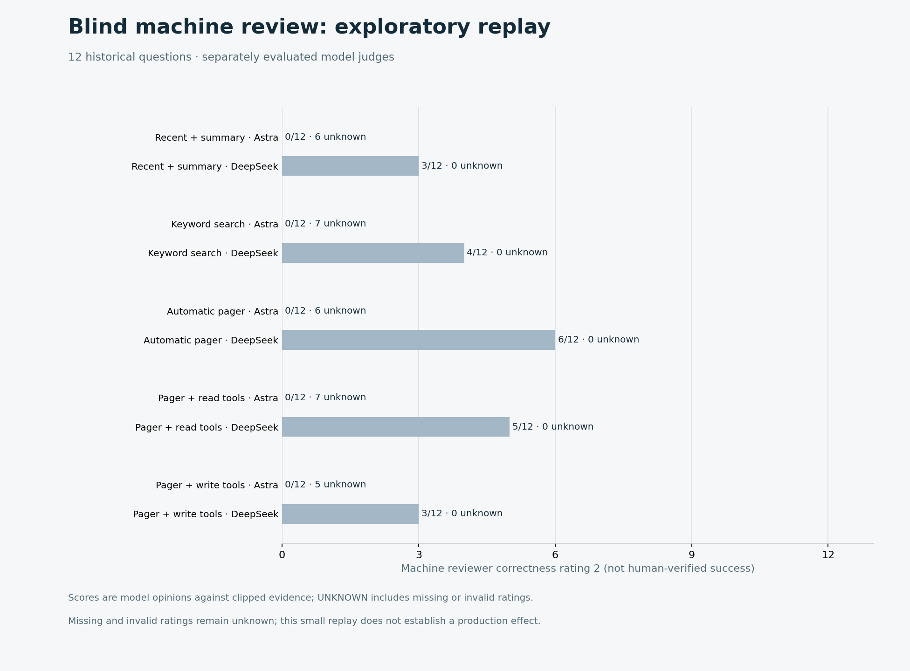
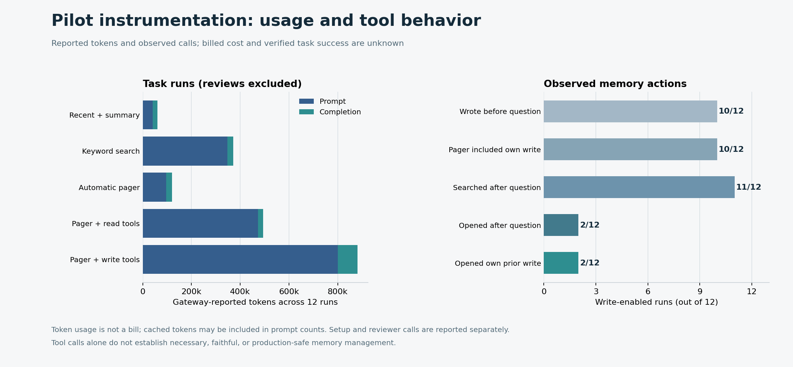

# Retrospective pilot follow-up — 2026-10-31

**This is an exploratory isolated replay, not proof of production value.** Twelve real historical questions were replayed in five conditions across six session snapshots; nine questions were reused from the previous pilot and three came from additional software-workflow, editorial and website-project conversations. The sessions are convenience-selected and associated with the same user. Historical requests for changes or deployment were not executed: the model could only answer with the available replay and memory tools. These are not independent users, verified task deliverables or a representative held-out production benchmark. [Pre-outcome registration](production-pilot-followup-registration.md) · [Previous pilot](production-pilot-expanded.md) · [Production validation protocol](production-validation-plan.md).

## Fixes and design

A diagnostic of the prior lifecycle audit found nine invalid reviews containing 15 invalid references; all 15 were memory IDs placed in the historical-evidence field. The new audit prompt and validator use separate namespaces: `supportingSourceIds` must be in the supplied earlier-history records, while `supportingMemoryIds` must have appeared in successful recorded memory actions or pager output. A memory ID is evidence of an action, not proof of the truth of a memory. Invalid IDs remain invalid; they are never silently mapped between namespaces.

All four prior truncated answers ended at a 2,500-token output limit. In the pilot harness, a response explicitly marked `length` now triggers at most two additional **tool-free** continuation calls, each limited to 2,500 tokens. Original segments are retained and concatenated; model errors, empty continuations, unexpected tool calls or an exhausted continuation budget remain non-success outcomes. No ambiguous tool action is automatically retried. A generated continuation can repeat, omit or contradict content despite ending normally; a complete finish alone is not verified correctness. The fix affects the replay harness, not all production agents or runtimes. Tests cover the continuation cap and denied tools, separate citation namespaces, fabricated IDs, and full audit aggregation.

All five arms use the same answer/continuation policy: recent summary, keyword archive, automatic pager, pager with read tools, and pager with read/write tools. Condition order is randomized within each task, task order is independently seeded, and at most two tasks run concurrently. The write arm receives time-prior historical messages in batches and starts with empty memory; the read-only memory arms index the archive directly. This initialization difference limits causal interpretation. Only the two preregistered AI models judge anonymous complete answers using explicit 0/1/2/UNKNOWN anchors against clipped earlier evidence; answer content may still reveal the arm. A separate preregistered unblinded AI audit reviews write-enabled traces. There are no human labels.

History and output remain private. The frozen source snapshots are checksummed, temporal cutoffs are verified for every task, and available credential patterns are checked before gateway calls. These checks do not establish that every sensitive value or semantic future hint was detected. Elapsed time includes gateway latency and parallel tasks; these are not low-load performance benchmarks.

## First cohort: gateway outage and preserved evidence

The preregistered first cohort recorded all 60 assignments, but only **28** finished with complete answers. Thirty-one ended with model failure and one with continuation model failure. Its 201 answer/intake model calls included four HTTP 503 responses and 46 other network errors (44 `URLError`, one disconnect and one timeout). Exactly one response reached the continuation path, but that continuation failed; the original partial segment was preserved. The outage continued across multiple tasks, making comparative condition outcomes uninterpretable. [Attempt and usage summary](assets/benchmarks/production-pilot-followup-first/attempts.json) · [Continuation check](assets/benchmarks/production-pilot-followup-first/continuation-verification.json).

The 28 complete answers received 56 blind AI calls; **52** passed format and source-ID validation. The separately planned unblinded autonomy audit received 24 calls; **23/24** passed format and both citation-namespace checks, and the remaining response was invalid JSON. None of the valid evaluations proves memory fidelity; some concern runs interrupted before the question. In particular, formal citation validity cannot be compared as an independently randomized product effectiveness result with the prior pilot's 8/18 audit results: samples, traces and schema differ. [Aggregate](assets/benchmarks/production-pilot-followup-first/aggregate.json).

The first cohort, its AI reviews, autonomy audits and three subsequent synthetic connectivity probes total **284 recorded calls**, with **1,520,037 prompt / 100,585 completion tokens reported**. Fifty failed calls did not report prompt or completion tokens; unknown tokens and charges are not treated as zero. [First-cohort ledger](assets/benchmarks/production-pilot-followup-first/ledger.json). The connectivity probes succeeded; after the outage was observed, a separate [replication was registered](production-pilot-followup-replication-registration.md) using the same questions, with a scheduler that stops launching further shards after a model/runner failure. This second run is not an independent sample and does not replace the first.

## Post-outage replication: execution

The separately registered, outage-triggered replication completed **60/60 assigned answer runs** with status `ok`. Six answers reached the output cap and each completed after one additional tool-free continuation. All returned segments were preserved; an exact suffix/prefix check found no overlap of 32 or more characters. This check cannot detect semantic duplication, omission, or contradictions. [Continuation verification](assets/benchmarks/production-pilot-followup/continuation-verification.json).

Of the 45 condition pairs on nine questions reused from the preceding pilot, the four that had previously been marked truncated all ended normally in this run; two used a continuation and two did not. Different model outputs and the post-outage rerun make this a descriptive [matched observation](assets/benchmarks/production-pilot-followup/overlap-verification.json), not a controlled causal comparison. None of these outcomes verifies an actual external deliverable. The 60 answer/intake runs involved **300 model calls** reporting **1,756,780 prompt / 169,430 completion tokens**, before reviewers and audits. [Attempt summary](assets/benchmarks/production-pilot-followup/attempts.json).

All retained records and tails precede their questions in the [temporal check](assets/benchmarks/production-pilot-followup/temporal-verification.json). An [exact-string check](assets/benchmarks/production-pilot-followup/intake-verification.json) found no future-question matches in 125 pre-question intake requests; it does not rule out semantic leakage.

## Replication: AI assessment and memory actions

The 60 complete answers received **120** planned blind-review calls. **92/120** passed response and historical-source-ID validation: DeepSeek produced **60/60** valid ratings; Astra produced **32/60**, with one invalid JSON response and **27 HTTP 403** responses. The provider did not supply a usable error explanation or usage for the 403s. There was no replacement reviewer and no retry; the 28 missing or invalid ratings remain UNKNOWN. Among the **29** answers for which both models gave non-null correctness scores, their scores agreed exactly on **15/29**. The 403s create nonrandom missingness and prevent a sound comparison across arms.

| Condition | Complete answers / attempts | Astra correctness 2 / 12 | DeepSeek correctness 2 / 12 |
|---|---:|---:|---:|
| Recent + summary | 12/12 | 0 | 3 |
| Keyword archive | 12/12 | 0 | 4 |
| Automatic pager | 12/12 | 0 | 6 |
| Pager + read tools | 12/12 | 0 | 5 |
| Pager + write tools | 12/12 | 0 | 3 |

These are individual AI opinions against clipped history, not verified success rates. Unknown ratings remain in the denominator; full distributions and valid counts appear in the [aggregate](assets/benchmarks/production-pilot-followup/aggregate.json). A small repeated convenience sample, AI disagreement and nonrandom missingness rule out a reliable correctness ranking or default-policy decision.

The planned, unblinded autonomy audit produced **24/24** responses satisfying schema and both citation-namespace checks. This addresses the prior formatting problem; it does not validate truth. For example, among 12 traces, Astra judged writes faithful in two and DeepSeek in eight, with other responses negative or unknown. In **10/12** write-enabled runs the agent wrote a total of 15 records before the question, and the pager included an earlier own write in those same ten runs. Two runs opened an earlier own write, but none both opened and cited that record. Six of 12 runs recorded intake problems and 30 intake model calls finished at the length limit. The ability to write or retrieve does not establish necessary, faithful or safe memory management.

After observing the 403 pattern, the reviewer scripts gained a tested per-model guard: after an explicit 403, later jobs for that reviewer are marked **not sent**, while other reviewers can continue. At most already-in-flight calls may finish. The ledger distinguishes planned-but-unsent jobs from sent calls with missing usage. This guard was added after the results above and was not used retroactively; all 27 original 403s remain recorded. No service restriction was bypassed.

## Combined usage and unknown costs

The ledgers retain both cohorts, including the three synthetic connectivity checks; there is no overlap between the two rows below. The first cohort's 50 failures and the replication's 27 denied reviewer calls did not return prompt or completion usage.

| Cohort | Calls sent | Prompt tokens reported | Completion tokens reported | Calls missing prompt/completion usage |
|---|---:|---:|---:|---:|
| First cohort, reviews, audits and three probes | 284 | 1,520,037 | 100,585 | 50 |
| Post-outage replication, reviews and audits | 444 | 2,890,068 | 215,788 | 27 |
| **Combined recorded minimum** | **728** | **4,410,105** | **316,373** | **77** |

The reported tokens are incomplete lower bounds, not an invoice. Known cached prompt tokens total **574,733**, potentially already included in prompt totals; cache details are missing for 145 calls. Request and response body bytes and local process/store measurements are in the [first ledger](assets/benchmarks/production-pilot-followup-first/ledger.json), [replication ledger](assets/benchmarks/production-pilot-followup/ledger.json), and per-arm aggregates; HTTP/TLS overhead and missing responses are excluded. Actual charges, route-specific prices and discounts, historic ingestion and summarization, engineering time, local compute, storage and network pricing are **UNKNOWN**. Thus actual cost per task or independently verified success, and any cost saving, remain **UNKNOWN**.

## Verification and limits

Regression tests cover tool-free continuation success and failure, partial-output preservation, guard against unexpected tool calls, two citation namespaces and fabricated IDs, multi-session time-cutoff extraction, ledger missingness, and halting new shards after a failed model call. The per-model 403 guard and its accounting tests were added after observing the replication's reviewer failures. Source and aggregate results were checked without publishing private questions, answers, model reasons or traces. The two independent calls per answer are machine judgments, not human labels. A stronger claim requires prospective diverse users and projects, verified real deliverables, complete reconciled billing and independent review under the [production validation protocol](production-validation-plan.md).
