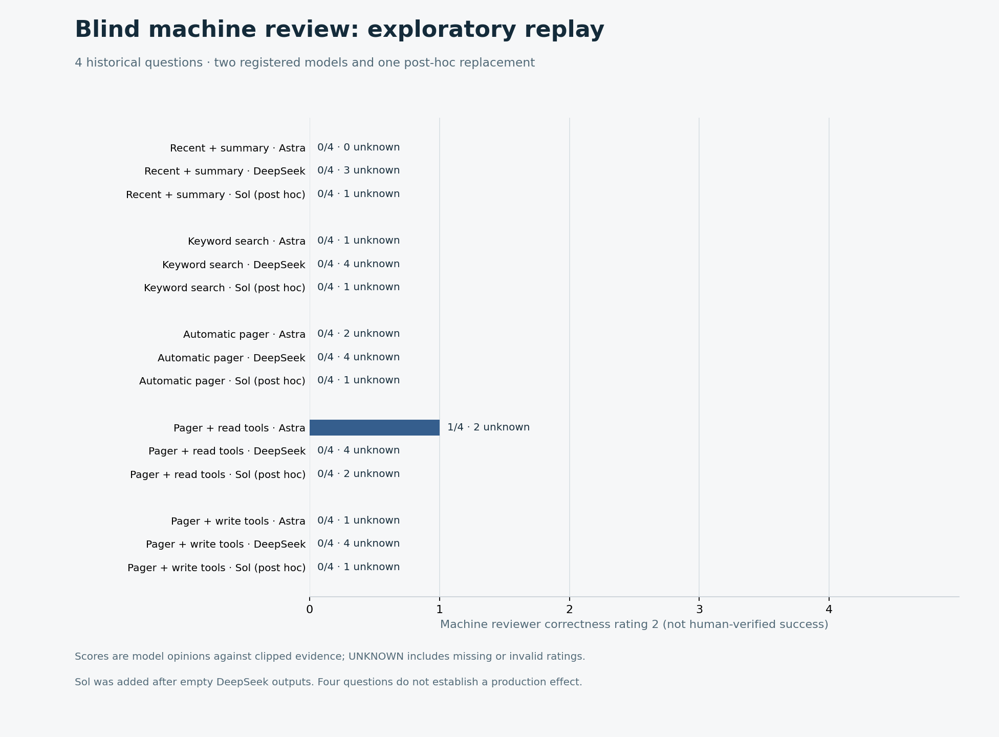

# Exploratory Memex production-validation pilot — 2026-10-31

**Status: retrospective instrumentation pilot, not production proof.** We ran five randomized conditions on four historical user questions from two sessions, including Memex-related work, using time-prior conversation and compaction summaries. The tasks were answered in isolated replay; they did not execute the original production work. Three questions share one session, the sample is convenience-selected, and these data cannot support a general accuracy or savings claim. [Registration and frozen design](production-pilot-registration.md).

## Design and limits

The questions occurred 43.47, 66.66, 68.83 and 191.37 hours after their session's first recorded event; these are elapsed wall hours, including inactive periods, not active working time. Up to 40 earlier user/assistant messages per question formed the archive, truncated to 1,800 characters per message; four preceding messages and the most recent time-prior actual compaction summary were supplied to all conditions. [Sequence and time verification](assets/benchmarks/production-pilot/temporal-verification.json) confirms that included records, tail messages and summaries precede the question. The model received no future question during intake; an [exact-string audit](assets/benchmarks/production-pilot/intake-verification.json) checked all 38 intake requests, but does not rule out semantic leakage.

The five conditions were recent history plus summary; simple keyword search/open; automatic Memex pager; pager plus read-only Memex tools; and pager plus read/write tools, starting with an empty agent-written memory. The write-enabled agent saw earlier historical messages in batches before the question and decided whether to store them. Other memory conditions indexed the same historical message archive directly. This initialization difference is material: the experiment does not isolate the causal or economic effect of autonomous writing. Condition order was randomly shuffled within each task using a fixed seed; all conditions used isolated stores and the same answer model, configured tool limits and current question. The registered manifest was hashed and [published before real-history calls](production-pilot-registration.md).

All **20/20 attempts** finished with recorded traces. Seventeen produced nonempty answers; three hit the predeclared tool-round limit: one keyword-search run and two read-only Memex-tool runs. These failures remain in the denominator. Nonempty text is an execution outcome, not a verified task success.

| Condition | Attempts | Nonempty answers | Tool-round-limit answers |
|---|---:|---:|---:|
| Recent + summary | 4 | 4 | 0 |
| Keyword search | 4 | 3 | 1 |
| Automatic pager | 4 | 4 | 0 |
| Pager + read tools | 4 | 2 | 2 |
| Pager + write tools | 4 | 4 | 0 |

The write-enabled group had at least one recorded intake problem in **3/4 runs**; nine intake model calls finished at the output length limit, and four intake tool-round-limit events occurred. A final answer can therefore be nonempty even though its earlier memory preparation was incomplete. There was no automatic retry. The five conditions have different preparation procedures and no verified success labels, so these numbers cannot establish comparative task correctness.

## Blind machine assessment

The user requested AI in place of human reviewers. For 17 nonempty answers, the preregistered GPT-6 Astra and DeepSeek Flash each received the same anonymized answer and clipped prior evidence independently, with no condition label or competing answer: **34 calls**. DeepSeek returned 16 empty bodies and one usable result, despite HTTP success; the empty calls consumed reported output tokens and were retained. GPT-6 Astra returned 14 usable results; three referred to IDs outside the supplied historical evidence. After observing repeated empty DeepSeek responses, GPT-6.1 Sol was added **post hoc** for another 17 anonymous calls: 14 usable and three with unsupported source IDs. This replacement was not part of the original registration and is separately accounted for. The 51 calls therefore yielded **29 usable ratings**, 16 empty bodies and six invalid source-ID ratings.

The original registered pair both produced usable ratings for only one answer. Astra and the post-hoc replacement both produced usable correctness ratings for 13 answers; their 0/1/2 correctness ratings agreed in seven and disagreed in six. One Astra rating was 2; the replacement gave no 2s. Missing or invalid ratings are **UNKNOWN**, not incorrect answers. The 0/1/2 prompt did not define detailed category anchors, and references were clipped to 1,000 characters per historical message; these weaknesses further limit interpretation. The models are not independent human annotators or a source of gold labels.

The full per-arm machine score distributions, validity checks and reviewer usage are in the [anonymous aggregate](assets/benchmarks/production-pilot/aggregate.json). They are exploratory model opinions, not a task-success rate. Twenty blinded audit rows were prepared locally and none have a human rating.

## Observed memory behavior

Of four write-enabled runs, **three** wrote a total of four records before the question; the fourth wrote none. The pager subsequently included an agent-written record in those same three runs. In **one** run the agent also searched, opened and cited its own earlier written record; another write occurred after a question. These are observed mechanical events, not proof that the memory was necessary, accurate or safe. The four pre-question write bodies were not exact full-string copies of the retained earlier messages; paraphrases may be valid or invalid, so their factual fidelity is **UNKNOWN** without substantive review.

A separate **post-hoc, unblinded** AI audit covered all four write-enabled traces with Astra and DeepSeek, then added Sol after the DeepSeek empty-output problem. Of 12 calls, only three produced schema-valid ratings tied to supplied historical IDs; four returned empty bodies and five used IDs outside that evidence list. Because this audit was post hoc, nonhuman and mostly invalid, it does not establish faithful autonomous memory management. The synthetic connectivity check is not counted as an autonomous real-history result.

## Cost and resource ledger

Gateway-reported usage, including unsuccessful and empty-output calls, is recorded without treating token counts as a bill:

| Category | Model calls | Prompt tokens | Completion tokens |
|---|---:|---:|---:|
| 20 task runs | 94 | 484,596 | 39,967 |
| Anonymous answer reviews, including post-hoc replacement | 51 | 481,468 | 61,771 |
| Post-hoc autonomy audits, including replacement | 12 | 133,567 | 11,812 |
| Synthetic connectivity checks | 6 | 11,316 | 417 |
| **Total observed** | **163** | **1,110,947** | **113,967** |

Known reported cached prompt tokens total 67,200, but a setup response did not provide cache details; cached tokens may already be included in prompt counts. Recorded request/response body bytes, timing, process CPU and final store bytes are in the [ledger](assets/benchmarks/production-pilot/ledger.json) and [per-arm aggregate](assets/benchmarks/production-pilot/aggregate.json). They exclude HTTP/TLS overhead and do not price resources. The gateway reported 4,262 prompt tokens for one synthetic reviewer check whose caller-side JSON request was 319 bytes; provider-side overhead or metering cannot be independently reconciled from the available data. This observation is not evidence of overbilling.

Actual invoices, route-specific prices and discounts, historical ingestion/summary creation, local compute and storage pricing, engineering work and human-review costs are **UNKNOWN**. Consequently, actual cost per attempt and per independently verified successful task are also **UNKNOWN**; no savings conclusion can be drawn. Gateway listings themselves state that channel prices vary; see [APIMaster pricing FAQ](https://apimaster.ai/blog/faq).

The host sampler collected 157 observations after the first run had already started: CPU busy ranged 14.2–41.82% and load1 2.16–5.05. Ninety-four individual samples met the earlier CPU/load threshold, but there was no per-run quiet-start gate or exclusive host. Latencies include gateway time and are not low-load performance claims. [Environment](assets/benchmarks/production-pilot/environment.json) and [load summary](assets/benchmarks/production-pilot/host-summary.json).

## Verification and next evidence

On Node 25.9.0 the repository offline harness passed **165/165**, SQLite consistency passed **36/36**, and bundle parity passed. Three focused local checks passed for Unicode JSONL parsing, the isolated worker contract, and aggregate accounting/privacy. The isolated worker contract exercises the real `memory_write`, `memory_search`, `memory_open` and pager path, keyword control and scoped path handling. A separate synthetic model/tool smoke reached write → search → open, but was explicitly instructed to do so and does not demonstrate autonomous behavior. The later real-history observations above are separate. Source cutoffs, randomized order, output statuses, ledger totals, blinded labels, reviewer formats and image regeneration were checked; all raw history, prompts, answers, traces, model reasons and audit packets remain in a private local directory.

Production claims still require prospective real tasks with actual deliverables, independent projects/users, appropriate randomized controls and guardrails, independently verified ground truth, and reconciled bills for all attempts. At the user's direction this pilot uses AI instead of human blind reviewers; it therefore does not meet the original protocol's two-human-review requirement. A larger run of the same reconstructed answers or more model judges alone would not remove these limitations. See the [production validation protocol](production-validation-plan.md).

The older replay extractor's `splitlines()` bug was also fixed and regression tested. Unicode separators inside four valid JSONL events generated ten invalid legacy fragments; parsing actual newline delimiters found zero invalid lines. The corrected extraction produced exactly the same ten historical questions, snapshots and tails used by the previous reports. [Parser verification](assets/benchmarks/production-pilot/old-parser-verification.json).
