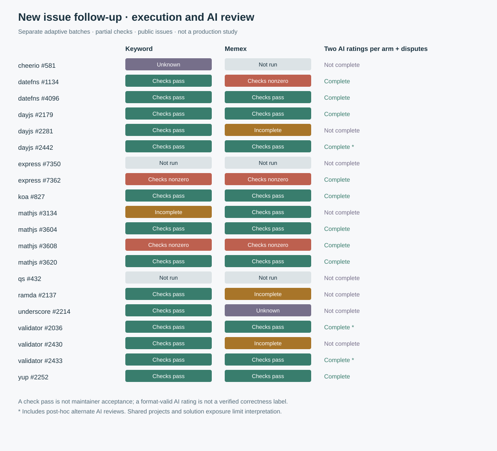
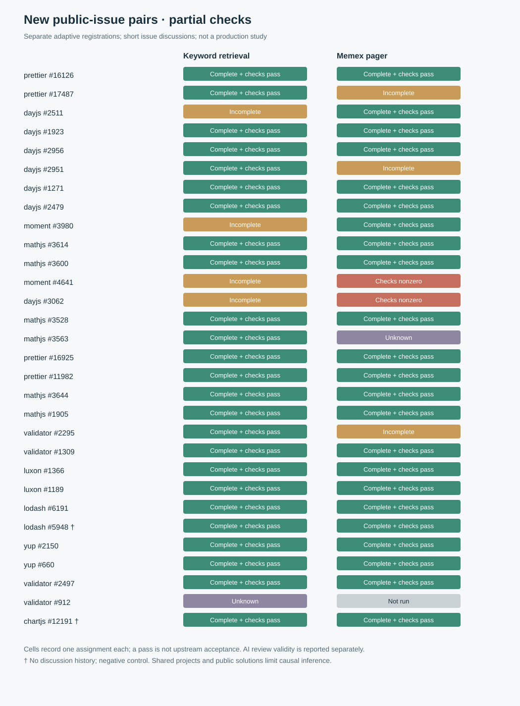

# Prospective engineering canary — 2026-10-31

**Status: 30 distinct public-issue pairs now have the review coverage defined below, including post-hoc recovery; the requested independent production study remains incomplete.** The initial single-issue canary and later separate real-issue agent instrumentation batches are described below. The observed tasks use public issue discussions and partial checks, not real long-running production sessions, and cannot establish Memex's impact on production correctness, cost, or autonomous memory management. The initial [registration](production-prospective-canary-registration.md) and its runner were published in commit [`fe093b5`](https://github.com/QiuXu-Tech/memex/commit/fe093b5) before its trial calls.

## Follow-up: 30 evaluable public-issue pairs, with post-hoc recovery

Across the earlier gateway cohort and the new follow-up, **30 distinct issues** have both randomized arms completed, two format-valid AI ratings for each arm, and a format-valid adjudication wherever the selected ratings disagreed. Two no-history controls are excluded. This combines **18 earlier issues** with **12 new follow-up issues**; it is not 30 newly run issues in this follow-up. The earlier 18 include separately registered supplementary ratings and five new post-hoc adjudications, and three of the 12 new issues use post-hoc alternate ratings. A format-valid response is an AI opinion, not a verified correctness label or upstream acceptance. All 30 have non-null correctness values for this descriptive comparison.

The retrieval store used Memex core commit [`27b2a1f`](https://github.com/QiuXu-Tech/memex/commit/27b2a1f106c7d717be443614e6bf40226e613074) (workspace version 0.65.0); the `packages/` tree is unchanged through this report. Attempts used pinned open-source snapshots, Node 24.18.0 and isolated workspaces in a VM, with the formal checks in a network-disabled sandbox. The new follow-up registered **20 distinct issue identities**, including one pair previously registered but never started after a timeout. Across its 40 consolidated arm slots, **24 completed and passed both partial checks**, five completed with a nonzero check, four were incomplete, two were unknown after timeouts and five were not run. Nine of the 20 issues had both arms pass the partial checks. **Nine issues** had both arms completed with two valid original AI ratings and all disagreements resolved; separately registered alternate ratings raise that coverage to **12**, without replacing the six original invalid Qwen responses. An additional disagreement on the incomplete Underscore pair still has an invalid alternate adjudication. Batch 29 stopped before any model call because the workspace parent was absent; batch 30 repaired the environment and registered the four unattempted pairs with a new seed. Batch 35 includes only an issue whose two prior slots were verified unstarted, and does not replay either timeout.

Among the 30 covered pairs, comparing the agreed correctness score or the registered/post-hoc adjudicator's score when the reviewers differed gives **25 equal, three higher for the Memex arm and two higher for the keyword arm**. This is a descriptive breakdown of a selected, adaptively assembled subset, not a causal estimate, a pass rate or evidence of a reliable gain. The two arms saw different amounts and content of public discussion; discussions or linked PRs may disclose solutions and may be present in training. Several tasks share projects and code paths. Checks are narrow, some references are manual ports, and model labels share a gateway whose true provenance is not verified. The blind packets omit the arm field, but condition inference cannot be ruled out. AI judges are not human reviewers. The underlying short, pre-seeded issue discussions are not real long-running production sessions or a test of an agent independently managing memory. The default strategy should remain unchanged.

The [machine-readable ledger](assets/benchmarks/production-prospective-agent-batches/aggregate.json) preserves original runs, ratings, failures and separately identified supplements. Registrations and partial qualification evidence are available for [27](production-prospective-agent-batch27-registration.md), [28](production-prospective-agent-batch28-registration.md), [29](production-prospective-agent-batch29-registration.md), [30](production-prospective-agent-batch30-registration.md), [31](production-prospective-agent-batch31-registration.md), [32](production-prospective-agent-batch32-registration.md) and [35](production-prospective-agent-batch35-registration.md), as well as [post-hoc adjudication 33](production-prospective-agent-adjudication-v33-registration.md) and [alternate blind review 34](production-prospective-agent-review-v34-registration.md). The [screening ledger](assets/benchmarks/production-prospective-agent-batches/followup-screening.json) records selected exclusions. In particular, a math.js reference failed the chosen accuracy checks and was not promoted; one preliminary qs `require` ran inside the isolated VM but outside its inner network-disabled sandbox before the formal sandboxed checks.

### Gateway 503 investigation and usage

The three earlier HTTP 503 records for `gpt-6.1-sol` and `claude-haiku-4-5` all retained the error code `system_cpu_overloaded`, with responses in 1.141–1.752 seconds. The full response bodies, headers and request IDs were not retained. An open-source relay implementation emits this same code for its CPU overload protection, and [its upstream fix](https://github.com/QuantumNous/new-api/pull/7317) addresses a documented host-versus-container CPU measurement problem. The matching [monitor](https://github.com/QuantumNous/new-api/blob/ea343c4a81151bfd537d33b66527c25fa21a1112/common/system_monitor.go) and [middleware](https://github.com/QuantumNous/new-api/blob/ea343c4a81151bfd537d33b66527c25fa21a1112/middleware/performance.go) are useful hypotheses only: we could not verify which relay or upstream issued the code, the deployed software/version, CPU readings or threshold. The [503 evidence ledger](assets/benchmarks/production-prospective-agent-batches/gateway-overload-evidence.json) records the exact timestamps and gaps. Definitive diagnosis requires the operator to correlate those times and future request IDs with the issuing node's host and cgroup CPU metrics, monitor configuration and relay/upstream logs. No provider-side repair was verified.

The existing client retries only an explicit 503 with bounded backoff and never automatically replays timeouts; its retry policy is covered by mocks, not a successful live 503 recovery. The present follow-up made **327 request attempts**: **325 successful responses and two timeouts**. The successful responses reported **2,096,693 input / 70,126 output tokens**. Five solver responses reported 1,383–2,661 output tokens against a requested 1,000-token limit, and one Qwen review reported 4,827 against 2,048; gateway enforcement and accounting semantics remain unverified, so the requested limits are not hard cost caps.

Four pages of provider-console rows match all 325 successful responses by model, aggregate input/output tokens and approximate time, for a **candidate-matched $0.631912**. The two timeout error rows displayed $0 but had no usable token counts; delayed or missing charges remain **UNKNOWN**. Adding only matched subtotals to the previous **$2.716694** gives **$3.348606**, excluding unknown charges, previous retrospective-pilot charges, local compute, storage, engineering time and taxes. No request IDs establish row attribution, so these are not invoices, complete total costs or savings estimates. [Billing evidence and gaps](assets/benchmarks/production-prospective-agent-batches/billing.json).

## Paired engineering canary

The selected [Lodash issue #5610](https://github.com/lodash/lodash/issues/5610) reports mutation of the input when `lodash/fp` omits a nested path through an array. All three conditions received the same issue and source excerpts. The randomized order was Memex pager, no history, and keyword retrieval. The history was the issue's five actual public comments, not a long user conversation; keyword retrieval opened three comments and the pre-seeded Memex pager included five, estimating 850 tokens. Each condition produced one bounded one-function patch; no agent could navigate the repository, run tests, or decide to manage memory during generation.

All three solver calls returned complete JSON. **In the registered run, zero of three candidates reached the test:** a case-insensitive forbidden-word check incorrectly matched the required JavaScript `function` keyword. The original results remain `invalid_or_test_error` / `NOT_RUN`. A corrected restricted-identifier guard was added with unit tests, then the *unchanged* three responses were uniformly re-evaluated. All three passed the same fixed checks **post hoc**. The checks cover two array paths, a plain nested path and a shallow omission; they are neither a full Lodash suite nor project acceptance. The tests ran on separate source copies under a network- and write-denying sandbox with a timeout. The sandbox has not been independently certified as a comprehensive security boundary. The full original and post-hoc statuses are in [the sanitized call and result ledger](assets/benchmarks/production-prospective-canary/results.json).

Two blinded AI reviewers each scored three responses. All six rated correctness 2/2; DeepSeek rated side-effect safety 1/2 on all three, while Astra rated it 2/2 on all three. Thus there were **three of three paired disagreements** on side-effect safety. The prespecified AI adjudicator returned raw value 1 for all three; its prompt did not restate the score direction, so those values are not safely comparable with the reviewers' scale. It used the same model family as the solver, so it was not independent. The reviewer prompts cannot guarantee that condition identity was not inferable. These are AI opinions, not human labels, project acceptance, or evidence that the patch has no regressions.

## 403 and cost

Before recharge, a 31,740-byte synthetic review-shaped request returned HTTP 403 `insufficient_user_quota`; its reported usage and any charge remain unknown. After the account was replenished, the three Astra review requests in this smaller canary (4,120–4,314 request bytes) all succeeded. A separate single diagnostic with the same synthetic content, parameters and 31,740-byte payload as the earlier failure then returned HTTP 200, with a nonempty complete response. This confirms recovery for that request at that time, not uninterrupted availability or the outcome of every real review.

The canary recorded **12 model calls**, reporting **27,847 prompt and 2,719 completion tokens**. Matching provider-console rows by model, token counts and approximate time yields **$0.014902**, comprising three solver, six review and three adjudication calls. The earlier three successful diagnostic calls separately match **$0.001032**, and the post-recharge long-request diagnostic matches **$0.004858** in provider rows. The canary and these four successful diagnostics therefore match **$0.020792** in total; they remain separate from the earlier failed call. These are candidate matches, not request-ID-verified invoice reconciliation; the failed diagnostic call, delayed or missing charges, local compute, storage, engineering time and any other costs remain **UNKNOWN**. The recharge amount and unrelated account-wide usage are not trial costs. No cost-per-success or savings claim follows from these records.

## Screening and remaining work

We captured **69 distinct open issues** from five public projects. Applying an explicit conservative mechanical filter produces **48 candidates**: open at capture; issue body 300–10,000 characters; 3–50 reported comments with the same count captured; a fenced or indented code example; and an expected/should/reproduction marker. This corrects the earlier informal count of 50; it is a filter, not 48 accepted, independent, reproducible tasks. A comment-count mismatch, disputed requirements, existing proposed fixes or linked PRs, missing dependencies and limited regression coverage require case-by-case review. Counts reflect the captured snapshots, not current issue state.

Across the captured pool, 31 issue examples across all five projects produced the reported baseline exception, assertion failure or a three-second timeout under pinned source snapshots. The 30 examples beyond #5610 were checked after the canary's outputs and include issues outside the strict mechanical filter. An automated text scan flagged 17 of these 31 for possible existing solution or pull-request mentions and three for feature/rule-change wording in the title; both flags are unverified heuristics, not proof of contamination or acceptance. Their expected behavior and acceptance criteria have not been independently validated; a baseline failure alone does not qualify a task. [Screening metadata and test hashes](assets/benchmarks/production-prospective-canary/baseline-screen.json) and the public reproduction scripts are available alongside the [canary test](https://github.com/QiuXu-Tech/memex/blob/main/scripts/production-prospective-canary-test.js). Express, Pino, ESLint and Prettier dependencies were installed in isolated clones with lifecycle scripts disabled; dependency-tree digests are recorded, but no upstream lockfiles were available, limiting reproducibility. ESLint dependency inventory reported intentionally omitted development dependencies as missing. Prettier installation reported Node-engine warnings. These checks do not constitute full project test suites.

A production-value study still needs 30–50 appropriately independent real tasks, including acceptance and regression checks frozen before randomized attempts; preserved source histories and time cutoffs; equivalent tool and context budgets; actual bounded work in a suitable isolated environment; separate evaluation of autonomous memory lifecycle; retained failures; and reconciled total costs. Existing issue discussion may contain suggested solutions, so it must not be treated as a clean held-out production dataset. This canary is not evidence for changing the default policy.

## Candidate audit update

A later read-only GitHub check found all 31 sampled issues still open, with at least one same-repository pull-request cross-reference for 25. A cross-reference does not by itself prove a fix, relevance, or model exposure. The [per-issue audit](assets/benchmarks/production-prospective-canary/issue-audit.json) records current state, labels, referenced PRs and the evidence for exclusions; unresolved entries remain pending rather than accepted.

The earlier baseline-screen count is **not an eligibility count**. In particular, [ESLint #21113](https://github.com/eslint/eslint/issues/21113#issuecomment-5640822603) has a later decision to add a new rule instead of changing the existing rule used in the original assertion. The original Pino #960 check put `level` in the bindings object; the later reported API passes it as the second options argument, and that call logged the debug message on the pinned checkout. Pino #1962's discussion describes the unbound-method pattern as expected behavior, and the Prettier #19530 reporter acknowledged a correction and said the issue could be closed. Those original baseline artifacts remain available, but are **excluded from the trial**, not treated as independent correctness standards. Other cases are excluded for an explicit solution in the issue, external dependency scope, or unsettled requirements; no task is yet claimed as eligible solely on the basis of this audit.

Of the 31 issues rechecked for current status, **11 are excluded** under the current screening decisions and **20 remain pending**; pending does not mean eligible. Across four projects, 11 [draft verifiers](assets/benchmarks/production-prospective-canary/draft-verifiers.json) now combine issue-specific expected behavior with selected regression controls. For [ESLint #21443](https://github.com/eslint/eslint/issues/21443), the eight-case draft checks three intended cases and five negative controls from the discussion; the isolated baseline failed the three intended cases while all five controls passed. Passing references and broader project regressions remain unverified, so none of the drafts is a frozen task acceptance or completed task. Two initial Prettier checks hit an environment address-space limit and exited with OOM; those failures were preserved, and after adjusting VM resource controls their baselines produced the expected assertion failures.

## Isolated agent environment and synthetic check

A dedicated Linux virtual machine was created without host directory mounts. The task verifier runs inside an additional bubblewrap namespace with networking disabled, read-only source and check mounts, dropped capabilities, an unprivileged UID, a timeout, and process/memory/file limits. Boundary checks observed denial of access to a guest sentinel and host-style paths, denial of writes to source/runtime, inability to use `sudo`, failed network access, and timeout of a busy loop. These are targeted checks, not a formal security certification. Node 24.18.0 was checked against the official published SHA-256; the ESLint checkout was pinned to commit `12cbff4125db3f6446f72fa0c48c46b92b120427`, and its guest-generated dependency lock has SHA-256 `4fa513b9243f5c751c0dfaca6aa462d70ae313d59fc1634d302782cc10a564d4`. At that point, other project environments and broader regression suites had not been validated; the later batches below add only selected project-specific controls.

A separate **synthetic** end-to-end diagnostic gave an agent a small broken addition function. It used the bounded repository search, exact-edit and public-test tools and passed the test in the VM; no arbitrary shell tool was exposed. The four model requests reported **4,295 prompt / 231 completion tokens**. Four provider rows match by model, token counts and approximate time, totaling **$0.001370**; request-ID reconciliation and other costs remain UNKNOWN. These calls are in addition to the previous canary/diagnostics, bringing candidate-matched successful-call rows across both to **$0.022162**, while the earlier failed 403 and non-model costs remain UNKNOWN. [Synthetic diagnostic ledger](assets/benchmarks/production-prospective-canary/agent-smoke.json).

This validates one synthetic tool chain only. At the time of this diagnostic, 30 or more eligible task rubrics were not frozen and the later real-issue runs and blinded reviews had not started. Autonomous memory write/read/retention was not validated by this diagnostic. The VM should not be confused with a production deployment or an independent human review.

## Expanded AI issue screening

Two AI reviewers independently screened **83 distinct public issues** for possible suitability: 52 in the first two cohorts and 31 in two later cohorts. This is eligibility screening, not blinded grading of attempted solutions. In the first 52, the original stored votes yielded 12 pairs suggesting further investigation, 15 pairs uncertain, 19 disagreements, five pairs suggesting exclusion, and one invalid pair. A later third AI reviewed the 19 disagreements: eight suggested further investigation, nine were uncertain and two suggested exclusion. Its involvement was introduced after initial screening began. The [first-cohort ledger](assets/benchmarks/production-prospective-canary/ai-screening-summary.json) records each issue and the initial decisions. Its early parser did not reject reasons that mentioned an existing comment ID missing from the reference list: 51 votes or adjudications have such omissions, and no reason contained an unknown comment ID. Thus its original validity count is weaker than the later strict validation.

In the later 31, the stricter original vote validation produced one pair suggesting further investigation, 12 pairs uncertain, seven disagreements and 11 pairs with at least one invalid output. After a post-hoc citation-format normalization, a third AI reviewed ten disagreements across these cohorts, returning five further-investigation suggestions, four uncertain and one exclusion. These totals use different stages of processing and must not be combined as if they were a single pre-registered classification. The [later-cohort ledger](assets/benchmarks/production-prospective-canary/ai-screening-later.json) preserves the logged original statuses and adjudications. Six of those 31 issue histories were clipped.

Some reviewer reasons mentioned existing comment IDs that were not listed in the response's reference array. The post-hoc formatter adds only explicitly mentioned, existing IDs; it keeps the unmodified original response, does not resolve invented IDs, and does not establish that the source supports the claim. Some private source-response files were temporarily unavailable from the host's cloud-synced filesystem; the later summary above was reconstructed from the separate complete call logs rather than silently treating unavailable records as successes. No candidate is eligible or its acceptance frozen merely because AI reviewers agree. Public discussion, linked pull requests and possible model pretraining also limit independence from existing solutions.

The first 52 issues and 19 disagreement reviews used 123 calls reporting **332,133 input and 18,395 output tokens**; provider-console rows matched on model, aggregate tokens and approximate time total **$0.135130**. Together with the previously matched canary, diagnostics and synthetic agent check, matched successful-call rows total **$0.157292**. For the later 31 and ten disagreement reviews, 72 completed calls reported **143,020 input and 14,980 output tokens**; their completed-call provider rows were subsequently matched to **$0.051826** by model, token totals and approximate time. The failed 403 charge, local compute and engineering time remain **UNKNOWN**. Provider-row matches are not invoice or request-ID reconciliation. These figures do not measure cost savings.

The initial synthetic model-driven smoke test preceded the later adjustment of the VM address-space limit and the worker's atomic edit change. Targeted sandbox and worker boundary tests were rerun after those changes; the initial model-driven smoke was not rerun under the modified configuration. Later model-route synthetic checks and real-issue attempts are reported separately below. The requested 30–50-task randomized comparison and autonomous memory-management validation have not been completed.

The previously published ESLint guest dependency-lock hash omitted one character; the corrected 64-character value above was rechecked against the VM file. The subsequent [three-issue agent instrumentation batch](production-prospective-agent-batch1-registration.md) and later registrations are summarized separately below.

## Separate real-issue agent instrumentation batches

**Thirty distinct open-source issues had at least one assignment started, including interrupted and failed attempts; the requested 30–50 completed new tasks have not been reached.** Across fourteen separately registered batches there were 84 assigned task–arm slots. Twenty-six were not launched after a stop, and some of those unstarted slots were registered again in later batches. Of the 58 started slots, 25 returned a complete final response and passed both frozen checks; 15 returned a complete response with a nonzero check; 12 were incomplete; and six were unknown or interrupted. These are operational counts across different registrations, models and selected tasks, not an effect estimate. A complete response plus the checks is not maintainer acceptance.

| Registration | Distinct issue assignments | Slot outcomes |
| --- | --- | --- |
| [ESLint initial](production-prospective-agent-batch1-registration.md) | #21333, #21443, #21436 | 6 incomplete |
| [Lodash interrupted](production-prospective-agent-batch2-registration.md) | #6195, #5750, #5881 | 1 complete with nonzero check; 1 interrupted; 4 not run |
| [Lodash search repair](production-prospective-agent-batch3-registration.md) | #5750, #5881 | 1 complete with nonzero check; 1 model failure; 2 not run |
| [ESLint additional](production-prospective-agent-batch4-registration.md) | #21441, #19931 | 4 incomplete |
| [Lodash alternate model](production-prospective-agent-batch5-registration.md) | #5881 | 2 complete and checks pass |
| [Pino and Prettier](production-prospective-agent-batch6-registration.md) | Pino #2057; Prettier #19427, #19847, #20047, #20293 | 7 complete and checks pass; 2 complete with nonzero check; 1 tool-call limit |
| [Prettier follow-up](production-prospective-agent-batch7-registration.md) | #19955, #19968 | 4 complete and checks pass |
| [ESLint suggestions](production-prospective-agent-batch8-registration.md) | #21122 | 2 complete with nonzero checks |
| [ESLint and Prettier](production-prospective-agent-batch9-registration.md) | ESLint #21361, #21422; Prettier #20306, #20307 | 3 complete and checks pass; 1 timeout; 4 not run |
| [Prettier interrupted](production-prospective-agent-batch10-registration.md) | #18080, #10851, #12649 | 1 timeout; 5 not run |
| [Prettier alternate route](production-prospective-agent-batch11-registration.md) | #8182 and four previously unstarted issues | 9 complete and checks pass; 1 complete with nonzero check |
| [Six Prettier issues](production-prospective-agent-batch12-registration.md) | #9112, #20174, #18066, #9955, #17213, #15537 | 4 complete with nonzero checks; 1 tool-call limit; 1 model failure; 6 not run |
| [Previously unstarted follow-up](production-prospective-agent-batch13-registration.md) | #9955, #17213, #15537 | 1 model failure; 5 not run |
| [Low-cost alternate route](production-prospective-agent-batch14-registration.md) | #17213, #15537 | 4 complete with nonzero checks; review stopped on a 503 |

A later **unblinded, post-hoc** standalone ESLint `no-unused-vars` check on the two #20307 attempts found one unused `expandedLastArg` binding in the keyword-arm candidate; the baseline and the Memex-arm candidate had none. Both candidates had passed the originally frozen issue and small regression checks. This targeted diagnostic is not Prettier’s configured full lint suite and does not establish its CI result; the original outcomes are unchanged. [Check and candidate hashes](assets/benchmarks/production-prospective-agent-batches/posthoc-unused-audit.json).

The runner used separate Linux VM source copies, bounded repository search/read/exact-edit tools, a public example, and network-disabled checks. The VM and sandbox were exercised with targeted boundary tests, not independently security-certified. Source and dependency locks, random orders, per-issue criteria and known exceptions are in the registrations. The [sanitized aggregate ledger](assets/benchmarks/production-prospective-agent-batches/aggregate.json) records each slot, reported token use, original review status and missing events; the [candidate audit](assets/benchmarks/production-prospective-agent-batches/candidate-audit.json) records additional held or excluded issues and reasons. Public issue comments or PRs may disclose solutions. Most histories are short. Both retrieval arms received the same single comment for #20306, #20174, #17213 and #9112, and the same two comments for #15537. #18080/#20307 may share a cause; #8182, #9955 and #9112 use the same reference patch and may share a cause. The batches were selected or modified after previous outcomes and do not constitute a single pre-registered cohort. After two solver 503 responses, the third newly registered batch used a different solver only for two issues whose arms had never started; it was not a randomized comparison of models. A subsequent reviewer also received a 503, and later reviews were not launched under the registered stop rule. None of those failed requests was retried.

### AI reviews and scoring correction

In batches 1–5, the original review prompts allowed `0`, `1`, `2` or `null` but did **not** define which numeric direction was better. Of 20 original review responses, 16 passed the original format check and four did not; their numerical scores cannot be pooled as a common scale. Two reference-format errors in the first batch were normalized only in a separately recorded post-hoc step; the originals remain invalid. Two Haiku reviews in batch 5 returned empty content despite HTTP 200 and remain invalid.

A separately [registered post-hoc re-review](production-prospective-agent-posthoc-rubric-registration.md) used an explicit rubric on only the six attempts with a nonempty code diff. All 12 responses passed the format check; five of the six candidate pairs disagreed and all five received format-valid AI adjudications. Candidate selection, rubric clarification and one reviewer replacement followed observation of earlier outputs, so these are not replacements for the original planned ratings.

In batches 6–14, the rubric specified the scale before calls. Of 76 planned individual ratings for reviewable candidates, **69 were format-valid, one failed with HTTP 503, and six were not launched**. There were 34 candidate attempts with two format-valid ratings; 26 pairs differed on correctness or side effects. Seventeen disagreements received format-valid AI adjudications, three returned invalid JSON, one adjudication timed out, and five were not launched after that timeout. Only **14 distinct issue pairs** in these explicit-rubric batches have complete final responses and two format-valid reviews per arm; that count includes attempts whose frozen checks failed and does not require a valid adjudication. Format-validity checks the response schema and permitted reference labels, not whether the cited evidence supports the judgment. Batches 6–11 used the solver model family for adjudication; batches 12–14 registered a third model name through the same proxy, whose provenance was not independently verified. All reviewers are AI rather than human or independent project maintainers.

A separate [post-hoc adjudication registration](production-prospective-agent-unstarted-adjudication-registration.md) addressed only the five disagreement reviews that had not been started after the batch 11 timeout. The new AI returned **3/5 format-valid results**; two were invalid, one with empty content and one with an extra field. The selection script checks for missing result files rather than checking start events; an independent audit of the original call log confirmed that none of these five had started. The original five statuses remain not run, and the failed original timeout was not retried. These follow-up judgments were selected and the third model chosen after seeing prior failures; they are not independent human review.

### Usage and cost gaps

The fourteen batches, both separately registered post-hoc review procedures, three route probes and two alternate-solver synthetic smokes recorded **774 model request starts**, **773 terminal records**, and reported **8,181,298 input / 115,705 output tokens**. Seven terminal failures did not report token usage and one interrupted request has no terminal record. These figures exclude the initial canary and 83-issue screening, whose reported usage is described above; they are not a complete account of unknown usage.

Provider-console rows matched by model, aggregate tokens and approximate time total **$1.486712** for completed prospective canary, screening, batch, review and diagnostic calls. This includes **$0.147794** in matched rows for batch 11, **$0.010622** for completed batch 13 calls and a synthetic smoke, and **$0.013538** for completed batch 14 solver calls and one review. There are no request IDs to prove attribution. One adjacent $0.002302 row may relate to the earlier disconnected call, but cannot be assigned confidently and is excluded from the subtotal. The failed 403, interrupted request, disconnected request, two solver timeouts, adjudication timeout, three later 503 responses, delayed or missing charges, previous retrospective-pilot charges, local compute, storage and engineering time remain **UNKNOWN**. [Billing match details and gaps](assets/benchmarks/production-prospective-agent-batches/billing.json). This subtotal is not an invoice, total study cost or cost-savings estimate.

## Gateway recovery and 30 additional public issues

**The requested study is still incomplete.** Batches 15–25 registered 30 previously unattempted, open issues from nine projects and fixed each issue snapshot, partial acceptance checks and paired random order before its solver calls. Batch 26 separately registered the two Chart.js assignments that had never started after a transport failure; it is not another issue. The registrations were made sequentially after earlier results, and public issue discussions or proposed PRs can disclose solutions or appear in training. Shared projects and related code paths mean these are not a single pre-registered set of independent samples. Two issues had no historical discussion records and were explicitly registered as **negative controls**, not as tests of memory retrieval. The other histories contained at most 19 issue comments; they are not long-running production sessions.

The 30 issues had 60 distinct issue–arm slots. After consolidating only the previously unstarted Chart.js follow-up, **48 slots completed with both partial checks passing**, seven stopped at the four-tool-call limit, two completed with a nonzero check, two had a model or transport failure, and one was not started. Both arms completed with the partial checks passing on **21/30 issues**, including both no-history controls; this is 19 issues after excluding those controls. By arm, keyword retrieval had 25 pass, four incomplete and one unknown; Memex had 23 pass, three incomplete, two nonzero checks, one unknown and one not run. These descriptive counts are not an estimate of production correctness or a causal improvement: the histories and context sizes differ, criteria are narrow, tasks share projects, and failed or unstarted work remains in the denominator.

The checks caught concrete problems. On [Day.js #3062](https://github.com/iamkun/dayjs/issues/3062), the Memex attempt passed the two target week-boundary examples but failed the frozen English-locale control. On [Moment #4641](https://github.com/moment/moment/issues/4641), the Memex attempt returned a final answer but failed the mixed-duration absolute-value check. The [new pair chart](assets/benchmarks/production-prospective-new-pairs.svg) distinguishes these outcomes from incomplete, unknown and unstarted work; the [sanitized ledger](assets/benchmarks/production-prospective-agent-batches/aggregate.json) retains the original batch slots and the follow-up separately.

The 50 reviewable attempts had 100 planned original AI ratings: **89 format-valid, seven invalid (including one timed-out review) and four not started**. Forty-one candidates had two valid original ratings, and **28/41** differed on correctness or side effects. Of the original adjudications for those disagreements, nine were format-valid and 19 were invalid. Only **16/30 issues** had complete final responses and two format-valid original ratings for each arm; that includes both no-history controls and does not require passing checks or a valid adjudication. Removing those controls leaves 14 such issues. A format-valid rating satisfies the JSON schema and permitted reference labels; it does not establish that the evidence supports the judgment. Reviewers are AI, not human assessors, and the common gateway's model provenance is unverified.

Separately registered follow-ups preserve, rather than replace, original outcomes. In [batch 15's budgeted re-review](production-prospective-agent-batch15-budgeted-registration.md), all six new reviewer outputs were format-valid for three candidates, but all three Gemini adjudications used disallowed reference labels. A subsequent deterministic, explicitly post-hoc mapping of exact packet-field labels to the registered reference categories made those three outputs schema-valid; it did not change scores or verify citations, and the original outputs remain invalid. In [batch 16](production-prospective-agent-batch16-budgeted-registration.md), three initially truncated Qwen ratings were re-reviewed successfully; five subsequent Gemini disagreement responses were invalid. A separately [registered alternate adjudicator](production-prospective-agent-batch16-fallback-registration.md) produced five format-valid outputs. For [batches 17–20](production-prospective-agent-batches17-20-fallback-registration.md), 10 of 12 supplementary adjudications were format-valid and two remained invalid. A further [registered follow-up](production-prospective-agent-batch17-unstarted-reviews-registration.md) assessed two batch 17 candidates whose original reviewer calls had never started: all four ratings were format-valid and both pairs disagreed; one of two adjudications was format-valid and the other remained invalid. The timed-out request was not repeated. Counting these supplementary ratings alongside original valid ratings yields **20/30 issue pairs**, including both no-history controls, with two format-valid ratings per completed arm; 18 remain after excluding the controls. This combined post-hoc count does not require successful checks or valid adjudications and does not replace the original 16/30 count. These subsets, budgets and model substitutions were chosen after observing failures. The alternate adjudicator has the same model name as the solver and is **not independent** of it.

The client now records every attempt and retries **only an explicit HTTP 503**, at most twice with bounded backoff; timeouts and other transport errors are never automatically retried. Five mocked gateway tests cover recovery, exhaustion, failure types and retry-delay limits. Across the 582 trial requests in batches 15–26, 579 returned HTTP 200, two timed out and one ended in a transport error; **no actual 503 occurred in these trials**, so live 503 recovery is not demonstrated. A separate earlier `gpt-6.1-sol` probe also timed out. Small health probes subsequently returned HTTP 200 for three model names, but they do not establish that long requests or the upstream provider are fixed. Batch 25 stopped on the transport error; its failed request was not retried, and batch 26 contains only slots independently verified to be unstarted.

For the new gateway work and supplementary reviews, the local ledger contains **637 request starts and 637 terminal records**, with **5,389,529 input and 160,684 output tokens reported**. Four failed requests reported no usage. Eight successful Qwen trial reviews reported completion-token usage above their requested `max_tokens`: four of ten batch 16 reviews requested 700 and reported 1,657–6,526, and four later reviews requested 2,048 and reported 3,423–7,405. Some responses report reasoning tokens; the proxy's enforcement and accounting semantics have not been established. The requested limit is therefore not a verified cost cap.

Provider-console rows matched by model, aggregate tokens and approximate time yield a **candidate-matched $1.229982** for 633 successful responses, including invalid reviews and diagnostics. This includes $0.003316 for the six later batch 17 review and adjudication calls. Three error rows displayed $0 without usable token data, while the transport error had no matched console row; the final cost of all four remains **UNKNOWN**. Together with the earlier candidate-matched subtotal, this yields **$2.716694**, excluding unknown or delayed charges, prior retrospective-pilot charges, compute, storage, engineering time and taxes. There are no request IDs to prove row attribution; this is neither an invoice nor a savings estimate. [Billing matches and gaps](assets/benchmarks/production-prospective-agent-batches/billing.json).

The individual registrations and qualification ledgers record fixed criteria and reference provenance: [15](production-prospective-agent-batch15-registration.md), [16](production-prospective-agent-batch16-registration.md), [17](production-prospective-agent-batch17-registration.md), [18](production-prospective-agent-batch18-registration.md), [19](production-prospective-agent-batch19-registration.md), [20](production-prospective-agent-batch20-registration.md), [21](production-prospective-agent-batch21-registration.md), [22](production-prospective-agent-batch22-registration.md), [23](production-prospective-agent-batch23-registration.md), [24](production-prospective-agent-batch24-registration.md), [25](production-prospective-agent-batch25-registration.md) and [26](production-prospective-agent-batch26-registration.md). Batch 25 also notes that one currency option name was chosen from source after its PR prose disagreed, and that the Chart.js check uses a mocked controller insertion method. The standard paired analyses remain exploratory. The agent was not asked to decide what to remember, create and maintain memories over time, or recover them across real task continuations. These results cannot demonstrate autonomous memory management, a reliable improvement in production task correctness, or savings. The default strategy should not be changed on this evidence.
