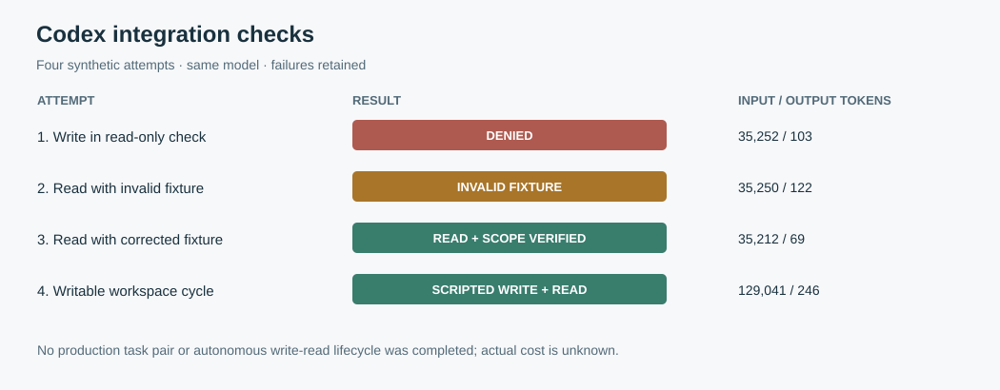

# Codex integration readiness — 2026-11-01

This is a repair and integration check on the Memex project itself, based on v0.65.0 plus the unreleased changes in this repository. It is **not** a randomized production trial: no real task pair, independent human evaluation, or autonomous write–read lifecycle was completed in this round. Earlier public-issue and replay results remain separate; their [limitations and outcomes](production-prospective-canary.md) are unchanged.

## Repairs

| Finding | Change and verification |
| --- | --- |
| A known record ID could bypass the search visibility filter for MCP open, status, restore and forget. | These operations now use workspace and visible-session filters. Deletion and cold restoration check inside their storage transactions; status changes retain the existing expected-path concurrency guard. Tests U70, U71 and U78 exercise different workspaces, different sessions and cold records. |
| `memory_write` accepted undeclared fields, including an ID that could replace a record from another workspace. | The MCP write schema disallows additional properties and the server rejects them even for a direct JSON-RPC request. U77 checks that the original record survives. |
| Different MCP processes without an explicit session ID shared the same L2 namespace. | Each process now receives a fresh default session ID. U72 verifies separation. Reusing L2 across a server restart requires an explicit, appropriately scoped session ID. |
| Newly generated global Codex configuration pinned the setup project's `--cwd`. | New snippets rely on the server process working directory. U76 uses one generated configuration in two workspaces; the corrected Codex smoke below also verifies the tested CLI's server directory. Existing configuration and records are not migrated automatically. |
| MCP `memory_open` described line paging but sliced characters, and an oversized line could not be continued. | Line windows now use lines; `nextCharOffset` continues within the same window. U73 and U75 exercise line boundaries and a long Unicode line. |
| An empty scope list was treated as an unfiltered scope by parts of the store and catalog. | An explicit empty list now returns no records. U79 covers get, list, search, catalog and forget. |
| A caller could write or compress a memory level that was not enabled. | The engine rejects disabled scopes before writing or compressing. U80 exercises both MCP calls and checks that the hidden record remains cold-state unchanged. |
| The programmatic materializer defaulted to both scopes even when L2 was disabled. | The default now uses the engine's enabled levels; U81 checks that a disabled session record is omitted while a visible workspace record remains. Explicit workspace, session and scope overrides remain available to trusted callers. |
| MCP tools did not advertise their read-only or destructive behavior. | Read-only and destructive annotations match their behavior; U74 checks the declarations. Annotations do not override client approval policies. |

The filters prevent these MCP tool calls from crossing logical workspace/session boundaries. They do **not** prevent another process with filesystem access to the memory root from reading or modifying its files. This is not a security certification. Existing `--cwd` configurations and any records captured under an incorrect workspace key require inspection; see the [Codex integration notes](integrations/codex.md).

On an isolated copy with Node 24.21.0, the generated bundle build and parity check passed, the offline harness passed **177/177**, and the SQLite concurrency and recovery suite passed **36/36**. These checks cover the exercised cases, not all possible concurrent schedules or hosts.

## Actual Codex checks

All four checks used `gpt-6.1-sol`, Codex CLI `0.166.0-alpha.5.1`, ChatGPT login and temporary stores. The first three used isolated read-only invocations; the fourth used a disposable workspace-write invocation. They were tool-integration smokes, not production tasks:

1. An explicit request to write was rejected: the tool required approval while this invocation's approval policy was `never`. The process still exited successfully; the tool call itself did not succeed.
2. The read-only tool completed but returned no marker because the fixture script had mistakenly seeded a different directory. This is an invalid instrumentation attempt, not a Memex retrieval failure or success.
3. After the fixture was corrected and independently checked from both directories, the read-only tool returned the project marker. An instrumented server process reported the Codex `--cd` project as its working directory. This is one host and CLI version, not a guarantee for other clients or configurations.
4. In a separate temporary writable workspace, an explicit prompt requested a write, search and open. All three MCP calls completed and the opened body matched the test fixture. After the Codex process exited, a separately started MCP server in the same workspace also found and opened that record; this readback used no model call. The default approval policy was unchanged. This is a scripted connection check, not an autonomous decision to manage memory.

No approval policy was changed for these checks. Both write attempts were explicitly scripted, so neither tests autonomous memory management. No AI blind review was run in this round.

## Usage, costs and remaining evidence

The four model turns reported **234,755 input tokens**, of which **201,856 were reported cached**, and **540 output tokens**. The individual raw usage records and the [sanitized summary](assets/benchmarks/codex-readiness-smoke.json) were checked against each other. These were Codex/ChatGPT calls; no APIMaster call was made in this round. The incremental charge, any subscription allocation, compute, storage and engineering costs remain **UNKNOWN**, so no savings or cost-per-success estimate is possible. Private local logs include the failed and invalid checks; account data and fixture files are not published.

Before making a production-value claim, run prespecified randomized comparisons on actual ongoing long-term tasks, with isolated stores and equivalent permissions, and independently assess the delivered artifacts. Measure successful writes, later retrieval and correct use of evidence across real continuations, including failures and review costs. The current read-only check does not establish that this lifecycle succeeds. The previous 30 public-issue pairs are exploratory and do not fill this gap. No default retrieval policy is changed by these findings.
