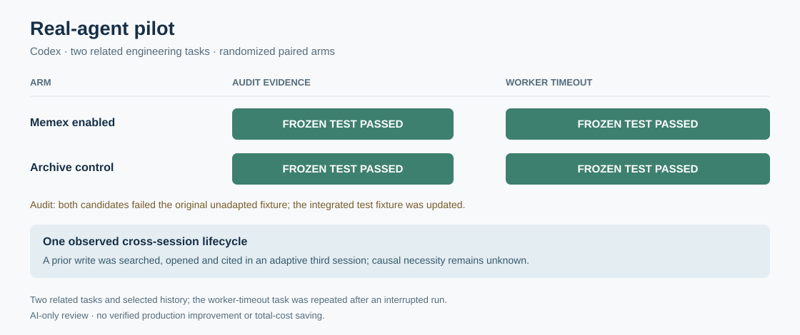

# Real-agent isolation and cross-session pilot — 2026-11-01

The isolated test tool is now usable from real MCP agents. In a small paired trial, four Codex candidates passed their frozen sandbox tests; a separate adaptive continuation observed one record written in one Codex process, then searched, opened, and cited as corroboration in a later process. **The record's causal necessity is unknown.** Two AI auditors agreed that the record was faithful to the supplied trace and used as corroboration, but disagreed on necessity; an adjudication retained it as unknown.

[Sanitized aggregate](assets/benchmarks/production-real-agent-20261101.json) · [Repaired cohort registration](assets/benchmarks/production-real-agent-20261101-registration.json) · [Execution registration](assets/benchmarks/production-real-agent-20261101-execution-registration.json) · [Blind review plan](assets/benchmarks/production-real-agent-20261101-review-plan.json) · [Adaptive follow-up registration](assets/benchmarks/production-real-agent-20261101-followup-registration.json) · [How to connect an agent](integrations/isolated-pilot.md) · [Previous shadow pilot](production-forward-pilot-20261101.md)

## Agent and isolation integration

The new stdio MCP bridge connects an actual agent to a preassigned worker in a disposable Linux VM. The agent can read, search and make bounded exact replacements in its assigned copy; `repo_test` invokes a fixed verifier in an additional network-disabled sandbox. The bridge itself is only a protocol adapter: its isolation depends on the trusted VM worker and supervisor supplied by the operator. Python source support was added in a separate v4 worker so earlier versioned worker artifacts remain unchanged. A worker-response deadline now retires a nonresponsive worker and records the ambiguous failure without retrying it. Tool descriptions also expose the worker's read and search limits.

Codex CLI `0.166.0-alpha.5.1`, model `gpt-6.1-sol` and the existing ChatGPT login were used with fresh ephemeral processes. The evaluation disabled shell and unified execution, apps and plugins; only the assigned pilot MCP server and, in treatment, the Memex MCP server were configured. The host working directory was disposable and the editable repository lived in the VM. A live event guard stopped a session if an unexpected MCP server, command execution or web search appeared. A final Codex smoke after integrating the changes read the isolated fixture and ran its sandbox test successfully.

An initial boundary recheck was invalid because its supposed outside sentinel had not been created. That attempt was retained; after the sentinel was created and verified outside the sandbox, the corrected check passed for an unprivileged UID, a read-only source mount, an inaccessible sentinel and denied network access. These are targeted checks, not a general security certification.

A restricted Claude Code `2.1.283` smoke used the existing APIMaster account, `claude-haiku-4-5`, no built-in tools and the same pilot MCP bridge. Its stream reported success and the bridge recorded a successful read and test. The wrapper then failed while recording the process status, so the original exit code is **UNKNOWN**; the raw stream and empty status file were retained. DSH was detected locally but no DSH agent run was performed in this round. No global agent configuration was intentionally installed.

## Initial interruption and repaired design

The [first registration](assets/benchmarks/production-real-agent-20261101-interrupted-registration.json) did not disable automatically loaded apps and plugins. In the control's first session, Codex tried an unrelated remote-desktop connector: reading a nonexistent file failed, listing the empty disposable host workspace completed, and an attempted process execution was denied by the existing approval policy. The current child process was interrupted and the cohort stopped. Three Codex turns had reported usage; the interrupted turn's usage is **UNKNOWN**. These attempts are retained and are not treated as a valid completed comparison.

Afterward, apps/plugins were disabled and a separate smoke found that the unrelated connector was unavailable while the assigned test tool still worked. The repaired cohort was then registered with the standard Memex-generated project manual in treatment workspaces. This is an **adaptive rerun** for the worker-timeout task, which had already been attempted; the audit task had not been attempted in the interrupted cohort. Registrations were written locally before their associated model calls, but were not independently timestamped.

Both arms had the same model, task, VM snapshot, bounded repository tools, fixed tests and archive access. Treatment additionally had an initially empty L3 Memex store and the usual Memex project manual; the manual tells the agent when to search, open and write. Individual task prompts did not require a memory call. Each arm used two separate Codex processes; the archive for the second process contained selected earlier project messages and that arm's first-session result. Task/arm order was seeded and randomized. Model-generated code was executed only by the assigned sandbox verifier.

The two tasks were investigator-formulated continuations of the user's ongoing Memex reliability work: an existing audit evidence defect, and a worker-timeout defect discovered in the new bridge written during this work. Selected real conversation excerpts were clipped and reused as context. These are two related engineering tasks in one project, not independent users or a complete live long-duration production sample.

## Paired outcomes and blind review

| Task | Memex arm | Archive control | Frozen acceptance |
|---|---|---|---|
| Audit evidence: a failed or missing-status pager should not supply observed memory IDs | Source changed; test passed | Source changed; test passed | 2/2 passed |
| MCP worker: a nonresponsive worker must time out, be retired and not silently retry an ambiguous edit | Source changed; test passed | Source changed; test passed | 2/2 passed |

All eight repaired-cohort sessions returned normally, with four distinct first/second process pairs. The two audit patches were identical. The two worker-timeout patches were similar; both passed the fixed test after earlier failed test attempts. No memory record was written in either treatment's first session. Both treatment agents searched an initially empty store and wrote a record during their second session, after the task work. Thus the paired task outcomes themselves do not demonstrate that either task benefited from an earlier written memory.

Two blinded AI reviewers, `gpt-6.1-sol` and `claude-haiku-4-5`, each assessed all four anonymous patches. They both rated the two worker-timeout candidates **2/2** for delivery. For each audit candidate, they gave **1/2 and 2/2**: the former noted that the patch did not update the tracked legacy test fixture, while the latter credited the adapted test result as full compatibility. The frozen verifier had, before the attempts, explicitly marked the old fixture's pager event as successful. A later isolated check confirmed that the **original unadapted fixture failed for both candidates**. The adjudicator retained this distinction: the source fix passed the preregistered adapted fixture, but the unchanged repository still needed its test fixture updated. The integrated fix now updates that fixture and adds failed/missing-status regressions; the final VM check passes. The worker timeout change was also integrated and passed its fixed VM test and a host protocol regression.

## Adaptive third session: write, open and citation

After observing the audit treatment's second-session write, we registered a third-session review of that **same task** in both arms. This selection was post hoc and is not another independent task. Both agents could use their own prior-session archive and current source. In the treatment, the third Codex process searched and opened the same workspace-scoped record written by the previous process; the opened body matched the written body, and the final answer cited the record as corroborating the earlier implementation and test result. No individual task prompt instructed the agent to invoke memory; the standard project manual did direct memory use for durable context.

The two unblinded AI memory audits both rated the record faithful to the supplied trace and the answer as using it. One rated necessity **unknown** and the other **yes**. A further adjudication considered the actual S1/S2 archive reads, current source and passing tests and rated causal necessity **unknown**. The other sources contain overlapping information, and the two stochastic arms do not supply a record-removal counterfactual.

The two blinded AI reviewers of the third-session answers also disagreed: one scored the Memex answer/control **2/1**, and the other **1/2**. The control asserted a separate Python word-boundary regex defect. A post-hoc isolated positive-sequence test passed for both identical candidates, and the adjudicator identified the claim as a misreading of source versus JSON backslash escaping. These opinions, the incorrect claim and the disagreement remain recorded; one adaptively selected task cannot establish a reliability advantage.

## Usage and costs

Codex's JSON event stream reports the following token counts. Cached input is already included in input. One deliberately interrupted turn did not emit a final usage record; its usage and any associated charge are not zero.

| Codex/ChatGPT stage | Completed turns | Reported input | Cached input | Reported output |
|---|---:|---:|---:|---:|
| Initial, isolation-repair and final connection smokes | 3 | 197,754 | 166,400 | 455 |
| Interrupted initial cohort | 3 | 632,732 | 554,752 | 2,297 |
| Repaired paired cohort | 8 | 1,941,036 | 1,762,816 | 8,368 |
| Adaptive third-session follow-up | 2 | 385,427 | 332,672 | 1,834 |
| **Reported total** | **16** | **3,156,949** | **2,816,640** | **12,954** |

Within the repaired paired cohort alone, the archive control reported **903,687 input** tokens (828,416 cached) and **3,492 output** tokens; the Memex arm reported **1,037,349 input** (934,400 cached) and **4,876 output**. These are the sums of four sessions per arm, including the Memex manual and tool interactions. The sample and missing subscription pricing do not support a cost comparison beyond these token counts.

The nine successful APIMaster review/audit/adjudication requests reported **62,553 input / 2,329 output tokens**; 10,078 input tokens were reported as cache creation. They match visible billing rows totaling a candidate **$0.010208**. The two Claude Code smoke requests reported **2,726 input / 250 output tokens** and match two rows totaling **$0.000436**. The combined candidate APIMaster subtotal is **$0.010644**. The Claude CLI also displayed a **$0.003976 list-price estimate**, which is not the matched gateway subtotal. The account rows matched by timestamp, model and aggregate tokens, but no per-request receipt linkage was available.

Codex used the ChatGPT login, not the APIMaster account; its incremental charge or subscription allocation, the interrupted turn's missing usage, compute, storage, engineering/review labor and total cost per independently verified success are **UNKNOWN**. The small trial does not establish cost savings. Raw conversations, tool traces and account details remain private; public registrations and aggregates omit them.

## Interpretation

This round demonstrates a working isolated test connection in actual Codex and a Claude Code connection smoke, a concrete audit fix, and one observed cross-session write → open → cited corroboration under the standard Memex manual. The task sample is small, related and partly adaptive, the history is selected, and reviews are AI-only. It does **not** complete 30–50 independent prospective production tasks or establish that Memex reliably improves production correctness, saves total cost, or manages memory faithfully across all tasks. The next experiment should use distinct ongoing tasks with independently frozen acceptance, the repaired tool surface, broader tests, and reconciled end-to-end costs.
