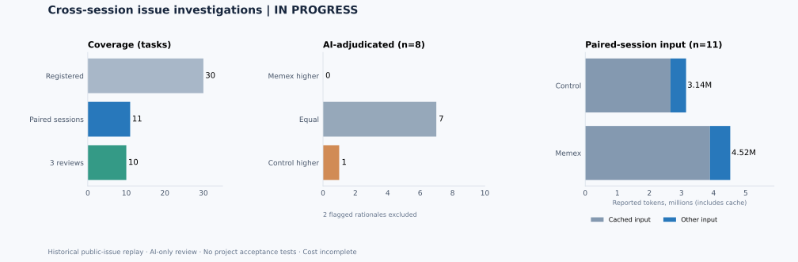

# Cross-session public-issue investigations: 30-task follow-up

**Status: IN PROGRESS.** Updated 2026-11-01T13:15:28.888473+00:00. This report is regenerated from preserved records. [Machine-readable results](assets/benchmarks/production-real30-20261101/results.json) · [Registration](assets/benchmarks/production-real30-20261101-registration.json) · [Additional frozen criteria](assets/benchmarks/production-real30-20261101-new-tasks-registration.json)

18/30 original attempts have completed both randomized arms, with two separate Codex processes per arm. 17/30 original attempts have two blinded AI reviews and a third model's adjudication without recovery; 1 more have a supplemental adjudication. Additionally, 2 post-hoc retry pairs are complete, 1 of those have reviews without recovery and 1 have a recovered review. 20/30 distinct tasks have an evaluable pair including these recoveries. 2 adjudication rationales have evidence or rubric problems and are excluded below. 8 tasks have not started; 4 have started without a complete pair.

For 15 original adjudications without those known flags or post-hoc recoveries, adjudicated scores were higher for Memex on **0**, equal on **14**, and higher for control on **1**. The 0/1/2 AI scores assess investigation criteria; reviewers are not project maintainers. Original opinions, including flagged ones, remain in the machine-readable results.

## What was tested

Thirty screened public issues from repositories with distinct owners were frozen with source revisions and task-specific criteria before calls. These are short, two-session **historical issue investigations**, not live long-running production tasks or code-fix trials. Arms receive the same source view and their own first-session handoff; the treatment additionally has a fresh Memex store. Both use isolated repository tools and a fresh Codex process for each session. Project acceptance tests were **NOT RUN**. Models may have seen public issues or solutions.

Fifteen tasks were assigned prior memory guidance and fifteen revised guidance to discourage duplicate reads while retaining source verification for uncertainty or conflicts. The initial four tasks ran before the search-result header fix; the rest use that fix in both guidance variants. A delayed download changed the order of the first eight tasks, not their assignments ([record](assets/benchmarks/production-real30-20261101-order-deviation.json)). The allocation commitment is published; assignments stay hidden until collection is complete, then are disclosed in the results. Three interrupted downloads were recovered as **partial source views** for T12, T16 and T20. Other views also exclude files inaccessible to the restricted worker; batch registrations record scope and hashes.

## Memory and usage

Among 18 completed pairs, the Memex arm wrote in session one on **18**, later opened a record it had written on **18**, and cited one in the final answer on **18**. On **17** it also opened the ordinary first-session handoff. These observable events do not establish whether memory was necessary, correct or autonomously managed throughout its lifecycle.

| Completed pairs only | Input tokens including cache | Cached input tokens | Output tokens | Session seconds |
| --- | ---: | ---: | ---: | ---: |
| Control | 5,425,702 | 4,577,408 | 43,073 | 2148.2 |
| Memex | 7,866,514 | 6,723,200 | 57,282 | 2513.2 |

Input includes cached input and is not a bill. Session time is summed, not wall time. Completed-pair sessions missing usage: 0. Incomplete original sessions and all retry sessions are excluded from this paired table.

Across **all original sessions with a result record**, including incomplete pairs, control reported 5,950,250 input / 46,981 output tokens and Memex reported 8,847,304 input / 64,507 output tokens. 2 recorded sessions lack usage; still-running sessions do not have final usage records. Different tasks and source-reading patterns limit inference.

Exact repeated source reads across sessions: control **16** (79,952 returned characters), Memex **15** (65,056 characters). These count identical arguments and identical returned source text in both sessions; such reads may be needed for independent verification. Characters are not tokens or billable cost.

Post-hoc retry sessions separately reported control 730,749 input / 5,174 output tokens and Memex 995,350 input / 7,526 output tokens; 0 retry sessions lack usage. The original timed-out sessions still have unknown usage. Among 2 completed retry pairs, 2 wrote in session one, 2 opened and 2 cited a prior record.

## Reviews, failures and cost

The two AI reviewers were gpt-6.1-sol and claude-haiku-4-5; deepseek-flash reviewed their ratings and disagreements. For original reviewed pairs, the first two models assigned different score pairs on **9** tasks; the adjudicator marked **9** as materially disputed. Arm labels were removed, though answer content may reveal treatment. T23's first adjudication failed with a transport error and unknown usage; a [registered supplemental adjudication](assets/benchmarks/production-real30-20261101-T23-adjudication-recovery-registration.json) retained the original failure. For T15's paired retry, Claude returned invalid JSON due to two unescaped quotation marks in a reason; a [registered syntax repair and supplemental adjudication](assets/benchmarks/production-real30-20261101-T15-retry-review-recovery-registration.json) preserved the raw response and initial adjudication. The initial T05 packet clipped a relevant comment; a [supplement](assets/benchmarks/production-real30-20261101-T05-supplement-registration.json) preserved original reviews but still produced an unsupported rationale ([evidence audit](assets/benchmarks/production-real30-20261101-T05-evidence-audit.json)). The T07 adjudicator introduced an independent-execution requirement not clearly present in the frozen criteria ([rubric audit](assets/benchmarks/production-real30-20261101-T07-rubric-audit.json)). An excerpt regression was fixed before later reviews.

The ledger contains **63** returned or failed review attempts, including **1** non-OK attempts. Review calls reported **1,285,451 input** and **20,364 output tokens**; **1** attempts lack reported usage. At this checkpoint, 62 provider rows have candidate matches by model, time and token counts, totaling **USD 0.177636**. Matching is not receipt-level attribution. Successful review calls without a candidate match at this snapshot: **0**. Failed-call charges, Codex subscription allocation, machine and human time remain **UNKNOWN** until reconciled. The T15 Memex second session and T18 control first session each timed out after 180 seconds without a completed turn or usage; their partial outputs and original pairs remain retained. Separately registered full-pair retries ([T15](assets/benchmarks/production-real30-20261101-T15-retry-registration.json), [T18](assets/benchmarks/production-real30-20261101-T18-retry-registration.json)) are recorded separately. Three source-download failures and their recoveries are retained in the results and fallback manifests.

The memory_search header was corrected after a real call reported +0 more despite additional matches. A separate real agent omitted the required kind on memory_write, failed, and then retried successfully. The generated manual and MCP description now identify kind as required, and the server returns an actionable missing-field error. Both defects have failing-before/passing-after MCP regressions. The latest offline suite passed **183/183**; the SQLite consistency suite passed **36/36** after the search fix. The write-guidance repair was made after this study's variants were frozen and is not included in its arms. The anti-duplicate-read guidance is an experiment; its effectiveness remains to be measured.

For T15's post-hoc whole-pair retry, GPT scored 1/1, Claude syntax-repaired original scored 1/1, and adjudication scored 1/1 (control / Memex). The original invalid JSON and initial adjudication remain in the results.

For T18's post-hoc whole-pair retry, GPT scored 1/1, Claude scored 2/2, and adjudication scored 1/1 (control / Memex).

## Task-level status and AI scores

Scores are **control / Memex** on the frozen 0/1/2 rubric. NOT RUN includes reviews not yet returned. A score is not an executable test result.

| Issue | Repository | Pair | GPT review | Claude review | Adjudication | Audit |
| --- | --- | --- | --- | --- | --- | --- |
| [T01](https://github.com/mnemosyne-oss/mnemosyne/issues/552) | mnemosyne-oss/mnemosyne | paired complete | 2/2 | 2/2 | 2/2 | — |
| [T03](https://github.com/modelcontextprotocol/python-sdk/issues/2610) | modelcontextprotocol/python-sdk | paired complete | 1/1 | 1/1 | 1/1 | — |
| [T04](https://github.com/pydantic/pydantic-ai/issues/1196) | pydantic/pydantic-ai | paired complete | 2/1 | 1/1 | 2/1 | — |
| [T05](https://github.com/yt-dlp/yt-dlp/issues/14206) | yt-dlp/yt-dlp | paired complete | 2/1 | 1/2 | 2/1 | flagged |
| [T07](https://github.com/gchq/CyberChef/issues/1881) | gchq/CyberChef | paired complete | 1/1 | 2/2 | 1/1 | flagged |
| [T08](https://github.com/asyncapi/website/issues/5151) | asyncapi/website | paired complete | 1/1 | 1/1 | 1/1 | — |
| [T09](https://github.com/conventional-changelog/commitlint/issues/3129) | conventional-changelog/commitlint | paired complete | 1/1 | 1/1 | 1/1 | — |
| [T11](https://github.com/yargs/yargs/issues/873) | yargs/yargs | paired complete | 1/1 | 1/1 | 1/1 | — |
| [T12](https://github.com/npm/cli/issues/9800) | npm/cli | paired complete | 1/1 | 2/2 | 1/1 | — |
| [T13](https://github.com/huggingface/huggingface_hub/issues/4196) | huggingface/huggingface_hub | paired complete | 1/1 | 2/1 | 1/1 | — |
| [T14](https://github.com/autogluon/autogluon/issues/5521) | autogluon/autogluon | paired complete | 1/1 | 2/2 | 1/1 | — |
| [T15](https://github.com/Arize-ai/openinference/issues/2101) | Arize-ai/openinference | started or incomplete | NOT RUN | NOT RUN | NOT RUN | —; retry reviewed with recovery |
| [T16](https://github.com/oppia/oppia/issues/23412) | oppia/oppia | paired complete | 1/1 | 1/1 | 1/1 | — |
| [T17](https://github.com/getpaseo/paseo/issues/2471) | getpaseo/paseo | paired complete | 2/2 | 2/1 | 2/2 | — |
| [T18](https://github.com/usebruno/bruno/issues/7362) | usebruno/bruno | started or incomplete | NOT RUN | NOT RUN | NOT RUN | —; retry reviewed |
| [T20](https://github.com/ray-project/ray/issues/58976) | ray-project/ray | paired complete | 2/2 | 2/2 | 2/2 | — |
| [T21](https://github.com/loopbackio/loopback-next/issues/11096) | loopbackio/loopback-next | paired complete | 2/2 | 1/1 | 2/2 | — |
| [T22](https://github.com/ioBroker/ioBroker.mqtt/issues/518) | ioBroker/ioBroker.mqtt | paired complete | 1/1 | 1/1 | 1/1 | — |
| [T23](https://github.com/storybookjs/storybook/issues/31699) | storybookjs/storybook | paired complete | 1/2 | 2/2 | recovery 2/2 | — |
| [T25](https://github.com/adobe/react-spectrum/issues/2806) | adobe/react-spectrum | paired complete | 1/1 | 2/2 | 2/2 | — |
| [T26](https://github.com/auth0/auth0-react/issues/929) | auth0/auth0-react | started or incomplete | NOT RUN | NOT RUN | NOT RUN | — |
| [T27](https://github.com/ansible-collections/community.hashi_vault/issues/456) | ansible-collections/community.hashi_vault | started or incomplete | NOT RUN | NOT RUN | NOT RUN | — |
| [T28](https://github.com/cdxgen/cdxgen/issues/1797) | cdxgen/cdxgen | NOT RUN | NOT RUN | NOT RUN | NOT RUN | — |
| [N01](https://github.com/glasgow-ipl/ietfdata/issues/84) | glasgow-ipl/ietfdata | NOT RUN | NOT RUN | NOT RUN | NOT RUN | — |
| [N02](https://github.com/adafruit/Adafruit_CircuitPython_OV5640/issues/26) | adafruit/Adafruit_CircuitPython_OV5640 | NOT RUN | NOT RUN | NOT RUN | NOT RUN | — |
| [N03](https://github.com/jquery-form/form/issues/353) | jquery-form/form | NOT RUN | NOT RUN | NOT RUN | NOT RUN | — |
| [N04](https://github.com/louislam/uptime-kuma/issues/5670) | louislam/uptime-kuma | NOT RUN | NOT RUN | NOT RUN | NOT RUN | — |
| [N05](https://github.com/containers/ramalama/issues/2642) | containers/ramalama | NOT RUN | NOT RUN | NOT RUN | NOT RUN | — |
| [N06](https://github.com/plotly/dash/issues/3343) | plotly/dash | NOT RUN | NOT RUN | NOT RUN | NOT RUN | — |
| [N07](https://github.com/nathan-gs/ha-map-card/issues/158) | nathan-gs/ha-map-card | NOT RUN | NOT RUN | NOT RUN | NOT RUN | — |

## Limits

This selected cohort has heterogeneous public tasks, short replays, possible source or model-training leakage, constrained tools, AI-only review and no independent project acceptance. Memory access and AI ratings cannot by themselves establish reliable improvement in live correctness, total cost or autonomous memory management. Full logs and answer packets remain locally preserved; published records contain hashes, scores and sanitized evidence summaries.
