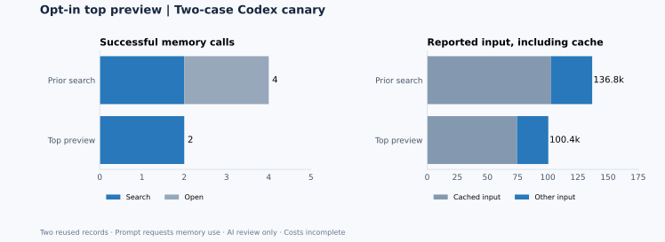

# Cross-session public-issue investigations: 30-task follow-up

**Status: Completed with post-hoc retries.** Updated 2026-11-01T13:43:02.364247+00:00. This report is regenerated from preserved records. [Machine-readable results](assets/benchmarks/production-real30-20261101/results.json) · [Registration](assets/benchmarks/production-real30-20261101-registration.json) · [Additional frozen criteria](assets/benchmarks/production-real30-20261101-new-tasks-registration.json)

28/30 original attempts have completed both randomized arms, with two separate Codex processes per arm. 25/30 original attempts have two blinded AI reviews and a third model's adjudication without recovery; 3 more have a supplemental adjudication. Additionally, 2 post-hoc retry pairs are complete, 1 of those have reviews without recovery and 1 have a recovered review. 30/30 distinct tasks have an evaluable pair including these recoveries. 3 adjudication rationales have evidence or rubric problems and are excluded below. 0 original attempts have not started; 2 original attempts remain incomplete and are retained alongside any retries.

For 22 original adjudications without those known flags or post-hoc recoveries, adjudicated scores were higher for Memex on **0**, equal on **20**, and higher for control on **2**. The 0/1/2 AI scores assess investigation criteria; reviewers are not project maintainers. Including post-hoc review recoveries and whole-pair retries gives **27** unflagged comparisons: Memex higher on **0**, equal on **25**, and control higher on **2**. A post-hoc sensitivity view that substitutes valid additional-model adjudications for the flagged cases contains **30** comparisons: Memex higher on **0**, equal on **27**, and control higher on **3**. Original opinions, including flagged ones, remain in the machine-readable results.

## What was tested

Thirty screened public issues from repositories with distinct owners were frozen with source revisions and task-specific criteria before calls. These are short, two-session **historical issue investigations**, not live long-running production tasks or code-fix trials. Arms receive the same source view and their own first-session handoff; the treatment additionally has a fresh Memex store. Both use isolated repository tools and a fresh Codex process for each session. Project acceptance tests were **NOT RUN**. Models may have seen public issues or solutions.

Fifteen tasks were assigned prior memory guidance and fifteen revised guidance to discourage duplicate reads while retaining source verification for uncertainty or conflicts. The initial four tasks ran before the search-result header fix; the rest use that fix in both guidance variants. The [amendment](assets/benchmarks/production-real30-20261101-search-count-amendment.json) records the exact code revisions. A delayed download changed the order of the first eight tasks, not their assignments ([record](assets/benchmarks/production-real30-20261101-order-deviation.json)). The allocation commitment is published; assignments stay hidden until collection is complete, then are disclosed in the results. Three interrupted downloads were recovered as **partial source views** for T12, T16 and T20. Other views also exclude files inaccessible to the restricted worker; batch registrations record scope and hashes.

## Memory and usage

Among 28 completed pairs, the Memex arm wrote in session one on **28**, later opened a record it had written on **28**, and cited one in the final answer on **28**. On **26** it also opened the ordinary first-session handoff. These observable events do not establish whether memory was necessary, correct or autonomously managed throughout its lifecycle.

| Completed pairs only | Input tokens including cache | Cached input tokens | Output tokens | Session seconds |
| --- | ---: | ---: | ---: | ---: |
| Control | 8,588,215 | 7,295,616 | 66,385 | 3179.0 |
| Memex | 12,040,197 | 10,312,064 | 89,553 | 3849.4 |

Input includes cached input and is not a bill. Session time is summed, not wall time. Completed-pair sessions missing usage: 0. Incomplete original sessions and all retry sessions are excluded from this paired table.

Across **all original sessions with a result record**, including incomplete pairs, control reported 8,958,366 input / 69,014 output tokens and Memex reported 12,814,691 input / 95,197 output tokens. 2 recorded sessions lack usage; still-running sessions do not have final usage records. Different tasks and source-reading patterns limit inference.

Exact repeated source reads across sessions: control **22** (113,798 returned characters), Memex **21** (89,805 characters). These count identical arguments and identical returned source text in both sessions; such reads may be needed for independent verification. Characters are not tokens or billable cost. Across completed pairs, control made 853 successful repository/archive calls with 1,725,769 response characters. Memex made 783 repository/archive calls with 1,680,276 characters, plus 139 memory calls with 54,536 characters. These are raw response lengths and cannot be converted directly into billed tokens. In the original completed pairs, **25** successful searches were immediately followed by opening their first hit, with **25** corresponding open responses at most 2,000 characters. This observed pattern motivated an opt-in bounded top-result preview; a separate two-case Codex canary is reported below.

Post-hoc retry sessions separately reported control 730,749 input / 5,174 output tokens and Memex 995,350 input / 7,526 output tokens; 0 retry sessions lack usage. The original timed-out sessions still have unknown usage. Among 2 completed retry pairs, 2 wrote in session one, 2 opened and 2 cited a prior record.

### Exploratory comparison of memory guidance

[Frozen allocation and seed](assets/benchmarks/production-real30-20261101/allocation.json). Input deltas are Memex minus control, in tokens including cache. The first four tasks used the earlier search-count behavior; selection, attrition and small groups limit inference. Original attempts with missing usage are excluded from the delta.

| Guidance | Complete original pairs | Pairs with usage | Before search fix | Both memory and handoff opened | Mean input delta | Median input delta |
| --- | ---: | ---: | ---: | ---: | ---: | ---: |
| old | 14 | 14 | 3 | 14 | 131,302.4 | 120,246.0 |
| new | 14 | 14 | 1 | 12 | 115,267.8 | 110,331.0 |

This is a descriptive subgroup analysis, not evidence of a billing reduction or an independent production improvement.

## Post-hoc preview mechanism canary

Two previously studied public-issue handoff records were seeded into fresh stores. The same question in both arms explicitly requested the stored record; each arm used a fresh Codex process and randomized version order. The prior version required search then open; the new version offered the opt-in preview. This is a reused, memory-prompted mechanism check, not two additional independent tasks or an autonomy test. [Registration](assets/benchmarks/production-real30-20261101-preview-canary-registration.json) · [Blinded review registration](assets/benchmarks/production-real30-20261101-preview-canary-review-registration.json) · [Results and allocation](assets/benchmarks/production-real30-20261101/preview-canary-results.json).

| Two paired cases | Search calls | Open calls | Input tokens including cache | Cached input | Output tokens |
| --- | ---: | ---: | ---: | ---: | ---: |
| Prior search | 2 | 2 | 136,841 | 102,784 | 516 |
| Top preview | 2 | 0 | 100,437 | 74,496 | 429 |

In both cases the new agent used the preview without a separate open and cited the seeded record. Both blinded reviewers and the adjudicator scored both answers 2/2 in both cases. Reported input was 26.6% lower across these two runs, including cached input. This small, selected comparison does not establish a general token saving, production accuracy improvement or lower bill.

All six canary review calls have candidate provider-row matches totaling **USD 0.009462**. Combined with the main study's candidate review subtotal, the matched total is **USD 0.297108**; this is not receipt-level attribution or full cost. The canary's Codex sessions reported 237,278 input and 945 output tokens. Its reviewer calls reported 59,292 input and 1,012 output tokens. Subscription allocation and non-model costs remain UNKNOWN.

## Current default strategy

Keep card-only search as the default and use the bounded top preview for focused queries where the first hit is likely to be relevant. Continue to consult source material when a preview leaves a gap or needs verification. The two-case result supports making the option available, but is too small to justify automatically opening the first hit for every query. The duplicate-handoff advice remains guidance rather than an enforced suppression rule.

## Reviews, failures and cost

The two AI reviewers were gpt-6.1-sol and claude-haiku-4-5; deepseek-flash reviewed their ratings and disagreements. Across **30** evaluable pairs using the recorded recoveries where needed, the first two models assigned different score pairs on **16** tasks; the effective adjudicator marked **16** as materially disputed. For flagged original adjudications this count uses the additional-model reassessment. Arm labels were removed, though answer content may reveal treatment. T23's first adjudication failed with a transport error and unknown usage; a [registered supplemental adjudication](assets/benchmarks/production-real30-20261101-T23-adjudication-recovery-registration.json) retained the original failure. N03's GPT review timed out without usage; its [registered review and adjudication recovery](assets/benchmarks/production-real30-20261101-N03-review-recovery-registration.json) retains the timeout and initial adjudication. N06's Claude review failed with a transport error and no usage; its [registered review and adjudication recovery](assets/benchmarks/production-real30-20261101-N06-review-recovery-registration.json) likewise retains the original failure. For T15's paired retry, Claude returned invalid JSON due to two unescaped quotation marks in a reason; a [registered syntax repair and supplemental adjudication](assets/benchmarks/production-real30-20261101-T15-retry-review-recovery-registration.json) preserved the raw response and initial adjudication. The initial T05 packet clipped a relevant comment; a [supplement](assets/benchmarks/production-real30-20261101-T05-supplement-registration.json) preserved original reviews but still produced an unsupported rationale ([evidence audit](assets/benchmarks/production-real30-20261101-T05-evidence-audit.json)). The T07 adjudicator introduced an independent-execution requirement not clearly present in the frozen criteria ([rubric audit](assets/benchmarks/production-real30-20261101-T07-rubric-audit.json)). The T25 adjudicator's rationale about milligram versus milliliter and explicit controls is also [flagged for review](assets/benchmarks/production-real30-20261101-T25-rubric-audit.json). Separately registered additional-model reassessments ([T05/T07](assets/benchmarks/production-real30-20261101-independent-audit-registration.json), [T25](assets/benchmarks/production-real30-20261101-independent-audit-T25-registration.json)) have returned 3/3 valid opinions; they preserve the original concerns. An excerpt regression was fixed before later reviews.

The ledger contains **100** returned or failed review attempts, including **3** non-OK attempts. Review calls reported **2,049,219 input** and **31,113 output tokens**; **3** attempts lack reported usage. At this checkpoint, 97 provider rows have candidate matches by model, time and token counts, totaling **USD 0.287646**. Matching is not receipt-level attribution. Successful review calls without a candidate match at this snapshot: **0**. Failed-call charges, Codex subscription allocation, machine and human time remain **UNKNOWN** until reconciled. The T15 Memex second session and T18 control first session each timed out after 180 seconds without a completed turn or usage; their partial outputs and original pairs remain retained. Separately registered full-pair retries ([T15](assets/benchmarks/production-real30-20261101-T15-retry-registration.json), [T18](assets/benchmarks/production-real30-20261101-T18-retry-registration.json)) are recorded separately. Three source-download failures and their recoveries are retained in the results and fallback manifests.

The memory_search header was corrected after a real call reported +0 more despite additional matches. The original attempts recorded **2** memory_write failures reporting an unknown empty kind; **2** were followed by a successful memory write in the same session. The generated manual and MCP description now identify kind as required, and the server returns an actionable missing-field error. Both defects have failing-before/passing-after MCP regressions. The latest offline suite passed **184/184**; the SQLite consistency suite passed **36/36** after the search fix. The write-guidance repair and the optional 2,000-character top-result search preview were made after this study's variants were frozen and are not included in its arms. The preview is tested for empty results, continuation and workspace isolation; its separate real-agent canary is reported above. The anti-duplicate-read guidance is also an experiment.

For T15's post-hoc whole-pair retry, GPT scored 1/1, Claude syntax-repaired original scored 1/1, and adjudication scored 1/1 (control / Memex). The original invalid JSON and initial adjudication remain in the results.

For T18's post-hoc whole-pair retry, GPT scored 1/1, Claude scored 2/2, and adjudication scored 1/1 (control / Memex).

## Task-level status and AI scores

Scores are **control / Memex** on the frozen 0/1/2 rubric. NOT RUN includes reviews not yet returned. A score is not an executable test result.

| Issue | Repository | Pair | GPT review | Claude review | Adjudication | Audit |
| --- | --- | --- | --- | --- | --- | --- |
| [T01](https://github.com/mnemosyne-oss/mnemosyne/issues/552) | mnemosyne-oss/mnemosyne | paired complete | 2/2 | 2/2 | 2/2 | — |
| [T03](https://github.com/modelcontextprotocol/python-sdk/issues/2610) | modelcontextprotocol/python-sdk | paired complete | 1/1 | 1/1 | 1/1 | — |
| [T04](https://github.com/pydantic/pydantic-ai/issues/1196) | pydantic/pydantic-ai | paired complete | 2/1 | 1/1 | 2/1 | — |
| [T05](https://github.com/yt-dlp/yt-dlp/issues/14206) | yt-dlp/yt-dlp | paired complete | 2/1 | 1/2 | 2/1 | flagged |
| [T07](https://github.com/gchq/CyberChef/issues/1881) | gchq/CyberChef | paired complete | 1/1 | 2/2 | 1/1 | flagged |
| [T08](https://github.com/asyncapi/website/issues/5151) | asyncapi/website | paired complete | 1/1 | 1/1 | 1/1 | — |
| [T09](https://github.com/conventional-changelog/commitlint/issues/3129) | conventional-changelog/commitlint | paired complete | 1/1 | 1/1 | 1/1 | — |
| [T11](https://github.com/yargs/yargs/issues/873) | yargs/yargs | paired complete | 1/1 | 1/1 | 1/1 | — |
| [T12](https://github.com/npm/cli/issues/9800) | npm/cli | paired complete | 1/1 | 2/2 | 1/1 | — |
| [T13](https://github.com/huggingface/huggingface_hub/issues/4196) | huggingface/huggingface_hub | paired complete | 1/1 | 2/1 | 1/1 | — |
| [T14](https://github.com/autogluon/autogluon/issues/5521) | autogluon/autogluon | paired complete | 1/1 | 2/2 | 1/1 | — |
| [T15](https://github.com/Arize-ai/openinference/issues/2101) | Arize-ai/openinference | started or incomplete | NOT RUN | NOT RUN | NOT RUN | —; retry reviewed with recovery |
| [T16](https://github.com/oppia/oppia/issues/23412) | oppia/oppia | paired complete | 1/1 | 1/1 | 1/1 | — |
| [T17](https://github.com/getpaseo/paseo/issues/2471) | getpaseo/paseo | paired complete | 2/2 | 2/1 | 2/2 | — |
| [T18](https://github.com/usebruno/bruno/issues/7362) | usebruno/bruno | started or incomplete | NOT RUN | NOT RUN | NOT RUN | —; retry reviewed |
| [T20](https://github.com/ray-project/ray/issues/58976) | ray-project/ray | paired complete | 2/2 | 2/2 | 2/2 | — |
| [T21](https://github.com/loopbackio/loopback-next/issues/11096) | loopbackio/loopback-next | paired complete | 2/2 | 1/1 | 2/2 | — |
| [T22](https://github.com/ioBroker/ioBroker.mqtt/issues/518) | ioBroker/ioBroker.mqtt | paired complete | 1/1 | 1/1 | 1/1 | — |
| [T23](https://github.com/storybookjs/storybook/issues/31699) | storybookjs/storybook | paired complete | 1/2 | 2/2 | recovery 2/2 | — |
| [T25](https://github.com/adobe/react-spectrum/issues/2806) | adobe/react-spectrum | paired complete | 1/1 | 2/2 | 2/2 | flagged |
| [T26](https://github.com/auth0/auth0-react/issues/929) | auth0/auth0-react | paired complete | 1/1 | 1/1 | 1/1 | — |
| [T27](https://github.com/ansible-collections/community.hashi_vault/issues/456) | ansible-collections/community.hashi_vault | paired complete | 1/1 | 1/1 | 1/1 | — |
| [T28](https://github.com/cdxgen/cdxgen/issues/1797) | cdxgen/cdxgen | paired complete | 1/1 | 1/1 | 1/1 | — |
| [N01](https://github.com/glasgow-ipl/ietfdata/issues/84) | glasgow-ipl/ietfdata | paired complete | 2/1 | 1/1 | 2/1 | — |
| [N02](https://github.com/adafruit/Adafruit_CircuitPython_OV5640/issues/26) | adafruit/Adafruit_CircuitPython_OV5640 | paired complete | 2/2 | 2/1 | 2/2 | — |
| [N03](https://github.com/jquery-form/form/issues/353) | jquery-form/form | paired complete | recovery 2/2 | 2/1 | recovery 2/2 | — |
| [N04](https://github.com/louislam/uptime-kuma/issues/5670) | louislam/uptime-kuma | paired complete | 1/1 | 1/2 | 1/1 | — |
| [N05](https://github.com/containers/ramalama/issues/2642) | containers/ramalama | paired complete | 1/1 | 2/2 | 1/1 | — |
| [N06](https://github.com/plotly/dash/issues/3343) | plotly/dash | paired complete | 1/1 | recovery 1/1 | recovery 1/1 | — |
| [N07](https://github.com/nathan-gs/ha-map-card/issues/158) | nathan-gs/ha-map-card | paired complete | 1/1 | 1/1 | 1/1 | — |

## Limits

This selected cohort has heterogeneous public tasks, short replays, possible source or model-training leakage, constrained tools, AI-only review and no independent project acceptance. Memory access and AI ratings cannot by themselves establish reliable improvement in live correctness, total cost or autonomous memory management. Full logs and answer packets remain locally preserved; published records contain hashes, scores and sanitized evidence summaries.
