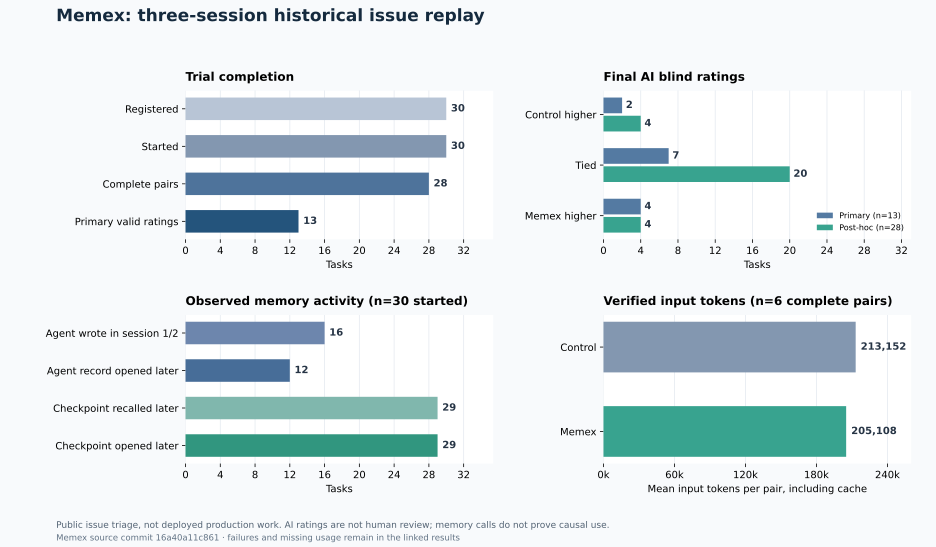
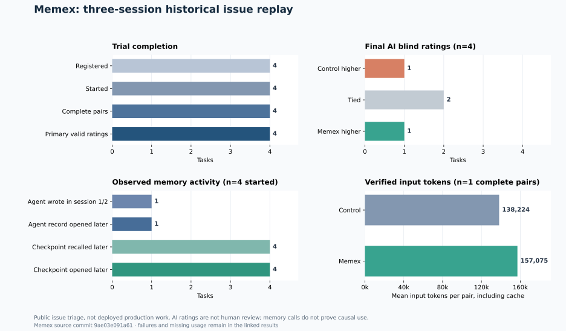

# Task-state memory and three-session issue replays

The repaired memory interface now records caller-supplied source, version, observation time and expiry. Default recall excludes superseded or explicitly expired records; historic records can still be opened by ID or explicitly requested. A separately registered 30-issue historical replay completed **28 paired tasks**. The original AI review produced valid final ratings for **13** pairs; a separately registered post-hoc replacement and adjudication produced ratings for the remaining **15**. In that sensitivity view, control scored higher in **4**, the pair tied in **20**, and Memex scored higher in **4**. Both means were **0.893/2**. This does not demonstrate improved production correctness or cost savings.

[Registration and frozen criteria](production-task-state-protocol-20261102.html) · [Results and individual statuses](assets/benchmarks/production-task-state-20261102/results.json) · [Review plan](assets/benchmarks/production-task-state-20261102/review-plan.json) · [Blind packet commitments](assets/benchmarks/production-task-state-20261102/packet-commitments.json) · [Post-hoc rescue registration](assets/benchmarks/production-task-state-20261102/rescue-registration.json) · [Post-hoc sensitivity results](assets/benchmarks/production-task-state-20261102/rescue-results.json) · [Packet unblinding](assets/benchmarks/production-task-state-20261102/packet-unblinding.json) · [Allocation unblinding](assets/benchmarks/production-task-state-20261102/allocation-unblinding.json) · [Original review failures](assets/benchmarks/production-task-state-20261102/review-failures.json)

## Repairs and interface

1. **Stale state:** Default search, automatic recall, paging and general grep hide `superseded` records and records with a valid, elapsed `validUntil`. An explicit status/expiry request or direct ID can retrieve history. Unknown or invalid legacy expiry is shown as unknown and is not silently treated as an expiry.
2. **Privacy:** New DSH materializer trace entries contain metadata, length and a SHA-256 digest rather than full injected text. On POSIX an existing trace and new entries are owner-only. Existing plaintext trace contents are preserved: `forget` does not erase them, and Windows ACL behavior was not established by this test.
3. **Configuration:** DSH `settingsTtlDays` is passed into the local store. Setting `autoArchive: false` no longer disables configured recall or buffers conversation events for archiving.
4. **Memory tools and state:** MCP and DSH default to `memory_search`, `memory_open`, `memory_write` and `memory_set_status`. DSH `advancedTools: true` opts into its additional tools; MCP `--all-tools` exposes the additional MCP tools. DSH status changes are scoped to the visible workspace/session and require a backend that declares atomic scoped-status support. `memory_compress` remains an independent DSH tool when its plugin is enabled.

`evidence` records a source and optionally version, `observedAt` and `validUntil`; exact source and version filters are available. These are **caller assertions**, not independently verified Git revisions or source facts. The agent must mark a replaced record `superseded`; the system does not automatically detect new source versions. Legacy provenance is preserved during updates. The repairs, compatibility settings and fault-injection coverage are described in the [integrity regression tests](https://github.com/QiuXu-Tech/memex/blob/main/test/integrity-regression.mjs) and [integration guide](integrations.html).

The 30-issue cohort used code commit `16a40a11c86133953ae360549897f1e390ee3980`, which already included the four initial repairs and evidence fields. Further compatibility, DSH core-tool and replay-bridge fixes were merged into commit `9ae03e0`; only the separately registered four-issue follow-up below used that later code. DSH integration tests use a fake host with a real local store, not an installed DSH application; the actual agent replay used Claude Code and MCP.

## Randomized replay and review

Each of the 30 public issues came from a different owner not used in the prior screened set; each discussion spanned at least seven days. Before agent calls, source snapshots, acceptance criteria, randomized task order and per-task arm order were frozen and publicly committed. Both arms received the same issue, staged discussion, isolated read-only source access, searchable history and their own handoffs. Each arm used three distinct Claude Code sessions; one arm additionally had Memex hooks and MCP. The measured output was a historical engineering-triage answer, not a patch or deployed change.

The frozen review plan used anonymized answers, GPT-6.1 Sol and DeepSeek Flash initial reviewers, and Gemini 3.8 Flash when numeric scores or unsupported-claim lists differed. References had to resolve to an evidence ID in the packet. Wording could still reveal the condition. The packet hashes and salted label commitments were published before review. **13 GPT requests timed out** and **two DeepSeek outputs were invalid JSON** despite successful HTTP responses. The initial analysis therefore has only **13/28 valid ratings**: control higher **2**, tied **7**, Memex higher **4**; all 13 were adjudicated, with nine numeric disagreements. Scores missing due to errors were not turned into zeroes.

After those failures, a [separate post-hoc plan](assets/benchmarks/production-task-state-20261102/rescue-registration.json) replaced one missing reviewer with GPT-6.1 Terra while retaining the original valid review, and sent disagreements to Gemini. The unchanged packets and original reviews were hash-checked; all **15/15** replacements and adjudications produced valid ratings, including seven numeric disagreements. Together with the 13 original ratings, the sensitivity view has **28/28** valid scores, with control higher **4**, tied **20**, and Memex higher **4**. This post-hoc result does not repair the original missing-review rate or make the two reviewer designs equivalent. Model identities and independence are provider claims, and AI review is not human evaluation.

Two registered pairs were incomplete under the client-budget guard: `state-09` had no control first session and `state-25` had neither first session; dependent sessions did not run. No results were imputed. Across started sessions, **51** budget-exhausted attempts needed the predeclared same-session, tool-free continuation. Public issue content may have appeared in training, repository snapshots may postdate the discussion, the rubric uses partial source excerpts, and a multi-day discussion compressed into three sessions is not a live, long-running production task.

## What the memory trace shows

Among the 30 started tasks, 16 treatment runs wrote a record in session 1 or 2, and 12 had an explicitly agent-written earlier record successfully opened in a later session. Automatic checkpoints from earlier sessions were recalled and later opened in 29 tasks. These counts include started incomplete pairs. Among the 28 complete pairs, **8** final treatment answers explicitly cited a previous-session record that was also successfully opened later and appeared in later recall. These are observable cross-session chains, not proof that the record was correct, necessary, or caused a higher score; answers using memory without an ID citation are not counted. [Trace aggregates](assets/benchmarks/production-task-state-20261102/memory-citations.json).

At inspection, 111 records remained in the treatment stores, including 87 automatic checkpoints; 20 had caller-supplied evidence, 17 had versions, 16 had observation times and one had expiry. This is an adoption count of records still present, not a validation of their claims. [Metadata counts](assets/benchmarks/production-task-state-20261102/metadata-adoption.json).

The original cohort had **26** `repo_search` calls rejected because an agent supplied a limit above 30, one other invalid-search error and 96 other pilot-tool errors. This was a replay-tool defect, not a Memex search result. The repaired bridge caps over-limit requests at 30 and reports the adjustment; an [offline replay](assets/benchmarks/production-task-state-20261102/search-limit-replay.json) passed all 26 recorded over-limit argument cases through a mock worker. That check does not establish search relevance. Exact repeated calls within one session were eight control and seven Memex; semantically overlapping reads are not counted. [Tool accounting](assets/benchmarks/production-task-state-20261102/tool-health.json).

## Token use and costs

Only **6/28** complete pairs had final session input reconciled with distinct streamed assistant messages for every session. Those six used **1,278,909 control / 1,230,649 Memex input tokens**, including cache reads and writes. This small, non-random subset is not a cohort-wide estimate. The streamed input totals for all 28 complete pairs were **11,215,172 / 10,058,922**, but 51 recovered attempts had terminal/stream discrepancies; the per-arm totals remain an exploratory observation, not a verified saving. [Stream recount](assets/benchmarks/production-task-state-20261102/stream-usage.json).

For all 28 complete pairs the Claude client reported list prices of **$6.265951 control / $5.189728 Memex**; all started sessions had a known client-reported total of **$11.874257**. These are client list prices, not actual wallet charges. For the solver's account time window, **1,695** visible successful Claude rows had the same count and uncached-input, cache-read and cache-write totals as the recorded distinct streamed messages; their displayed wallet sum was **$1.305480**. This corroborates an account-window subtotal, not a per-arm bill. [Solver window](assets/benchmarks/production-task-state-20261102/solver-wallet-window.json) · [Client-price comparison](assets/benchmarks/production-task-state-20261102/paired-client-costs.json).

The initial reviewers' successful rows totaled **$0.178166** in the corresponding account window, and the 30 successful post-hoc replacement/adjudication rows totaled **$0.351464** in a later window. Their per-model successful-row counts and token totals matched the gateway terminal records. These windows are not request-ID joins or complete invoices. The gateway UI marked some timed-out requests as upstream usage unavailable and cost pending reconciliation: the eventual charge is **UNKNOWN**, even where the UI currently showed zero. The separate three-reviewer synthetic preflight candidate was $0.003834, and the Terra synthetic preflight candidate was $0.000064; the first two-task solver window is already included in the larger solver window and must not be added again. Host, labor and other activity costs are not fully accounted for. [Initial review window](assets/benchmarks/production-task-state-20261102/review-wallet-window.json) · [Rescue window](assets/benchmarks/production-task-state-20261102/rescue-wallet-window.json).

## Separately registered post-repair follow-up

A separately registered [four-issue follow-up](production-task-state-canary-protocol-20261102.html) used commit `9ae03e091a61fe91e095825311b56d5cc537c431` after the bridge and DSH compatibility fixes. It was selected after the main cohort had exposed tool errors, with four further distinct owners, frozen source hashes and acceptance criteria, randomized arm order, and packet commitments published before review. All **4/4 pairs** completed six sessions and received valid original blind ratings: control higher **1**, tied **2**, Memex higher **1**. All four had numeric disagreement and were adjudicated; both means were **0.75/2**. This small follow-up cannot establish a correctness improvement.

Across the 28 completed main pairs and these four, **32 distinct issues** have evaluable scores, but **15** of the main scores required a post-hoc reviewer replacement. The four were selected and registered later at a different code commit; these counts are not a single pre-registered effect estimate. In the four follow-up tasks, one agent-written earlier record was opened later; all four opened and recalled automatic earlier checkpoints, and none of the final answers explicitly cited a prior record ID. A successful read alone is not proof of use or necessity.

The four-pair client list prices were **$0.816749 control / $0.862664 Memex**; only one pair had independently reconciled input, **138,224 / 157,075 tokens**. Eight resumed attempts had terminal/stream discrepancies, so other pair-level input remains unverified. The follow-up solver's 220 successful account-window rows matched the count and three recorded input/cache totals; their candidate wallet subtotal was **$0.184478**. The 12 successful reviewer rows matched their per-model prompt/output totals and displayed **$0.044870**. These are account-window observations, not per-arm billing. There were six other pilot-tool errors and no over-limit search error in this follow-up; no over-limit adjustment was exercised. [Results](assets/benchmarks/production-task-state-canary-20261102/results.json) · [Commitments](assets/benchmarks/production-task-state-canary-20261102/packet-commitments.json) · [Packet unblinding](assets/benchmarks/production-task-state-canary-20261102/packet-unblinding.json) · [Allocation unblinding](assets/benchmarks/production-task-state-canary-20261102/allocation-unblinding.json) · [Memory citations](assets/benchmarks/production-task-state-canary-20261102/memory-citations.json) · [Tool health](assets/benchmarks/production-task-state-canary-20261102/tool-health.json) · [Solver wallet window](assets/benchmarks/production-task-state-canary-20261102/solver-wallet-window.json) · [Review wallet window](assets/benchmarks/production-task-state-canary-20261102/review-wallet-window.json).

The specifically enumerated account-window solver, review and preflight subtotals sum to **$2.068356** across the main cohort and follow-up. This is a candidate visible subtotal for the listed calls, not a reconciled total for all work; the unsettled timeout costs and other cost categories remain unknown.

## Verification and remaining work

On Node 25.9, the built bundle matched source and **196/196 offline tests, 38/38 SQLite consistency/recovery tests, and 50/50 integrity/isolation tests passed**. These include end-to-end MCP/DSH tool coverage, legacy provenance and expiry checks, failure-injected rollback and retry, trace permission failure, and configured TTL/recall behavior. The search-limit, follow-up registration, citation, stream-accounting, tool-health, blind-rescue and rescue-aggregation regressions also passed. Process interruption and injected failures do not prove power-loss durability. [CI workflow](https://github.com/QiuXu-Tech/memex/actions/workflows/ci.yml) · [GitHub Actions and Pages deployments](https://github.com/QiuXu-Tech/memex/actions).

The next meaningful validation is a prospective live-work trial with a frozen outcome, independent human review and request-level billing, comparing Memex against the existing handoff workflow. The present experiment supports that the cross-session plumbing can execute and expose earlier records, and that stale records can be excluded under the implemented rules. It does not yet show a reliable production correctness gain, true cost reduction, or autonomous management without agent guidance.
