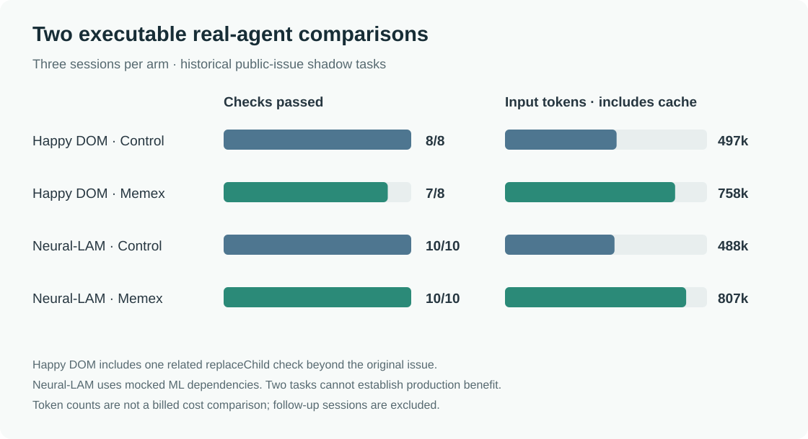

# Executable real-agent comparisons and grep repair (2026-11-01)

**Two additional registered public issues were run as executable, randomized three-session Codex comparisons.** Both arms met the checks for the original issues. On one related extra check, the Happy DOM control passed and the Memex candidate failed. In both Memex arms, the first process wrote a record and the second process opened and cited that same record. Both controls could also retrieve the prior handoff, so these observations do **not** establish that memory caused the result or saved cost.

[Results, tool failures, blinded ratings, usage and cost candidates](assets/benchmarks/production-value-20261101/results.json) · [T30 registration](assets/benchmarks/production-value-20261101-T30-registration.json) · [T02 registration](assets/benchmarks/production-value-20261101-T02-registration.json) · [Earlier 30-task registration and first four pairs](production-cohort-30-20261101.html)

## What was compared

The tasks were selected from the earlier locally frozen set of 30 distinct public issues. The Happy DOM task T30 followed its scheduled position; Neural-LAM T02 was selected adaptively for a clear maintainer decision and a lightweight executable verifier, rather than the original task sequence. Each task's source commit, random arm-order commitment, public checks and withheld-check hashes were published on GitHub **before that task's model calls**. The full local registration also predated the calls, but was not independently timestamped when initially created. See commits [`bce60fd`](https://github.com/QiuXu-Tech/memex/commit/bce60fd9f2247c8abf7310ebf25645d65eea033d) and [`bee5742`](https://github.com/QiuXu-Tech/memex/commit/bee5742881ca4f09c5e880985296ff88a8987333). The now-unblinded allocation files for [T30](assets/benchmarks/production-value-20261101/T30-allocation.json) and [T02](assets/benchmarks/production-value-20261101/T02-allocation.json) match the respective published SHA-256 commitments.

Each arm used three separate ephemeral Codex processes (`gpt-6.1-sol`, low reasoning): S1 investigated, S2 edited and could run the public checks, and S3 reviewed without editing. Both arms had the same source, public issue history, sandbox checks, bounded tools and access to their own prior-session handoffs. The treatment additionally had an initially empty L3 Memex store and its normal manual. Individual task prompts did not tell the agent to invoke a memory tool. Each arm used a separate project copy and the same predetermined check sets; the hidden results below were run after the candidates were finalized.

These are **historical open-source issue replays**, not live production sessions. The original issue discussions and proposed solution could have been seen by a model or contained in training. The restricted control has an archive but is not a comparison against every default Codex feature. One task per project does not establish independence at the population level. The two tasks use different Memex commit identifiers, but the relevant Memex code was unchanged between them; both precede the grep repair described below.

## Executable outcomes

| Task | Frozen issue scope | Arm | Public checks | Withheld checks | Result |
|---|---|---|---:|---:|---|
| [T30 Happy DOM #2203](https://github.com/capricorn86/happy-dom/issues/2203) | Replace a document element while preserving ordinary replacement and the one-root constraint | Control | 3/3 | 5/5 | Original issue checks pass; direct `replaceChild` extra check also passes. |
| T30 | Same | Memex | 3/3 | 4/5 | Original issue checks pass; direct `replaceChild` extra check fails. |
| [T02 Neural-LAM #393](https://github.com/mllam/neural-lam/issues/393) | Normalize CPU device count, preserve GPU/auto and update help | Control | 4/4 | 6/6 | All assigned checks pass. |
| T02 | Same | Memex | 4/4 | 6/6 | All assigned checks pass. |

Before the agent calls, unmodified source failed the relevant public and withheld checks, while a positive reference passed them. T30's reference was the already-public, unmerged [PR #2304](https://github.com/capricorn86/happy-dom/pull/2304); T02's was an investigator-written reference. T30 executes the actual TypeScript source via a pinned TypeScript transpiler in a network-disabled sandbox. Its direct `replaceChild` check covers a related API beyond the original `replaceWith` issue; it is reported separately from the frozen issue outcome. T02 executes the actual `fit()` and CLI parser but substitutes test doubles for PyTorch, Lightning and datastore dependencies. Neither verifier is a full upstream suite or maintainer acceptance; no real ML training was run.

Both T30 arms encountered a denied edit in `HTMLDocument.ts` because filesystem permissions prevented edits in its directory; failed exact replacements also occurred. The model candidates and failures are retained. The second task allowed the full disposable source workspace to be edited. This difference is a limitation of comparing tasks, not a reason to discard either T30 outcome.

## Memory observations and blind review

For T30, S1 wrote `mem_3778d97424`; S2 searched, opened it and cited it in the implementation handoff. For T02, the corresponding record was `mem_2efe1c9d85`. In both cases the S2 agent also opened its ordinary S1 archive, so the two sources overlap. A read and citation establishes observed use, not necessity or causal benefit. The original three-session trials did not expose the status and deletion tools.

Two AI models reviewed anonymous diffs, test results and handoffs; arm labels and record IDs were removed, although answer content could still reveal the condition. For T30, one reviewer rated both deliveries 2/2 and the other rated control/Memex 2/1, treating the related `replaceChild` check as a frozen requirement. A separately registered adjudicator distinguished the original issue criteria from that extra check and rated both deliveries 2/2. Both reviewers rated side-effect confidence 1/2 for both. For T02 both reviewers rated both deliveries and side-effect confidence 2/2. Original opinions are retained in the [results](assets/benchmarks/production-value-20261101/results.json); they are AI assessments, not human or upstream review.

A separately [registered fourth-session follow-up](assets/benchmarks/production-value-20261101-T02-followup-registration.json) was added **after** observing T02's results. Both arms received their own prior outputs. This time the treatment could also use `memory_set_status` and `memory_forget` on a disposable L3 store, backed up beforehand. It searched once, opened two prior records and wrote one new handoff; it made **0 status changes and 0 deletions**. The previously open investigation record stayed open; there were 2 records before and 3 afterward. The upstream issue was still open, so leaving it open is not automatically an error. The task prompt requested a handoff but did not command a particular memory tool. This adaptive repeat is not a new independent task or evidence of reliable lifecycle management.

In that follow-up, control/Memex reported **121,397/116,235 input** tokens (including **99,456/102,912 cached**) and **684/1,005 output** tokens, separately from the three-session table below.

## Reported usage and costs

The table sums the **three original sessions** per arm. Cached input is included in input; elapsed seconds sum those session durations and exclude setup and independent final checks. The two tasks ran on a shared host and their arms at different times, so these are observations, not a controlled latency benchmark.

| Task | Arm | Input tokens | Cached input | Output tokens | Session seconds |
|---|---|---:|---:|---:|---:|
| T30 | Control | 497,188 | 387,328 | 4,838 | 184.9 |
| T30 | Memex | 757,941 | 652,288 | 6,194 | 254.1 |
| T02 | Control | 487,925 | 396,928 | 3,646 | 169.0 |
| T02 | Memex | 807,153 | 704,128 | 5,180 | 225.4 |

Across the original paired runs the event streams reported **2,550,207 input** tokens, including **2,140,672 cached**, and **19,858 output**. On these two cases, Memex arms reported more total input and longer elapsed session time; this does not by itself measure billed cost or establish a general slowdown. The Memex S2 in each task opened both its memory record and its ordinary S1 handoff, a possible source of duplicated context worth investigating. The actual pricing of cached and uncached subscription use is unknown.

Five successful AI review/adjudication calls reported **60,644 input / 1,527 output** tokens. Five visible APIMaster wallet rows match by model, approximate time and token counts for a **candidate $0.009708 subtotal**; there is no per-request receipt linkage. This excludes Codex subscription allocation, host/VM compute, storage and engineering time, all **UNKNOWN**. The additional synthetic Codex grep smoke reported 45,165 input and 201 output tokens, separately from the paired runs and fourth session.

## Memex defects fixed during this work

Inspection and a reproducer found that `memory_grep` silently searched only the 400 most recently updated visible records. A cold record older than 401 newer records was found by ID but a workspace grep incorrectly reported no match. It also silently skipped missing record files. Commit [`480ab47`](https://github.com/QiuXu-Tech/memex/commit/480ab479971d324a7fd20eff8657a10a761736fb) removes the silent 400-record cutoff, reports unreadable visible files, and retries when a record moves while it is being read. It leaves the hit limit in place and selects only fields needed for the scan. The new end-to-end tests cover an older cold record, a missing file, workspace visibility and a simulated path move. The built-bundle offline harness passed **181/181** and SQLite consistency passed **36/36**; a separate *prompted synthetic* Codex MCP smoke found the old cold record and reported a genuinely absent pattern.

On one shared-host synthetic store of **10,000 records / 10M assigned tokens**, using ten warm reads per version, the old implementation returned no match for the old cold record at median **18.5 ms** because it stopped early; the repaired version found it at **192.9 ms**. For an absent marker the old/repaired medians were **17.7/191.9 ms**; for a recent marker they were **11.0/5.1 ms**. The miss and deep-hit work now grows with the number and size of visible files. The quiet-start CPU gate failed, the corpus is repetitive synthetic data, and the old and new scans do different amounts of work; these figures do not establish production latency. The benchmark seeding process reported a wrong database-size path after writing; the original error was retained, 10,000 records and the cold target were independently checked, and seeding was not repeated.

## Reproducible artifacts

The public [aggregate](assets/benchmarks/production-value-20261101/results.json) includes original tool failures, per-session usage, unblinded mapping after the trials, original AI opinions, adjudication and the performance samples. Raw conversations and account details remain private.

- T30 candidate diffs: [control](assets/benchmarks/production-value-20261101/T30-baseline.diff), [Memex](assets/benchmarks/production-value-20261101/T30-memex.diff). Checks: [public](assets/benchmarks/production-value-20261101/T30-verify-public.js), [withheld](assets/benchmarks/production-value-20261101/T30-verify-hidden.js), [TypeScript loader](assets/benchmarks/production-value-20261101/T30-loader.mjs).
- T02 candidate diffs: [control](assets/benchmarks/production-value-20261101/T02-baseline.diff), [Memex](assets/benchmarks/production-value-20261101/T02-memex.diff). Checks: [public](assets/benchmarks/production-value-20261101/T02-verify-public.js), [withheld](assets/benchmarks/production-value-20261101/T02-verify-hidden.js), [Python fixture](assets/benchmarks/production-value-20261101/T02-fixture.py).

The checks assume `/work` contains the pinned source and `/checks` contains the appropriately named `verify.js` and companion files, as in the [isolated agent setup](https://qiuxu-tech.github.io/memex/integrations/isolated-pilot.html). T30 additionally uses `npm ci --workspace=packages/happy-dom --omit=dev --omit=optional --ignore-scripts` and TypeScript 5.9.3 matched to the source lockfile; the sandbox runs with no network. T02 uses Python standard-library doubles and does not install ML dependencies.

Together with the [previous four pairs](https://qiuxu-tech.github.io/memex/production-cohort-30-20261101.html), **6/30** of the original registered investigations have now had both randomized arms run, one was interrupted and 23 were not started. Only these two new pairs used the executable checks described here. The sample remains too small and restricted to establish production correctness, savings, or reliable autonomous memory management.
